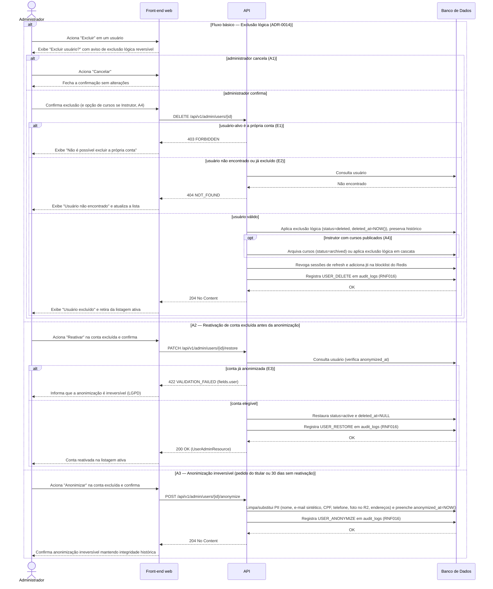

# UC018 — Excluir e Anonimizar Usuário

Diagrama de sequência do sistema para o caso de uso UC018 (Excluir e Anonimizar Usuário, RF012), atualizado conforme a [ADR-0014](../adr/0014-exclusao-logica-e-anonimizacao.md). Estende o UC008 e é acionado pela ação "Excluir" da lista de usuários (inclusive no atendimento a pedido de exclusão/anonimização feito pelo próprio titular via perfil/DPO, LGPD art. 18, VI). Representa a exclusão lógica reversível pelo Administrador (`status = deleted`, `deleted_at = NOW()`), o tratamento dos cursos de Instrutor (A4: arquivamento ou exclusão lógica em cascata), a revogação imediata de acessos (blocklist de `jti` no Redis e revogação de sessões de refresh), a reativação antes da anonimização (A2, bloqueada em E3 se já anonimizada) e a anonimização irreversível como passo separado (A3, a pedido do titular ou após 30 dias de carência).

