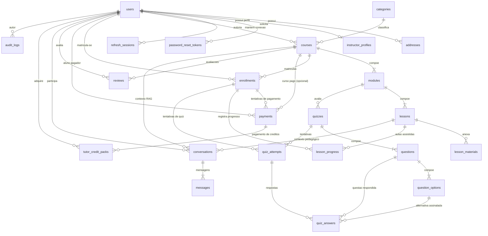
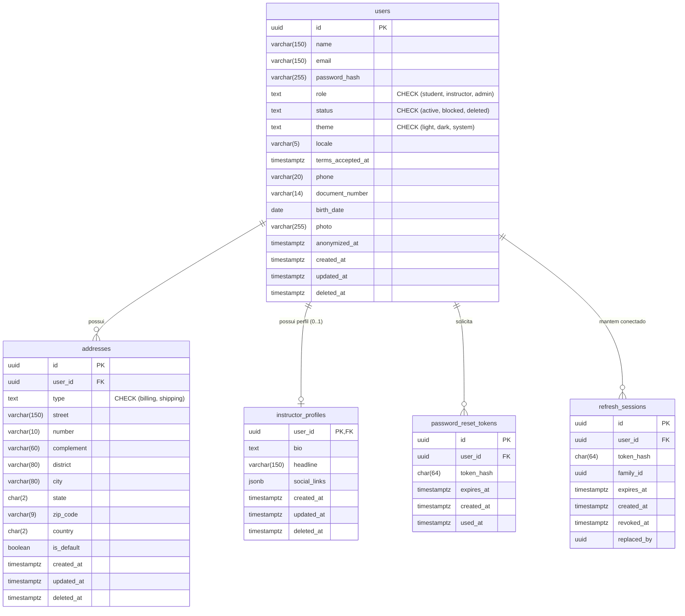
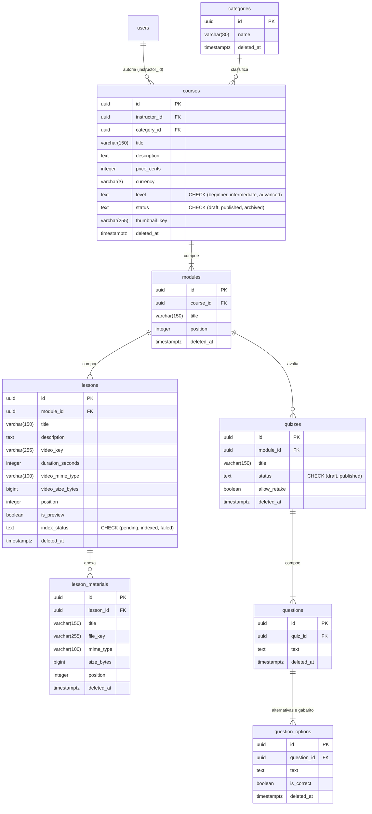
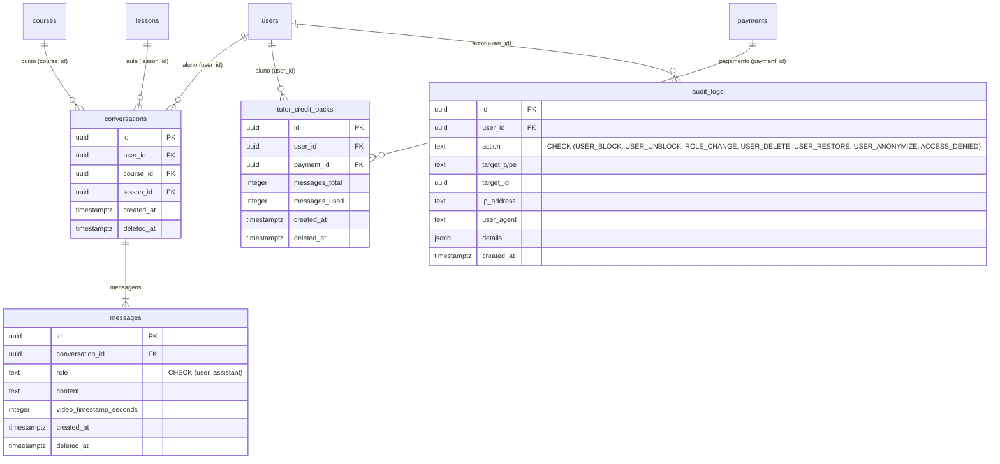
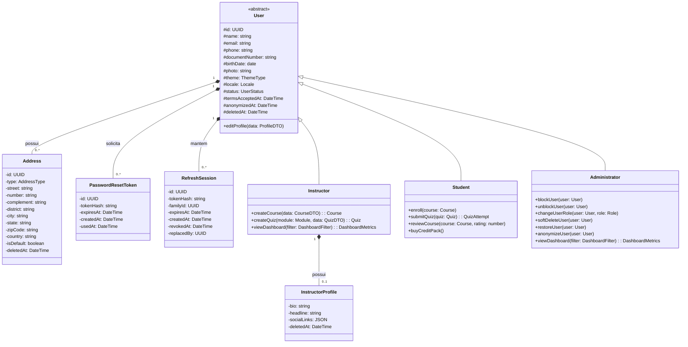
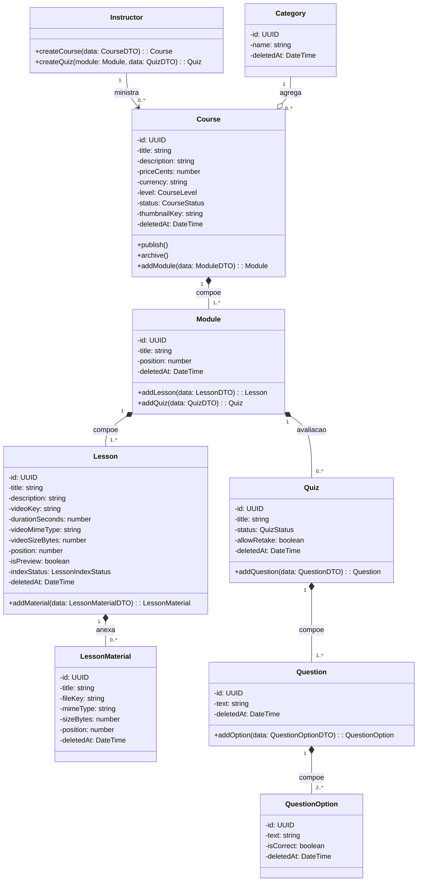
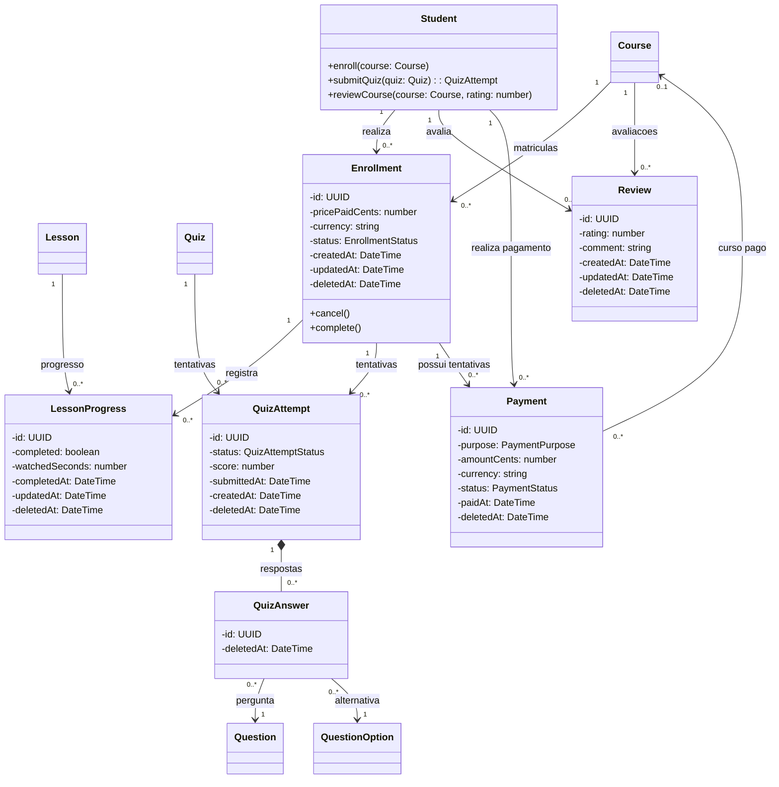
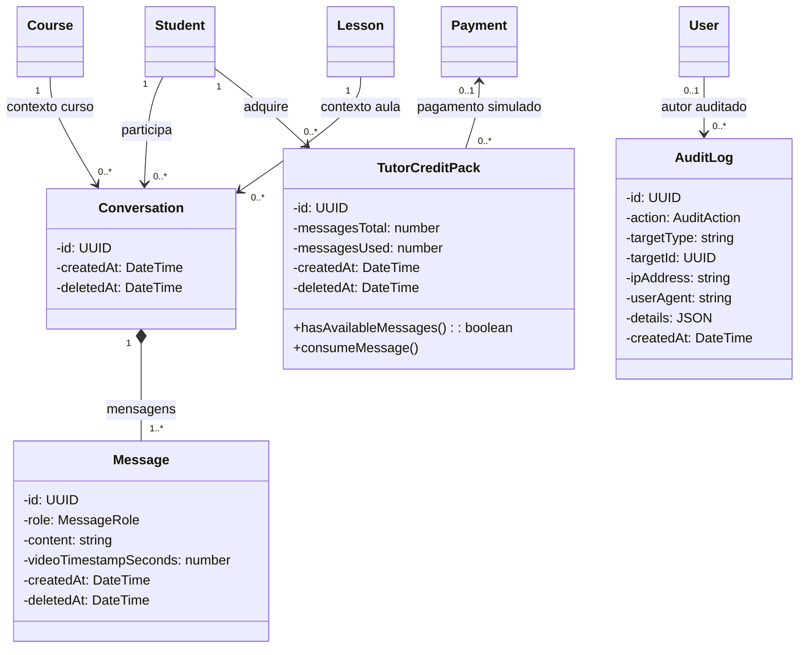

# TDD — Technical Design Document

> Regras de escrita no [CONTEXT.md](../CONTEXT.md). O que não tiver fonte formal é anotado como proposta (`<!-- proposta: motivo -->`).

## 1. Stack

A infraestrutura e as escolhas tecnológicas da plataforma estão consolidadas no [ADR-0007](adr/0007-stack-e-bancos.md) e detalhadas na tabela abaixo:

| Camada / Função | Tecnologia | Versão | Justificativa | Decisão / ADR |
|---|---|---|---|---|
| **Front-end Web** | Next.js com TypeScript | 14+ <!-- proposta: versão a confirmar pelo grupo --> | Arquitetado estritamente como SPA (Single Page Application, sem Server Components ou Server Actions) consumindo a API via JSON/REST e SSE. TypeScript unifica a tipagem com os DTOs do sistema e viabiliza tema claro/escuro (RNF014), suporte i18n (RNF013) e responsividade 360–1920 px (RNF019). | [ADR-0007](adr/0007-stack-e-bancos.md) |
| **API (Core)** | Laravel / PHP | Laravel 13 / PHP 8.3 | Monólito modular dividido nas áreas A a D (`auth`, `authoring`, `learning`, `admin`, `analytics`). Proporciona produtividade, migrações integradas, Eloquent ORM e separação coesa de domínios sem microsserviços adicionais ([ADR-0006](adr/0006-divisao-por-areas.md), [ADR-0018](adr/0018-core-como-monolito-modular.md)). | [ADR-0007](adr/0007-stack-e-bancos.md), [ADR-0018](adr/0018-core-como-monolito-modular.md) |
| **Banco de dados do Core** | PostgreSQL | 16 | SGBD relacional transacional primário que atende com maturidade todas as entidades relacionais da plataforma, com suporte a particionamento de auditoria (ADR-0016), índices parciais únicos de e-mail (ADR-0014) e tipos modernos (`uuid`, `jsonb`, `timestamptz`). Fica na mesma instância do `ai-service`, em database `core` separado. | [ADR-0017](adr/0017-core-em-postgresql.md) |
| **Serviço do Tutor de IA (`ai-service`)** | Laravel com Laravel AI SDK / PHP | Laravel 13 / PHP 8.3 | Microsserviço físico separado responsável por transcrever aulas, gerar embeddings uma única vez (RNF004), executar o pipeline RAG do `CourseTutorAgent` e responder em streaming SSE (RNF003) sem onerar o core transacional. | [ADR-0007](adr/0007-stack-e-bancos.md) |
| **Banco vetorial (`ai-service`)** | PostgreSQL com extensão `pgvector` | PostgreSQL 16 (`pgvector:pg16`) | Suporte nativo de primeira classe no Laravel 13 e Laravel AI SDK (`whereVectorSimilarTo`, `$table->vector()`), indexação HNSW de alta performance com filtragem híbrida e particionada por `course_id`. Fica na mesma instância gerenciada do Railway, em database `ai` separado. | [ADR-0007](adr/0007-stack-e-bancos.md), [ADR-0017](adr/0017-core-em-postgresql.md) |
| **Serviço de Mídia (`media-service`)** | Laravel / PHP | Laravel 13 / PHP 8.3 | Serviço físico desacoplado para coordenar o processamento de upload de vídeos e materiais via API e entrega de streaming via URLs assinadas de 15 minutos (RNF002, B2, B4). | [ADR-0007](adr/0007-stack-e-bancos.md), [sdd.md](sdd.md) |
| **Armazenamento de Objetos (Storage)** | Cloudflare R2 | API S3-compatible | Armazenamento seguro de vídeos das aulas, materiais complementares e thumbnails; streaming de vídeo e download por URLs assinadas temporárias (RNF002); upload de arquivos realizado via API/`media-service` (B2, B4). | [sdd.md](sdd.md) |
| **Mensageria e Filas** | RabbitMQ | 3.13+ | Broker de mensageria assíncrona para orquestração de pipelines pesados em background (transcrição de vídeos e ingestão de embeddings para o `ai-service`). | <!-- proposta: alinhado ao Obsidian Vault e SDD para jobs assíncronos desacoplados --> |
| **Cache e Gerenciamento de Sessão** | Redis | 7.2+ | Cache de listagens em memória (RNF009), rate limiting de requisições, controle de janela deslizante de cota do Tutor de IA e suporte à blocklist de tokens JWT (`jti`) revogados nesta sprint (ADR-0008). | [ADR-0008](adr/0008-sessao-jwt-em-cookie.md) |
| **Testes Automatizados (Backend)** | Pest PHP | 2.x / 3.x | Framework de testes fluente para PHP que assegura cobertura mínima de testes de 75% no backend com validação em pipeline de CI (RNF006). | <!-- proposta: alinhado ao Obsidian Vault e RNF006 --> |
| **Testes Automatizados (Frontend)** | Vitest e Playwright | Mais recentes | Vitest para testes unitários/componentes do Next.js e Playwright para validação de testes ponta a ponta (E2E) dos fluxos principais. | <!-- proposta: alinhado ao Obsidian Vault --> |
| **Hospedagem e Deploy** | Vercel (front-end), Railway (API e serviços) e Cloudflare R2 (mídia) | Planos gratuitos ou de entrada | Front-end SPA na Vercel, com `rewrites` de `/api/*` para a API no Railway, de modo que navegador e API compartilham o mesmo host e o cookie `__Host-` do ADR-0008 continua válido. API, `media-service`, `ai-service` e bancos no Railway; bancos, cache e mensageria sem exposição pública. Docker Compose fica só para o ambiente de desenvolvimento local. Domínio ainda pendente. | [ADR-0010](adr/0010-hospedagem-e-armazenamento.md), [ADR-0007](adr/0007-stack-e-bancos.md) |

Os protótipos de alta fidelidade do front-end (24 telas em HTML, com PNGs em tema claro e escuro) ficam em `especificacao/10-especificacoes-de-caso-de-uso/prototipos/` e seguem o [design system](design-system.md).

## 2. Modelo de dados

O modelo relacional da plataforma é baseado em PostgreSQL 16 ([ADR-0017](adr/0017-core-em-postgresql.md)), adota convenções de nomenclatura estritamente em língua inglesa e `snake_case` para tabelas e colunas no banco de dados ([ADR-0015](adr/0015-convencao-de-nomes-por-camada.md)) e implementa exclusão lógica transversal (`deleted_at: timestamptz`) em todas as entidades de negócio ([ADR-0014](adr/0014-exclusao-logica-e-anonimizacao.md)). A especificação a seguir divide-se em Diagrama Entidade-Relacionamento (ER), Dicionário de Dados e Diagrama de Classes, organizados estruturalmente pelas quatro áreas funcionais do sistema ([ADR-0006](adr/0006-divisao-por-areas.md)): Área A (Acesso e conta), Área B (Autoria do instrutor), Área C (Aprendizagem do aluno) e Área D (Tutor de IA, analytics e administração).

> **Nota sobre fronteiras entre módulos ([ADR-0018](adr/0018-core-como-monolito-modular.md)):** As chaves estrangeiras (FKs) entre tabelas pertencentes a áreas distintas (como `courses.instructor_id -> users.id`, `enrollments.course_id -> courses.id` e `conversations.user_id -> users.id`) existem exclusivamente no **modelo físico relacional** do database `core`, para assegurar integridade referencial no PostgreSQL 16. Na camada de aplicação, os módulos nunca acessam diretamente `Repository` ou `Model` de outro módulo: toda consulta ou mutação entre módulos passa obrigatoriamente pelos **Services públicos** expostos pelo módulo proprietário — em especial `UserService`, `SessionService` e `InstructorProfileService` (Auth / Área A) e `CourseQueryService` (Authoring / Área B).

### 2.1 Diagrama Entidade-Relacionamento (ER)

#### Visão Geral dos Relacionamentos



#### Área A – Acesso e conta



#### Área B – Autoria do instrutor



#### Área C – Aprendizagem do aluno

```mermaid
erDiagram
    users ||--o{ enrollments : "aluno (user_id)"
    courses ||--o{ enrollments : "curso (course_id)"
    enrollments ||--o{ payments : "0..* tentativas"
    users ||--o{ payments : "pagador (user_id)"
    courses ||--o{ payments : "curso pago (opcional)"
    enrollments ||--o{ lesson_progress : "registra progresso"
    lessons ||--o{ lesson_progress : "aula assistida"
    enrollments ||--o{ quiz_attempts : "tentativas de quiz"
    quizzes ||--o{ quiz_attempts : "quiz respondido"
    quiz_attempts ||--o{ quiz_answers : "respostas"
    questions ||--o{ quiz_answers : "pergunta"
    question_options ||--o{ quiz_answers : "opcao assinalada"
    users ||--o{ reviews : "autor (user_id)"
    courses ||--o{ reviews : "curso avaliado"

    enrollments {
        uuid id PK
        uuid user_id FK
        uuid course_id FK
        integer price_paid_cents
        varchar(3) currency
        text status "CHECK (pending, active, cancelled, completed)"
        timestamptz created_at
        timestamptz updated_at
        timestamptz deleted_at
    }

    payments {
        uuid id PK
        uuid user_id FK
        uuid course_id FK
        uuid enrollment_id FK
        text purpose "CHECK (enrollment, tutor_credits)"
        integer amount_cents
        varchar(3) currency
        text status "CHECK (approved, declined)"
        timestamptz paid_at
        timestamptz deleted_at
    }

    lesson_progress {
        uuid id PK
        uuid enrollment_id FK
        uuid lesson_id FK
        boolean completed
        integer watched_seconds
        timestamptz completed_at
        timestamptz updated_at
        timestamptz deleted_at
    }

    quiz_attempts {
        uuid id PK
        uuid enrollment_id FK
        uuid quiz_id FK
        text status "CHECK (draft, submitted)"
        numeric(5,2) score
        timestamptz submitted_at
        timestamptz created_at
        timestamptz deleted_at
    }

    quiz_answers {
        uuid id PK
        uuid attempt_id FK
        uuid question_id FK
        uuid option_id FK
        timestamptz deleted_at
    }

    reviews {
        uuid id PK
        uuid user_id FK
        uuid course_id FK
        smallint rating "CHECK (1..5)"
        text comment
        timestamptz created_at
        timestamptz updated_at
        timestamptz deleted_at
    }
```

#### Área D – Tutor de IA, analytics e administração



### 2.2 Dicionário de dados

Atributos normalizados rigorosamente até a 3FN, com as duas exceções justificadas mantidas da especificação do Item 12: estrutura semiestruturada `jsonb` em `instructor_profiles.social_links` e `audit_logs.details` (exceção conhecida à 1FN), e desvio controlado na redundância de `course_id` em `payments` e `conversations` (para evitar junções caras na verificação de pagamentos e no pipeline RAG da IA). Todas as tabelas de negócio possuem a coluna `deleted_at: timestamptz` para controle de exclusão lógica ([ADR-0014](adr/0014-exclusao-logica-e-anonimizacao.md)).

#### Área A – Acesso e conta

| Atributo | Classe | Domínio | Tamanho | Descrição |
|---|---|---|---|---|
| **Tabela: users** | | | | Entidade central de contas de usuários (alunos, instrutores e administradores). |
| id | Determinante | uuid | - | Identificador único universal do usuário (PK). |
| name | Simples | varchar | 150 | Nome completo do usuário. |
| email | Simples | varchar | 150 | E-mail para login; índice único parcial (`UNIQUE WHERE anonymized_at IS NULL`). |
| password_hash | Simples | varchar | 255 | Hash criptográfico seguro da senha (RNF007). |
| role | Simples | text CHECK | 20 | Perfil de acesso: `student`, `instructor` ou `admin`. |
| status | Simples | text CHECK | 20 | Situação cadastral: `active` (ativo), `blocked` (bloqueado) ou `deleted` (excluído). |
| theme | Simples | text CHECK | 20 | Tema da interface: `light` (claro), `dark` (escuro) ou `system` (sistema) (UC013 R-7). |
| locale | Simples | varchar | 5 | Idioma da interface: `pt-BR` (padrão), validado contra idiomas ativos (RNF013). |
| terms_accepted_at | Simples | timestamptz | - | Timestamp de aceite dos termos de uso e privacidade no cadastro (RNF020). |
| phone | Simples | varchar | 20 | Telefone de contato com DDD (opcional). |
| document_number | Simples | varchar | 14 | CPF formatado do titular (opcional). |
| birth_date | Simples | date | - | Data de nascimento do usuário (opcional). |
| photo | Simples | varchar | 255 | Chave da foto de perfil no Cloudflare R2 (opcional). |
| anonymized_at | Simples | timestamptz | - | Timestamp da anonimização LGPD; nulo enquanto a conta não for anonimizada (ADR-0014). |
| created_at | Simples | timestamptz | - | Timestamp de criação do registro. |
| updated_at | Simples | timestamptz | - | Timestamp da última atualização dos dados cadastrais. |
| deleted_at | Simples | timestamptz | - | Exclusão lógica (soft delete); nulo para contas ativas (ADR-0014). |
| **Tabela: addresses** | | | | Endereços cadastrados pelo usuário. |
| id | Determinante | uuid | - | Identificador único do endereço (PK). |
| user_id | Simples | uuid | - | Chave estrangeira para `users.id`, proprietário do endereço. |
| type | Simples | text CHECK | 20 | Tipo do endereço: `billing` (cobrança) ou `shipping` (entrega). |
| street | Simples | varchar | 150 | Logradouro. |
| number | Simples | varchar | 10 | Número predial. |
| complement | Simples | varchar | 60 | Complemento de endereço (opcional). |
| district | Simples | varchar | 80 | Bairro. |
| city | Simples | varchar | 80 | Município. |
| state | Simples | char | 2 | Unidade Federativa (UF). |
| zip_code | Simples | varchar | 9 | Código de Endereçamento Postal (CEP formatado). |
| country | Simples | char | 2 | Código do país (ISO 3166-1 alpha-2, padrão 'BR'). |
| is_default | Simples | boolean | - | Indica se o endereço é o padrão para o usuário. |
| created_at | Simples | timestamptz | - | Timestamp de criação do registro. |
| updated_at | Simples | timestamptz | - | Timestamp da última atualização. |
| deleted_at | Simples | timestamptz | - | Exclusão lógica (soft delete); nulo para endereços ativos (ADR-0014). |
| **Tabela: instructor_profiles** | | | | Dados complementares públicos exclusivos de instrutores (UC013 A1). |
| user_id | Determinante | uuid | - | Chave primária e estrangeira vinculada a `users.id` (1:0..1). |
| bio | Simples | text | - | Minibiografia profissional de apresentação (opcional). |
| headline | Simples | varchar | 150 | Título / chamada de apresentação pública (opcional). |
| social_links | Composto | jsonb | - | Estrutura semiestruturada de links sociais (Twitter, LinkedIn, GitHub). |
| created_at | Simples | timestamptz | - | Timestamp de criação do perfil. |
| updated_at | Simples | timestamptz | - | Timestamp da última modificação. |
| deleted_at | Simples | timestamptz | - | Exclusão lógica (soft delete); nulo para perfis ativos (ADR-0014). |
| **Tabela: password_reset_tokens** | | | | Tokens temporários para redefinição de senha (UC011). |
| id | Determinante | uuid | - | Identificador único do pedido de redefinição (PK). |
| user_id | Simples | uuid | - | Chave estrangeira para `users.id`. |
| token_hash | Simples | char | 64 | Hash SHA-256 do token de redefinição de uso único (RNF017). |
| expires_at | Simples | timestamptz | - | Validade limite de 30 minutos a partir da emissão (RNF017). |
| created_at | Simples | timestamptz | - | Timestamp de geração; novos pedidos invalidam anteriores (UC011 A1). |
| used_at | Simples | timestamptz | - | Timestamp em que o token foi consumido; nulo enquanto válido. |
| **Tabela: refresh_sessions** | | | | Sessões de longa duração do recurso «manter conectado» (ADR-0008). |
| id | Determinante | uuid | - | Identificador único da sessão de refresh (PK). |
| user_id | Simples | uuid | - | Chave estrangeira para `users.id`. |
| token_hash | Simples | char | 64 | Hash SHA-256 do refresh token opaco (ADR-0008). |
| family_id | Simples | uuid | - | Identificador da família da sessão para detecção de reuso (ADR-0008). |
| expires_at | Simples | timestamptz | - | Data e hora de expiração da sessão (30 dias). |
| created_at | Simples | timestamptz | - | Timestamp de emissão do token. |
| revoked_at | Simples | timestamptz | - | Data e hora de revogação explícita; nulo enquanto ativa. |
| replaced_by | Simples | uuid | - | Identificador do token sucessor gerado na rotação. |

#### Área B – Autoria do instrutor

| Atributo | Classe | Domínio | Tamanho | Descrição |
|---|---|---|---|---|
| **Tabela: categories** | | | | Categorias temáticas de classificação dos cursos. |
| id | Determinante | uuid | - | Identificador único da categoria (chave primária). |
| name | Simples | varchar | 80 | Nome descritivo da categoria de curso (obrigatório). |
| deleted_at | Simples | timestamptz | - | Timestamp de exclusão lógica (ADR-0014); nulo se ativo. |
| **Tabela: courses** | | | | Catálogo de cursos criados por instrutores (UC006, RF002). |
| id | Determinante | uuid | - | Identificador único do curso (chave primária). |
| instructor_id | Simples | uuid | - | FK para `users.id` (Área A), identificando o instrutor proprietário do curso. |
| category_id | Simples | uuid | - | FK para `categories.id`, categorização temática do curso. |
| title | Simples | varchar | 150 | Título oficial do curso (obrigatório). |
| description | Simples | text | - | Descrição detalhada do conteúdo programático (obrigatório). |
| price_cents | Simples | integer | - | Preço do curso expresso em centavos (inteiro, obrigatório). |
| currency | Simples | varchar | 3 | Código ISO 4217 da moeda (padrão 'BRL', obrigatório). |
| level | Simples | text CHECK | 20 | Nível de dificuldade: 'beginner', 'intermediate', 'advanced' (opcional). |
| status | Simples | text CHECK | 20 | Estado de publicação: 'draft', 'published' ou 'archived' (obrigatório, padrão 'draft'). |
| thumbnail_key | Simples | varchar | 255 | Chave da imagem de capa no storage Cloudflare R2 (opcional). |
| deleted_at | Simples | timestamptz | - | Timestamp de exclusão lógica (ADR-0014); nulo se ativo. |
| **Tabela: modules** | | | | Módulos de conteúdo programático ordenados dentro do curso (UC014, RF003). |
| id | Determinante | uuid | - | Identificador único do módulo (chave primária). |
| course_id | Simples | uuid | - | FK para `courses.id`, curso ao qual o módulo pertence. |
| title | Simples | varchar | 150 | Título descritivo do módulo (obrigatório). |
| position | Simples | integer | - | Posição sequencial do módulo dentro do curso (única por curso, obrigatório). |
| deleted_at | Simples | timestamptz | - | Timestamp de exclusão lógica (ADR-0014); nulo se ativo. |
| **Tabela: lessons** | | | | Unidade de aula em vídeo com metadados e indexação vetorial (UC015, RF004). |
| id | Determinante | uuid | - | Identificador único da aula (chave primária). |
| module_id | Simples | uuid | - | FK para `modules.id`, módulo ao qual a aula pertence. |
| title | Simples | varchar | 150 | Título da aula (obrigatório). |
| description | Simples | text | - | Descrição do conteúdo da aula (opcional). |
| video_key | Simples | varchar | 255 | Chave do arquivo de vídeo no storage Cloudflare R2 (obrigatório após upload). |
| duration_seconds | Simples | integer | - | Duração total do vídeo em segundos (opcional). |
| video_mime_type | Simples | varchar | 100 | Tipo MIME do arquivo de vídeo (ex.: 'video/mp4', 'video/webm'). |
| video_size_bytes | Simples | bigint | - | Tamanho do arquivo de vídeo em bytes (até 500 MB). |
| position | Simples | integer | - | Posição sequencial da aula dentro do módulo (obrigatório). |
| is_preview | Simples | boolean | - | Flag indicando se a aula pode ser assistida gratuitamente como degustação (padrão false). |
| index_status | Simples | text CHECK | 20 | Status da indexação vetorial para o Tutor de IA: 'pending', 'indexed', 'failed' (obrigatório, padrão 'pending'). |
| deleted_at | Simples | timestamptz | - | Timestamp de exclusão lógica (ADR-0014); nulo se ativo. |
| **Tabela: lesson_materials** | | | | Arquivos complementares de apoio vinculados à aula (UC015, RF004, decisão B4). |
| id | Determinante | uuid | - | Identificador único do material complementar (chave primária). |
| lesson_id | Simples | uuid | - | FK para `lessons.id`, aula à qual o material pertence. |
| title | Simples | varchar | 150 | Título descritivo do material (obrigatório). |
| file_key | Simples | varchar | 255 | Chave do arquivo de documento no storage Cloudflare R2 (obrigatório). |
| mime_type | Simples | varchar | 100 | Tipo MIME do arquivo (ex.: 'application/pdf', obrigatório). |
| size_bytes | Simples | bigint | - | Tamanho do arquivo em bytes (até 50 MB, obrigatório). |
| position | Simples | integer | - | Posição sequencial do material dentro da aula (obrigatório). |
| deleted_at | Simples | timestamptz | - | Timestamp de exclusão lógica (ADR-0014); nulo se ativo. |
| **Tabela: quizzes** | | | | Avaliações objetivas vinculadas aos módulos do curso (UC004, RF007). |
| id | Determinante | uuid | - | Identificador único do quiz (chave primária). |
| module_id | Simples | uuid | - | FK para `modules.id`, vinculando o quiz ao módulo correspondente. |
| title | Simples | varchar | 150 | Título do quiz (obrigatório). |
| status | Simples | text CHECK | 20 | Estado de publicação do quiz: 'draft' ou 'published' (obrigatório, padrão 'draft'). |
| allow_retake | Simples | boolean | - | Flag indicando se novas tentativas de resolução são permitidas após submissão (padrão true, obrigatório). |
| deleted_at | Simples | timestamptz | - | Timestamp de exclusão lógica (ADR-0014); nulo se ativo. |
| **Tabela: questions** | | | | Questões avaliativas que compõem o quiz (UC004, RF007). |
| id | Determinante | uuid | - | Identificador único da questão (chave primária). |
| quiz_id | Simples | uuid | - | FK para `quizzes.id`, quiz proprietário da questão. |
| text | Simples | text | - | Enunciado da questão (obrigatório). |
| deleted_at | Simples | timestamptz | - | Timestamp de exclusão lógica (ADR-0014); nulo se ativo. |
| **Tabela: question_options** | | | | Alternativas de resposta e gabarito oficial da questão (UC004, RF007). |
| id | Determinante | uuid | - | Identificador único da alternativa (chave primária). |
| question_id | Simples | uuid | - | FK para `questions.id`, questão à qual a alternativa pertence. |
| text | Simples | text | - | Texto descritivo da alternativa (obrigatório). |
| is_correct | Simples | boolean | - | Indica se a alternativa compõe o gabarito oficial (obrigatório). |
| deleted_at | Simples | timestamptz | - | Timestamp de exclusão lógica (ADR-0014); nulo se ativo. |

#### Área C – Aprendizagem do aluno

| Atributo | Classe | Domínio | Tamanho | Descrição |
|---|---|---|---|---|
| **Tabela: enrollments** | | | | Vínculo formal de matrícula do aluno em um curso (UC003, UC019). |
| id | Determinante | uuid | - | Identificador único da matrícula (PK). |
| user_id | Simples | uuid | - | FK para `users.id` (Área A), aluno matriculado. |
| course_id | Simples | uuid | - | FK para `courses.id` (Área B), curso da matrícula. |
| price_paid_cents | Simples | integer | - | Valor pago pela matrícula, em centavos (0 para cursos gratuitos). |
| currency | Simples | varchar | 3 | Código ISO 4217 da moeda da transação (padrão 'BRL'). |
| status | Simples | text CHECK | 20 | Status da matrícula: 'pending', 'active', 'cancelled', 'completed' (UC003, UC019). |
| created_at | Simples | timestamptz | - | Data e hora de criação da matrícula. |
| updated_at | Simples | timestamptz | - | Data e hora da última alteração de status (opcional). |
| deleted_at | Simples | timestamptz | - | Data e hora de exclusão lógica (nulo se ativo, ADR-0014). |
| **Tabela: payments** | | | | Registro transacional do pagamento simulado (matrícula ou créditos de IA) (UC019, RF020). |
| id | Determinante | uuid | - | Identificador único do pagamento simulado (PK). |
| user_id | Simples | uuid | - | FK para `users.id` (Área A), aluno pagador. |
| course_id | Simples | uuid | - | FK para `courses.id` (Área B), curso associado (opcional/NULL em avulso). |
| enrollment_id | Simples | uuid | - | FK para `enrollments.id`, matrícula associada (0..* por matrícula, NULL se cota extra). |
| purpose | Simples | text CHECK | 20 | Finalidade do pagamento: 'enrollment' ou 'tutor_credits' (RF020). |
| amount_cents | Simples | integer | - | Valor cobrado no pagamento simulado, em centavos. |
| currency | Simples | varchar | 3 | Código ISO 4217 da moeda (padrão 'BRL'). |
| status | Simples | text CHECK | 20 | Status do pagamento: 'approved' ou 'declined' (UC019). |
| paid_at | Simples | timestamptz | - | Data e hora do pagamento aprovado; nulo na recusa. |
| deleted_at | Simples | timestamptz | - | Data e hora de exclusão lógica (nulo se ativo, ADR-0014). |
| **Tabela: lesson_progress** | | | | Registro contínuo de progresso e retomada de videoaulas (UC009). |
| id | Determinante | uuid | - | Identificador único do progresso da aula (PK). |
| enrollment_id | Simples | uuid | - | FK para `enrollments.id`, matrícula do aluno. |
| lesson_id | Simples | uuid | - | FK para `lessons.id` (Área B), aula assistida. |
| completed | Simples | boolean | - | Indica se a aula foi concluída pelo aluno (true/false). |
| watched_seconds | Simples | integer | - | Posição em segundos assistidos para retomada da aula (UC009 R-2). |
| completed_at | Simples | timestamptz | - | Data e hora em que a aula foi concluída (nulo se não concluída). |
| updated_at | Simples | timestamptz | - | Data e hora da última sincronização do progresso. |
| deleted_at | Simples | timestamptz | - | Data e hora de exclusão lógica (nulo se ativo, ADR-0014). |
| **Tabela: quiz_attempts** | | | | Histórico de tentativas de resolução de quizzes pelo aluno (UC002). |
| id | Determinante | uuid | - | Identificador único da tentativa de resolução do quiz (PK). |
| enrollment_id | Simples | uuid | - | FK para `enrollments.id`, matrícula do aluno. |
| quiz_id | Simples | uuid | - | FK para `quizzes.id` (Área B), quiz respondido. |
| status | Simples | text CHECK | 20 | Status da tentativa: 'draft' (rascunho) ou 'submitted' (enviada) (UC002 A2). |
| score | Simples | numeric(5,2) | - | Nota calculada da tentativa: acertos / total de questões × 100, escala decimal de 0,00 a 100,00, arredondada a 2 casas (meio para cima); nula enquanto 'draft' (UC002 R-2). |
| submitted_at | Simples | timestamptz | - | Data e hora de submissão e correção das respostas; nula enquanto 'draft'. |
| created_at | Simples | timestamptz | - | Data e hora de início/criação da tentativa. |
| deleted_at | Simples | timestamptz | - | Data e hora de exclusão lógica (nulo se ativo, ADR-0014). |
| **Tabela: quiz_answers** | | | | Respostas individuais assinaladas pelo aluno em cada questão (UC002). |
| id | Determinante | uuid | - | Identificador único da resposta individual do quiz (PK). |
| attempt_id | Simples | uuid | - | FK para `quiz_attempts.id`, tentativa à qual a resposta pertence. |
| question_id | Simples | uuid | - | FK para `questions.id` (Área B), pergunta respondida. |
| option_id | Simples | uuid | - | FK para `question_options.id` (Área B), alternativa assinalada pelo aluno. |
| deleted_at | Simples | timestamptz | - | Data e hora de exclusão lógica (nulo se ativo, ADR-0014). |
| **Tabela: reviews** | | | | Avaliação com nota e comentário textual atribuída ao curso (UC010). |
| id | Determinante | uuid | - | Identificador único da avaliação do curso (PK). |
| user_id | Simples | uuid | - | FK para `users.id` (Área A), aluno autor da avaliação. |
| course_id | Simples | uuid | - | FK para `courses.id` (Área B), curso avaliado. |
| rating | Simples | smallint CHECK | - | Nota atribuída ao curso pelo aluno, de 1 a 5 (UC010 R-3). |
| comment | Simples | text | - | Comentário textual opinativo sobre o curso (opcional) (UC010 R-3). |
| created_at | Simples | timestamptz | - | Data e hora de publicação ou substituição da avaliação. |
| updated_at | Simples | timestamptz | - | Data e hora da última edição da avaliação (opcional). |
| deleted_at | Simples | timestamptz | - | Data e hora de exclusão lógica (nulo se ativo, ADR-0014). |

#### Área D – Tutor de IA, analytics e administração

| Atributo | Classe | Domínio | Tamanho | Descrição |
|---|---|---|---|---|
| **Tabela: conversations** | | | | Conversa do Aluno com o Tutor de IA contextualizada na aula (UC001, RF009). Restrição de unicidade: `UNIQUE(user_id, lesson_id)`. |
| id | Determinante | uuid | - | Identificador único da conversa (PK). |
| user_id | Simples | uuid | - | FK para `users.id` (Área A), identificando o Aluno dono da conversa. |
| course_id | Simples | uuid | - | FK para `courses.id` (Área B), curso ao qual a conversa pertence (desvio justificado da 3FN para isolamento RAG). |
| lesson_id | Simples | uuid | - | FK para `lessons.id` (Área B), aula específica que fornece o contexto pedagógico. |
| created_at | Simples | timestamptz | - | Data e hora de criação da conversa. |
| deleted_at | Simples | timestamptz | - | Data e hora de exclusão lógica (nulo para conversas ativas, ADR-0014). |
| **Tabela: messages** | | | | Mensagem individual trocada na conversa com o Tutor de IA (UC001). |
| id | Determinante | uuid | - | Identificador único da mensagem (PK). |
| conversation_id | Simples | uuid | - | FK para `conversations.id`, indicando a conversa à qual a mensagem pertence. |
| role | Simples | text CHECK | 20 | Papel do emissor: `user` (pergunta do Aluno) ou `assistant` (resposta do Tutor de IA). |
| content | Simples | text | - | Conteúdo textual da pergunta ou da resposta gerada pelo Tutor. |
| video_timestamp_seconds | Simples | integer | - | Segundo exato do vídeo da aula referenciado na resposta ou na pergunta (opcional, D6). |
| created_at | Simples | timestamptz | - | Data e hora de envio ou geração da mensagem. |
| deleted_at | Simples | timestamptz | - | Data e hora de exclusão lógica (nulo para mensagens ativas, ADR-0014). |
| **Tabela: tutor_credit_packs** | | | | Pacote de créditos extras do Tutor de IA adquirido por Aluno com pagamento simulado (RF020, RNF022). |
| id | Determinante | uuid | - | Identificador único do pacote de créditos extras (PK). |
| user_id | Simples | uuid | - | FK para `users.id` (Área A), identificando o Aluno proprietário do pacote. |
| payment_id | Simples | uuid | - | FK para `payments.id` (Área C), identificando o pagamento simulado da aquisição. |
| messages_total | Simples | integer | - | Quantidade total de mensagens contratadas no pacote (ex.: 50). |
| messages_used | Simples | integer | - | Quantidade de mensagens consumidas do pacote (padrão 0). |
| created_at | Simples | timestamptz | - | Data e hora da aquisição e ativação do pacote. |
| deleted_at | Simples | timestamptz | - | Data e hora de exclusão lógica (nulo para registros ativos, ADR-0014). |
| **Tabela: audit_logs** | | | | Trilha de auditoria das ações administrativas e de segurança no PostgreSQL 16 (RNF016, ADR-0016). Particionada por mês (`PARTITION BY RANGE (created_at)`) com exportação para R2 por 5 anos via `audit:archive`. |
| id | Determinante | uuid | - | Identificador único do registro de auditoria (PK). |
| user_id | Simples | uuid | - | FK para `users.id` (Área A), identificando o autor da ação (nulo em tentativas não autenticadas e na rotina automática de anonimização, UC018 A3). |
| action | Simples | text CHECK | 50 | Identificador estável da ação: `USER_BLOCK`, `USER_UNBLOCK`, `ROLE_CHANGE`, `USER_DELETE`, `USER_RESTORE`, `USER_ANONYMIZE`, `ACCESS_DENIED`. |
| target_type | Simples | text | - | Tipo da entidade ou recurso alvo da ação auditada (ex.: `User`, `ProtectedArea`). |
| target_id | Simples | uuid | - | Identificador UUID do recurso afetado (opcional; preservado na exclusão LGPD). |
| ip_address | Simples | text | - | Endereço IP de origem da requisição (compatível com IPv4 e IPv6). |
| user_agent | Simples | text | - | Identificação do cliente HTTP/navegador que originou a requisição. |
| details | Composto | jsonb | - | Metadados contextuais estruturados da operação (ex.: papéis anterior e novo); sem dados pessoais sensíveis (UC018 R-4). |
| created_at | Simples | timestamptz | - | Data e hora exata da ocorrência do evento auditado (chave de particionamento). |

### 2.3 Diagrama de Classes

Classes de domínio técnico modeladas em estrita aderência ao padrão TE5_1 e às decisões do Item 13: atributos em `camelCase`, sem identificadores de chaves estrangeiras como atributos primitivos (referências puras a tipos do domínio e composições estruturadas com multiplicidade explícita). A multiplicidade entre `Enrollment` e `Payment` expressa formalmente `1` para `0..*` (tentativas de pagamento registradas na matrícula), e aquisições avulsas de pacotes de créditos do Tutor de IA (`tutor_credit_packs`) associam-se diretamente a `Payment` sem exigência de matrícula vinculada.

#### Área A – Acesso e conta



#### Área B – Autoria do instrutor



#### Área C – Aprendizagem do aluno



#### Área D – Tutor de IA, analytics e administração




## 3. APIs

A API central expõe interfaces REST sobre HTTPS, com payloads estritamente em JSON, seguindo versionamento por URI (`/api/v1`). O contrato formal completo é mantido em especificação OpenAPI 3.0 (arquivo a publicar no repositório de código da aplicação, garantindo cumprimento do RNF015).

### 3.1 Padrão de Resposta de Erro

Para garantir consistência no consumo pelo front-end SPA e facilitar o tratamento de exceções, todas as respostas de erro HTTP (famílias 4xx e 5xx) seguem uma estrutura padronizada com código de erro interno, mensagem amigável e detalhamento opcional de campos (essencial para validação de formulários, RNF005):

```json
{
  "error": {
    "code": "VALIDATION_FAILED",
    "message": "Os dados fornecidos são inválidos.",
    "fields": {
      "email": [
        "O campo e-mail é obrigatório.",
        "O e-mail deve ter um formato válido."
      ],
      "password": [
        "A senha deve conter no mínimo 8 caracteres, incluindo letras e números."
      ]
    }
  }
}
```

Códigos de erro padrão da API (o `code` é estável e é o que o front-end e os testes comparam; `message` e os textos de `fields` saem no idioma do usuário, RNF013). O idioma vem de `User.locale`; sem sessão, de `Accept-Language`; sem tradução para o idioma pedido, cai em pt-BR. Hoje só o pt-BR está ativo, e en e es entram com novos arquivos de tradução, sem mudar o `code`:

| Código | HTTP | Quando | Fluxos |
|---|---|---|---|
| `UNAUTHENTICATED` | 401 | JWT ausente, inválido ou expirado; credencial de login incorreta, conta com status `deleted` (excluída) ou conta anonimizada (`anonymized_at IS NOT NULL`), sempre com mensagem genérica idêntica à de senha incorreta para não revelar que a conta existiu (UC005 R-1, ADR-0014 item 6). O front-end tenta o refresh uma vez e, sem sucesso, leva ao login. | UC005 E1 e E2; UC016 E1 |
| `ACCOUNT_BLOCKED` | 403 | Conta com status bloqueado. No login só é devolvido depois da credencial correta, para não revelar o status a quem não conhece a senha. | UC005 E3; UC008 |
| `FORBIDDEN` | 403 | Perfil sem permissão, propriedade (`assertOwnership`), Aluno sem matrícula, quiz com aulas não concluídas, ação proibida sobre a própria conta, cabeçalho `Origin` inválido (ADR-0008). | UC016 E2; UC004, UC006, UC014 e UC015 E3; UC009 E1; UC001 E4; UC002 E3; UC008 E1; UC018 E1; UC010 |
| `NOT_FOUND` | 404 | Recurso inexistente. Também no lugar do 403 quando confirmar a existência vazaria dado (quiz sem matrícula, UC002) e usuário já removido. | UC002; UC004 E4; UC008 E2; UC018 E2 |
| `VALIDATION_FAILED` | 422 | Validação dos campos, com `fields` por campo (RNF005): e-mail em uso, senha fora da política, confirmação diferente, termos não aceitos, senha atual incorreta (não é 401, que o front-end trataria como sessão expirada), CPF, data, foto, link, posição de módulo em uso, intervalo de datas. | UC012 E1 a E3; UC013 E1 e E2; UC017 E1 a E3; UC004 E1 e E2; UC006 E1 e E4; UC007 E1; UC010 E2; UC014 E1 e E2; UC015 E1; UC002 E1 |
| `RESET_TOKEN_EXPIRED` | 422 | Link de redefinição com mais de 30 minutos (RNF017). | UC011 E2 |
| `RESET_TOKEN_INVALID` | 422 | Link já usado, adulterado ou inexistente. | UC011 E3 |
| `PAYMENT_DECLINED` | 422 | Pagamento simulado recusado; o pagamento é registrado como `declined` e a matrícula continua `pending`. Como não há operadora de cartão, não se usa o 402 do Stripe. | UC003 E2; UC019 E1 |
| `CONFLICT` | 409 | O estado atual do recurso impede a operação: curso com alunos matriculados no `DELETE`, curso despublicado ou preço alterado durante a matrícula, matrícula já existente. A mensagem diz o motivo. | UC003 E1; UC006 E2; UC014 E4; UC015 E4; UC019 E2 e E3 |
| `LESSON_NOT_INDEXED` | 409 | Aula ainda sem transcrição e embeddings; o Tutor de IA não responde até a indexação terminar. | UC001 E1 |
| `PAYLOAD_TOO_LARGE` | 413 | Corpo HTTP acima do limite do servidor, recusado antes de chegar à aplicação. O limite de 500 MB do vídeo (RNF018, UC015 R-2) é limite da aplicação: acima dele, `422 VALIDATION_FAILED` no FormRequest (UC015 E1), e o limite do servidor deve ser maior que 500 MB para que o 413 só apareça quando o corpo passa dele. Abaixo do limite do servidor, a regra de 2 MB da foto (UC013 R-6) também é `VALIDATION_FAILED`. | UC013 E1 |
| `TOO_MANY_REQUESTS` | 429 | Limite de taxa: 5 logins inválidos seguidos bloqueiam a conta por 15 minutos (RNF008) e o Tutor de IA tem cota de 20 mensagens por hora por Aluno em janela deslizante (UC001). Sempre com o cabeçalho `Retry-After` (segundos) e `error.retryAfterSeconds`, que alimentam o tempo restante mostrado ao Usuário. | UC005 E4; UC001 E2 |
| `INTERNAL_SERVER_ERROR` | 500 | Falha inesperada, inclusive quiz publicado com gabarito incompleto (UC002 E2). A resposta não expõe detalhe interno; o detalhe vai para o log. | UC002 E2 |
| `SERVICE_UNAVAILABLE` | 503 | Dependência fora do ar (ai-service, Cloudflare R2, envio de e-mail), com `Retry-After`. | UC001 E3; UC009 E2; UC015 E2 |

Regras do padrão: um erro tem um só `code`, sempre na estrutura acima, e o status HTTP segue a semântica do código (4xx erro do cliente, 5xx falha do servidor). Respostas que protegem contra enumeração de usuários (UC005 R-1 e UC011 R-2) têm o mesmo status e o mesmo corpo nos dois casos, e o e-mail de recuperação sai por fila para o tempo de resposta também não diferenciar. Para assegurar manutenibilidade e evitar proliferação de classes de exceção por cenário, a aplicação utiliza a classe única `ApiException(code: ErrorCode, httpStatus: int, fields: array = [])` e o enum tipado `ErrorCode` (declarados no módulo Auth / Área A, item 13), utilizados transversalmente por todos os módulos do monólito. Cada código estável da tabela acima corresponde a um caso de `ErrorCode`. Na prática de mercado há duas alternativas ao envelope próprio, o `application/problem+json` da RFC 9457 e o formato `{message, errors}` padrão do Laravel; o envelope daqui mantém o `fields` do segundo e o `code` estável do primeiro.

Respostas de sucesso: `200 OK` com corpo em leituras e atualizações, `201 Created` em criações e `204 No Content`, sem corpo, em todo `DELETE` bem-sucedido.

### 3.2 Paginação

Toda listagem é paginada ([ADR-0009](adr/0009-listagens-na-url-e-paginacao.md), atualizada pela [ADR-0015](adr/0015-convencao-de-nomes-por-camada.md)). Os parâmetros na API são estritamente em camelCase: `page` (padrão 1), `perPage` (padrão 20, máximo 100; valores fora de 1 a 100 retornam 422 `VALIDATION_FAILED` com o campo em `fields.perPage`), `sort` (lista branca de campos; prefixo `-` para decrescente, com desempate por `id`) e os filtros próprios de cada rota. Os mesmos parâmetros ficam na URL da tela, que é a fonte do estado de filtros e página. A única exceção é o histórico de mensagens do Tutor de IA (`Message`), paginado por cursor (`cursor` e `perPage`, resposta com `meta.nextCursor`) para a rolagem infinita da conversa; todo o resto usa `page` e `perPage`. Cada tela usa um API Resource que devolve somente os campos que ela exibe e serializa o envelope em camelCase. Metadados consolidados seguem no envelope da resposta (RNF009, ADR-0015):

```json
{
  "data": [ ... ],
  "meta": {
    "currentPage": 1,
    "perPage": 20,
    "total": 42,
    "lastPage": 3
  },
  "links": {
    "first": "/api/v1/catalog/courses?page=1&perPage=20",
    "last": "/api/v1/catalog/courses?page=3&perPage=20",
    "prev": null,
    "next": "/api/v1/catalog/courses?page=2&perPage=20"
  }
}
```

### 3.3 Endpoints por Área e Casos de Uso

A tabela abaixo resume os endpoints da API REST organizados pelas áreas A a D ([ADR-0006](adr/0006-divisao-por-areas.md)) e correlacionados aos casos de uso correspondentes ([especificacao/10-especificacoes-de-caso-de-uso/](../especificacao/10-especificacoes-de-caso-de-uso/00-item.md)):

| Área | Método e Endpoint | Descrição e Acesso | UC Relacionado |
|---|---|---|---|
| **Área A: Acesso e conta** | `POST /api/v1/auth/register` | Cadastro de novo usuário na plataforma, com o papel escolhido (Aluno ou Instrutor) e o aceite dos termos (público). E-mail em uso, senha fora da política ou termos não aceitos: 422 `VALIDATION_FAILED` com `fields` | UC012 |
| | `POST /api/v1/auth/login` | Autenticação com e-mail, senha e campo booleano `rememberMe`; emissão de JWT em cookie HttpOnly e, com `rememberMe` verdadeiro, de refresh token (público). Credencial inválida, conta excluída (`status = deleted`) ou conta anonimizada (`anonymized_at IS NOT NULL`): 401 `UNAUTHENTICATED` com mensagem genérica, idêntica à de senha incorreta para não revelar a existência da conta (ADR-0014 item 6, UC005 E1); conta bloqueada, com a credencial correta: 403 `ACCOUNT_BLOCKED` (UC005 E3); bloqueio por força bruta: 429 `TOO_MANY_REQUESTS` com `Retry-After` | UC005 |
| | `POST /api/v1/auth/refresh` | Troca o refresh token do cookie por novo par de cookies, com rotação (cookie de refresh presente apenas com `rememberMe`) | UC005 |
| | `GET /api/v1/auth/me` | Dados do usuário autenticado, para restaurar a sessão ao carregar a SPA (autenticado) | UC005 |
| | `POST /api/v1/auth/logout` | Encerramento de sessão e invalidação do token (autenticado) | UC005 |
| | `POST /api/v1/auth/forgot-password` | Solicitação de link de redefinição de senha com validade de 30 min (público). Responde `200` com a mesma mensagem exista ou não o e-mail (UC011 R-2); e-mail malformado: 422 `VALIDATION_FAILED`; excesso de pedidos: 429 | UC011 |
| | `POST /api/v1/auth/reset-password` | Redefinição de senha com token recebido por e-mail (público). Link expirado: 422 `RESET_TOKEN_EXPIRED`; usado ou inválido: 422 `RESET_TOKEN_INVALID` | UC011 |
| | `GET /api/v1/profile` | Obtenção dos dados cadastrais do usuário logado (autenticado) | UC013 |
| | `PUT /api/v1/profile` | Atualização de nome, telefone, endereço, CPF, data de nascimento, foto e tema (autenticado) | UC013 |
| | `PUT /api/v1/profile/password` | Alteração de senha do usuário logado com confirmação da senha atual e da nova senha (autenticado). Senha atual incorreta, nova senha fora da política ou confirmação diferente: 422 `VALIDATION_FAILED` com `fields`, nunca 401 | UC017 (RF019) |
| | `GET /api/v1/profile/instructor` | Leitura do perfil de instrutor: `headline`, `bio` e `socialLinks` (Instrutor) | UC013 |
| | `PUT /api/v1/profile/instructor` | Atualização do perfil de instrutor: `headline`, `bio` e `socialLinks` (Instrutor). Aluno ou Administrador: 403 `FORBIDDEN`; link ou bio inválidos: 422 `VALIDATION_FAILED` | UC013 |
| **Área B: Autoria do instrutor** | `GET /api/v1/instructor/courses` | Listagem paginada de "Meus cursos" do instrutor (Instrutor) | UC006 |
| | `GET /api/v1/instructor/courses/{id}` | Leitura de um curso do instrutor, para edição (Instrutor dono) | UC006 |
| | `POST /api/v1/instructor/courses` | Criação de novo curso em status de rascunho (Instrutor) | UC006 |
| | `PUT /api/v1/instructor/courses/{id}` | Atualização de metadados, título, preço e publicação do curso (Instrutor dono) | UC006 |
| | `DELETE /api/v1/instructor/courses/{id}` | Exclusão de curso e de seus módulos e aulas; responde `204` (Instrutor dono) | UC006 |
| | `PATCH /api/v1/instructor/courses/{id}/archive` | Arquivamento do curso: `published` vira `archived`; sai do catálogo, os matriculados mantêm o acesso e nada é apagado (Instrutor dono; Administrador ao excluir Instrutor) | UC006 |
| | `POST /api/v1/instructor/courses/{id}/modules` | Criação e ordenação de módulos do curso (Instrutor dono) | UC014 |
| | `PUT /api/v1/instructor/modules/{id}` | Edição e reordenação de módulos (Instrutor dono) | UC014 |
| | `DELETE /api/v1/instructor/modules/{id}` | Exclusão de módulo; responde `204` (Instrutor dono) | UC014 |
| | `POST /api/v1/instructor/modules/{id}/lessons` | Criação de aula com metadados e upload multipart de vídeo via API (`media-service` grava no R2 e salva `videoKey`) (Instrutor dono) | UC015 |
| | `PUT /api/v1/instructor/lessons/{id}` | Edição de metadados da aula e marcação de `isPreview` (Instrutor dono) | UC015 |
| | `PUT /api/v1/instructor/lessons/{id}/video` | Substituição do vídeo da aula via upload direto pela API/`media-service` (Instrutor dono) | UC015 |
| | `DELETE /api/v1/instructor/lessons/{id}` | Exclusão de aula; responde `204` (Instrutor dono) | UC015 |
| | `POST /api/v1/instructor/lessons/{id}/materials` | Upload de material complementar da aula (PDF/anexo) via API (`media-service` grava no R2 e registra `LessonMaterial`) (Instrutor dono) | UC015 |
| | `DELETE /api/v1/instructor/materials/{id}` | Exclusão lógica de material complementar; responde `204` (Instrutor dono) | UC015 |
| | `POST /api/v1/instructor/modules/{id}/quiz` | Cadastro de quiz com perguntas e alternativas com gabarito (Instrutor dono) | UC004 |
| | `PUT /api/v1/instructor/quizzes/{id}` | Edição de perguntas, gabarito e `status` (`draft` ou `published`) do quiz (Instrutor dono); preserva tentativas e notas já registradas (R-2). Gabarito ausente ou menos de 2 alternativas: 422 `VALIDATION_FAILED` | UC004 |
| **Área C: Aprendizagem do aluno** | `GET /api/v1/catalog/courses` | Listagem paginada de cursos publicados com filtro `category` e ordenação `sort`: `GET /api/v1/catalog/courses?category=&page=&perPage=&sort=` (público) | UC020 |
| | `GET /api/v1/catalog/courses/{id}` | Detalhes públicos do curso com lista de módulos e aulas prévia (público) | UC020 |
| | `POST /api/v1/courses/{id}/enroll` | Criação da matrícula: `active` em curso gratuito; `pending` em curso pago, devolvendo os dados para o pagamento (Aluno) | UC003 |
| | `POST /api/v1/enrollments/{id}/pay` | Processamento de pagamento simulado (Aluno dono). `approved`: registra o pagamento, a matrícula vira `active` e o acesso é liberado (`200`). `declined`: registra `Payment.status = declined`, mantém a matrícula `pending` e responde `422 PAYMENT_DECLINED` | UC019 |
| | `GET /api/v1/lessons/{id}/stream` | Geração de URL assinada de 15 min no Cloudflare R2 para assistir à aula (Aluno matriculado ou preview). Aula inexistente: 404 `NOT_FOUND`; Aluno sem matrícula em aula que não é prévia: 403 `FORBIDDEN`; falha ao assinar a URL do vídeo: 503 `SERVICE_UNAVAILABLE` com `Retry-After` | UC009 |
| | `POST /api/v1/lessons/{id}/progress` | Registro de segundos assistidos e marcação de conclusão da aula (Aluno matriculado). Corpo: `{ "watchedSeconds": inteiro >= 0, "completed": booleano }`; valor inválido: 422 `VALIDATION_FAILED` | UC009 |
| | `GET /api/v1/quizzes/{id}` | Carga do quiz: perguntas e alternativas, sem gabarito (Aluno matriculado no curso do quiz, com as aulas do módulo concluídas); `404` para quiz inexistente ou sem matrícula, `403` se as aulas não estão concluídas | UC002 |
| | `PUT /api/v1/quizzes/{id}/attempt/draft` | Salvamento do rascunho das respostas do quiz (Aluno matriculado) | UC002 |
| | `GET /api/v1/quizzes/{id}/attempt/result` | Consulta do resultado da última tentativa enviada, com as respostas do Aluno e o gabarito, que só aparece depois do envio (Aluno matriculado) | UC002 |
| | `POST /api/v1/quizzes/{id}/attempt` | Submissão de respostas do quiz e correção automática imediata (Aluno matriculado) | UC002 |
| | `POST /api/v1/courses/{id}/reviews` | Criação ou substituição da avaliação e comentário do aluno sobre o curso, uma por aluno e curso (Aluno matriculado). Primeira avaliação: 201 Created; substituição da existente: 200 OK; Aluno sem matrícula: 403 `FORBIDDEN` | UC010 |
| | `GET /api/v1/courses/{id}/reviews/me` | Consulta da avaliação anterior do próprio aluno para o curso, para pré-preencher o formulário (Aluno matriculado). Sem avaliação anterior: 404 `NOT_FOUND`, e o formulário abre vazio | UC010 |
| **Área D: Tutor de IA e Administração** | `GET /api/v1/ai/tutor/conversations/{id}/messages` | Histórico da conversa com rolagem infinita, paginado por cursor (`cursor` e `perPage`, resposta com `meta.nextCursor`) (Aluno dono) | UC001 |
| | `POST /api/v1/ai/tutor/chat` | Envio de dúvida ao Tutor de IA com streaming SSE da resposta contextualizada (Aluno matriculado) | UC001 |
| | `POST /api/v1/ai/tutor/credits/buy` | Compra de pacote de mensagens extras do Tutor de IA com pagamento simulado (reusa `Payment` com `purpose = 'tutor_credits'`, liberando mensagens adicionais após esgotar a cota horária de 20 msgs/h) (Aluno) | UC001 |
| | `GET /api/v1/analytics/dashboard` | Visualização de métricas e gráficos; parâmetros `startDate` e `endDate` (datas ISO, `startDate` ≤ `endDate`, senão `422 VALIDATION_FAILED`), `courseId` opcional e `groupBy` (`day`, `week`, `month`); o Instrutor só vê os próprios cursos (`403 FORBIDDEN` para curso de outro Instrutor, R-2) (Instrutor / Administrador) | UC007 |
| | `GET /api/v1/admin/users` | Listagem paginada e busca de usuários da plataforma com filtros de perfil (`role`), situação cadastral (`status`: `active`, `blocked`, `deleted`) e termo de busca textual (`search`): `GET /api/v1/admin/users?search=&role=&status=&page=&perPage=` (Administrador) | UC008 |
| | `PUT /api/v1/admin/users/{id}/status` | Bloqueio ou desbloqueio de conta de usuário (`active` ou `blocked`; envio de `deleted` devolve 422 `VALIDATION_FAILED`) (Administrador) | UC008 |
| | `PUT /api/v1/admin/users/{id}/role` | Alteração do perfil de acesso do usuário (`student`, `instructor`, `admin`); revoga sessões de refresh e coloca o `jti` do token atual na blocklist do Redis (Administrador) | UC008 |
| | `DELETE /api/v1/admin/users/{id}` | Exclusão lógica de conta (`status = deleted`, preenchimento de `deleted_at`, revogação de sessões e blocklist de `jti`) com escolha de arquivar (`archived`) ou excluir em cascata os cursos de Instrutor (Administrador) | UC018 |
| | `PATCH /api/v1/admin/users/{id}/restore` | Reativação de conta de usuário excluída logicamente (`status = active`, limpa `deleted_at`) antes da anonimização (Administrador). Conta já anonimizada: 422 `VALIDATION_FAILED` | UC018 |
| | `POST /api/v1/admin/users/{id}/anonymize` | Anonimização irreversível dos dados pessoais conforme LGPD (`anonymized_at`, substituição de PII por dados sintéticos mantendo integridade histórica) (Administrador) | UC018 |
| | `GET /api/v1/me/permissions` | Verificação de permissões e direcionamento de rota protegida por perfil (autenticado) | UC016 |

---

## 4. Autenticação e autorização

### 4.1 Mecanismo de Autenticação e Emissão de Token

A autenticação é inteiramente baseada em tokens JWT (*JSON Web Tokens*) assinados com RS256, criptografia assimétrica de par de chaves RSA, pela biblioteca `php-open-source-saver/jwt-auth` ([ADR-0008](adr/0008-sessao-jwt-em-cookie.md)), dispensando sessões com estado no servidor web da API e assegurando alta escalabilidade (RNF001).
- **Emissão e Assinatura:** No login bem-sucedido (UC005), a API assina o JWT utilizando sua chave privada. O token carrega claims padrão (`sub` com UUID do usuário, `role`, `iat`, `exp`).
- **Validação:** Requisições subsequentes são validadas pelo middleware da API utilizando a chave pública, que os microsserviços também usam para validar o token sem acesso à chave privada, eliminando queries ao banco de dados apenas para checagem criptográfica do token.
- **Armazenamento Seguro do Token:** Para blindar a aplicação contra ataques de furto por *Cross-Site Scripting* (XSS), o JWT é transmitido ao cliente e armazenado no cookie `__Host-access` (`Path=/`) com flags `HttpOnly`, `Secure` e `SameSite=Strict`. O front-end SPA nunca manipula o token via código JavaScript de acesso a storage local (`localStorage` / `sessionStorage`).
- **Tempo de Vida (TTL):** O JWT possui TTL de 1 hora (RNF001 e UC005). O TTL implementa a expiração por inatividade da regra R-2 do UC005: a sessão sem renovação expira em 1 hora. Ao expirar, o front-end renova a sessão com o refresh token da opção "manter conectado", quando existir; sem ele, o usuário reautentica.
- **Manter conectado:** No login, o campo booleano `rememberMe` decide se a API também emite um refresh token rotativo, no cookie `__Secure-refresh` (`Path=/api/v1/auth/refresh`, `HttpOnly`, `Secure`, `SameSite=Strict`) de vida longa. Cada renovação invalida o anterior. A duração (30 dias) e a rotação estão definidas no [ADR-0008](adr/0008-sessao-jwt-em-cookie.md).
- **Revogação e Blocklist:** A invalidação antecipada de tokens (logout imediato, alteração de perfil no UC008 ou bloqueio/exclusão administrativa no UC008/UC018) é implementada nesta sprint por meio de uma blocklist de `jti` mantida no Redis pelo tempo residual de expiração do token (ADR-0008). O custo é uma única verificação em memória por requisição autenticada, com chave expirando automaticamente junto ao TTL do JWT.

### 4.2 Autorização, Perfis e Verificação de Propriedade (*Ownership*)

O sistema adota o modelo RBAC (*Role-Based Access Control*) com três perfis formais de acesso:
1. **Aluno (`student`):** Permissão para matricular-se, assistir aulas liberadas, responder quizzes, interagir com o Tutor de IA e avaliar cursos.
2. **Instrutor (`instructor`):** Permissão de autoria para criar cursos, módulos, aulas e quizzes, além de consultar relatórios de seus próprios cursos no dashboard.
3. **Administrador (`admin`):** Permissão irrestrita de gestão, incluindo governança de usuários, bloqueios de contas, exclusão e auditoria de ações administrativas retida por 12 meses (RNF016).

**Regras de proteção e controle de acesso:**
- **Guarda por Perfil (UC016):** 100% das rotas privadas passam por middlewares dedicados de autorização (`EnsureUserHasRole`). Usuários que tentarem acessar rotas fora de seu perfil recebem HTTP 403 (*Forbidden*) e são redirecionados à sua respectiva interface no front-end. Toda negação de acesso por perfil (UC016 E2) e por propriedade é registrada na trilha de auditoria (RNF016).
- **Identificador do quiz e vazamento de gabarito (UC002):** O quiz é localizado por UUID aleatório, não sequencial, o que dificulta a enumeração de identificadores; a proteção real é a autorização. `GET /quizzes/{id}`, `PUT .../attempt/draft`, `POST .../attempt` e `GET .../attempt/result` exigem Aluno matriculado no curso do módulo do quiz, e a API responde `404` com o mesmo corpo para quiz inexistente e para quiz de curso em que o Aluno não está matriculado, sem revelar que o quiz existe. O gabarito nunca sai em `GET /quizzes/{id}`; só aparece em `GET .../attempt/result`, depois do envio, ao lado das respostas do próprio Aluno.
- **Verificação Estrita de Propriedade (`assertOwnership`):** Em todas as operações mutáveis de recursos pertencentes a instrutores ou alunos (ex.: edição de curso, alteração de módulo, resposta de quiz ou progresso de aula), a API executa obrigatoriamente a verificação de pertencimento: o `userId` autenticado no token deve corresponder ao proprietário da entidade ou o solicitante deve possuir o perfil de Administrador. Tentativas de acesso a recursos alheios são imediatamente rejeitadas.

### 4.3 Fluxos de Login e Recuperação de Senha

- **Proteção contra Força Bruta (RNF008, UC005):** A API monitora tentativas inválidas consecutivas de login por e-mail/IP. Após 5 falhas consecutivas, a conta ou endereço de origem é temporariamente bloqueado por 15 minutos.
- **Mitigação de Enumeração de Usuários (UC005, UC011, ADR-0014 item 6):** Respostas de falha de login exibem uma mensagem genérica (*"Credenciais inválidas"*), aplicada tanto para senha incorreta quanto para tentativas de login em contas com status `deleted` (excluídas logicamente) ou já anonimizadas (retornando o mesmo HTTP 401 `UNAUTHENTICATED` genérico, impedindo que o atacante infira a existência ou histórico prévio da conta). No fluxo de recuperação de senha (UC011), o envio do link por e-mail retorna status afirmativo padronizado independentemente de o e-mail constar ou não na base de dados.
- **Ciclo de Recuperação de Senha (UC011):** O link de redefinição de senha encaminhado por e-mail contém um token de uso único (*one-time token*) com validade estrita de 30 minutos. Uma vez utilizado para gravar a nova senha (com hash seguro conforme RNF007), o token é imediatamente invalidado.

---

## 5. Tutor de IA

O Tutor de IA é projetado como um ator sistêmico especializado ([ADR-0005](adr/0005-tutor-de-ia-como-ator-sistemico.md)) que atua como assistente pedagógico contextual dentro do reprodutor de aulas (UC001). A inteligência do assistente é materializada pelo `CourseTutorAgent`, implementado no microsserviço dedicado `ai-service` utilizando as ferramentas nativas do Laravel AI SDK.

### 5.1 Pipeline de Contextualização e RAG

O ciclo de vida do conhecimento do curso e atendimento ao aluno é composto pelas seguintes etapas:

```mermaid
flowchart TD
    subgraph Ingestao["1. Pipeline de Ingestão Assíncrona (RNF004)"]
        Upload["Instrutor conclui upload do vídeo da aula"]
        JobTrans["Job de Transcrição (Whisper / STT) via RabbitMQ"]
        Chunks["Geração de chunks com texto e timestamp (início e fim)"]
        Embed["Geração de embeddings (uma única vez por aula)"]
        Persist[("Gravação no PostgreSQL 16 + pgvector com course_id")]
        Upload --> JobTrans --> Chunks --> Embed --> Persist
    end

    subgraph Consulta["2. Atendimento ao Aluno em Tempo Real (UC001, RNF003)"]
        Pergunta["Aluno envia dúvida no chat da aula"]
        AuthCheck["ai-service valida autenticação e course_id da aula"]
        VetSearch["Busca vetorial filtrada: course_id + HNSW cosine similarity"]
        ContextBuild["Montagem de prompt pedagógico com chunks mais relevantes"]
        StreamLLM["Chamada ao LLM com streaming Server-Sent Events (SSE)"]
        Resposta["Exibição gradual da resposta com citação de aula e timestamp"]
        Pergunta --> AuthCheck --> VetSearch --> ContextBuild --> StreamLLM --> Resposta
    end
```



1. **Transcrição de Vídeo e Segmentação:** Ao receber o evento de upload de aula, um worker assíncrono consome a fila no RabbitMQ, extrai a trilha de áudio do Cloudflare R2 e executa o reconhecimento de voz (transcrição). O texto resultante é segmentado em trechos (*chunks*) lógicos conservando seus intervalos temporais (`start_time` e `end_time` em segundos).
2. **Indexação Vetorial Única (RNF004):** Para cada chunk, o vetor de embedding é gerado uma única vez e persistido na tabela de chunks do PostgreSQL 16 com a coluna `embedding` do tipo `vector`. O índice HNSW (`vector_cosine_ops`) garante busca rápida mesmo com crescimento da base.
3. **Busca Vetorial Restrita por Curso:** A busca semântica é estritamente vinculada ao curso da aula em reprodução. A query executa um filtro relacional composto: `Chunk::where('course_id', $courseId)->whereVectorSimilarTo('embedding', $queryEmbedding)->limit(5)->get()`. Isso isola categoricamente o conteúdo de diferentes cursos e impede vazamento de dados de outros instrutores.
4. **Geração de Resposta e Citação Obrigatória:** O modelo de linguagem recebe os chunks recuperados com instruções de sistema (*system prompt*) instruindo postura de tutor socrático. A resposta final deve obrigatoriamente citar o nome da aula e o timestamp correspondente (ex.: *"[Aula 3 — Introdução, aos 04:15]"*), permitindo ao aluno navegar diretamente ao ponto exato do vídeo.
5. **Streaming de Resposta (RNF003):** A resposta gerada é enviada de volta ao front-end por conexão *Server-Sent Events* (SSE), garantindo que o primeiro token da resposta chegue ao aluno em menos de 3 segundos (meta p95 do RNF003).

### 5.2 Limites de Uso, Controle de Custo e Privacidade

- **Rate Limiting e Cota do Tutor:** Para conter custos de inferência de LLM e evitar abusos, cada Aluno matriculado possui uma cota de 20 mensagens por hora por Aluno, em janela deslizante (*sliding window*) monitorada no Redis. Ao estourar a cota horária, a API responde HTTP 429 `TOO_MANY_REQUESTS` acompanhada obrigatoriamente do cabeçalho `Retry-After` com os segundos restantes até que a mensagem mais antiga expire da janela deslizante, além do campo `error.retryAfterSeconds` no corpo da resposta (UC001).
- **Pacote Extra de Créditos (simulado):** O Aluno pode adquirir pacotes de mensagens extras do Tutor de IA com pagamento simulado (reutilizando a infraestrutura de `Payment` da Área C com `purpose = 'tutor_credits'` e persistindo em `TutorCreditPack`). A franquia extra adquirida só é consumida após o esgotamento da cota horária gratuita regular de 20 mensagens/hora.
- **Privacidade e LGPD:** Em estrito cumprimento à privacidade do aluno (RNF020), nenhuma informação de identificação pessoal (PII) — como nome, e-mail, telefone ou CPF — é enviada aos provedores de modelos de linguagem externos. A mensagem enviada contém apenas a dúvida formulada pelo aluno e os fragmentos de contexto extraídos das aulas do curso.
- **Tratamento de Indisponibilidade do Modelo:** Conforme determinado no [ADR-0005](adr/0005-tutor-de-ia-como-ator-sistemico.md), o Tutor de IA é tratado como ator sistêmico externo. Caso a API de inferência externa falhe ou atinja timeout, o sistema ativa um fluxo alternativo/de degradação graciosa: o chat exibe uma mensagem informativa amigável (*"O Tutor de IA está temporariamente indisponível no momento. Por favor, tente novamente em alguns instantes."*), sem interromper a reprodução do vídeo ou o progresso da aula pelo aluno.

---

## 6. Decisões técnicas

As decisões arquiteturais do projeto são formalizadas e mantidas como Architecture Decision Records (ADRs) no diretório [`docs/adr/`](adr/README.md). A tabela abaixo consolida as decisões vigentes:

| ADR | Identificador | Título e Síntese da Decisão | Itens Afetados |
|---|---|---|---|
| [ADR-0001](adr/0001-minimo-por-integrante-e-numeracao-provisoria.md) | D1 | **Meta interna de 4 por integrante e numeração final:** Estabelece divisão de trabalho com meta de 4 artefatos por aluno e consolida identificadores definitivos sequenciais. | 6, 7, 8, 9, 10 |
| [ADR-0002](adr/0002-formato-de-estoria-e-criterios.md) | D2 | **Formato de estória e critérios de aceite:** Padroniza estórias de usuário no padrão *Como / Posso / Para* com ao menos 2 critérios em formato *DADO QUE / QUANDO / ENTÃO*. | 7 |
| [ADR-0003](adr/0003-extend-no-sentido-do-te3-3.md) | D3 | **«extend» no sentido do TE3_3 e UML:** Fixa a direção correta do relacionamento de extensão nos casos de uso (do caso opcional/estendido para o caso base). | 9, 10 |
| [ADR-0012](adr/0012-diagramas-do-ra1-em-drawio.md) | D4 | **Diagramas do RA1 em draw.io:** fonte `.drawio` versionada e PNG exportado da fonte nos itens 4 (BPMN 2.0), 9 e 11 (UML); substitui a ADR-0004. | 4, 9, 11 |
| [ADR-0005](adr/0005-tutor-de-ia-como-ator-sistemico.md) | D5 | **Tutor de IA como ator sistêmico:** Modela o Tutor como ator secundário participante de casos de uso sem iniciar fluxos autônomos. | 2, 5, 6, 9, 10 |
| [ADR-0006](adr/0006-divisao-por-areas.md) | D6 | **Divisão por áreas de A a D:** Estrutura o sistema e o trabalho da equipe em 4 áreas funcionais especializadas. | 6, 7, 8, 10 |
| [ADR-0007](adr/0007-stack-e-bancos.md) | D7 | **Definição da stack tecnológica e bancos de dados:** Formaliza Next.js SPA, API Laravel 13 modular e `ai-service` com PostgreSQL 16 + pgvector; banco do core substituído pela ADR-0017. | 5, 11 |
| [ADR-0008](adr/0008-sessao-jwt-em-cookie.md) | D8 | **Sessão com JWT em cookie HttpOnly:** Token de acesso de 1 hora, refresh token rotacionado para «manter conectado» e blocklist no Redis. | 5, 11 |
| [ADR-0009](adr/0009-listagens-na-url-e-paginacao.md) | D9 | **Listagens com estado na URL e paginação obrigatória:** Filtros, ordenação e página na query string, resposta mínima por tela; parâmetro `per_page` substituído pela ADR-0015 (`perPage`). | 5, 11 |
| [ADR-0010](adr/0010-hospedagem-e-armazenamento.md) | D10 | **Hospedagem e armazenamento de mídia:** Front-end na Vercel, API e microsserviços no Railway e mídia no Cloudflare R2. | 5, 11 |
| [ADR-0013](adr/0013-diagramas-do-ra2-em-drawio.md) | D4 | **Diagramas do RA2 em draw.io:** Fonte `.drawio` e exportação PNG para os diagramas dos itens 12 a 14; substitui a ADR-0011. | 12, 13, 14 |
| [ADR-0014](adr/0014-exclusao-logica-e-anonimizacao.md) | D14 | **Exclusão lógica e anonimização separada:** `deleted_at` em todas as tabelas de negócio; exclusão de usuário reversível e anonimização como passo separado irreversível. | 10, 12, 13, 14, 15 |
| [ADR-0015](adr/0015-convencao-de-nomes-por-camada.md) | D15 | **Convenção de nomes por camada:** Banco em snake_case, API e código em camelCase (`perPage`); substitui o nome do item 4 da ADR-0009. | 12, 13, 14, 15 |
| [ADR-0016](adr/0016-retencao-de-logs-e-auditoria.md) | D16 | **Retenção de logs e da trilha de auditoria:** Auditoria retida 12 meses no PostgreSQL e 5 anos arquivada no R2; logs da aplicação por 90 dias. | 8, 12, 14 |
| [ADR-0017](adr/0017-core-em-postgresql.md) | D17 | **Core em PostgreSQL 16:** Core migrado para PostgreSQL 16 na mesma instância do `ai-service`, em databases `core` e `ai` separados; substitui o MySQL da ADR-0007. | 5, 11, 12 |
| [ADR-0018](adr/0018-core-como-monolito-modular.md) | D18 | **Core como monólito modular:** Core estruturado em módulos internos comunicando-se por Services públicos (única exceção: o catálogo público de cursos, somente leitura, no módulo Learning), sem microsserviços novos. | 11, 13 |

