## 6. UC004 – Cadastrar Quiz com Gabarito

- **Nome do caso de uso:** Cadastrar Quiz com Gabarito
- **Ator(es):** Instrutor.
- **Descrição:** o Instrutor cadastra um quiz com perguntas e o respectivo gabarito para um módulo do seu curso (US010, RF007).
- **Pré-condições:** o Instrutor ter realizado login, ser dono do curso e ter cadastrado o módulo (UC014).
- **Pós-condições:** quiz disponível para os alunos matriculados responderem, com o gabarito usado na correção automática.
- **Regras de negócio:** R-1 toda pergunta precisa de ao menos duas alternativas, com uma marcada como correta; R-2 a edição do gabarito não altera as notas já lançadas.
- **Protótipo(s) de tela:** formulário de cadastro de pergunta com alternativas e marcação de gabarito. As telas de cada fluxo aparecem junto ao fluxo, abaixo.
- **Fluxo básico:**
  1. O Instrutor acessa o módulo do curso.
  2. O Instrutor cria um novo quiz.
  3. O Instrutor cadastra as perguntas com alternativas. (A-1)
  4. O Instrutor marca a alternativa correta de cada pergunta.
  5. O Instrutor aciona “Salvar quiz”. (A-2) (A-3)
  6. O sistema valida as perguntas. (E-1) (E-2)
  7. O sistema publica o quiz, que fica disponível para os alunos do módulo.
  8. Este caso de uso é finalizado.

  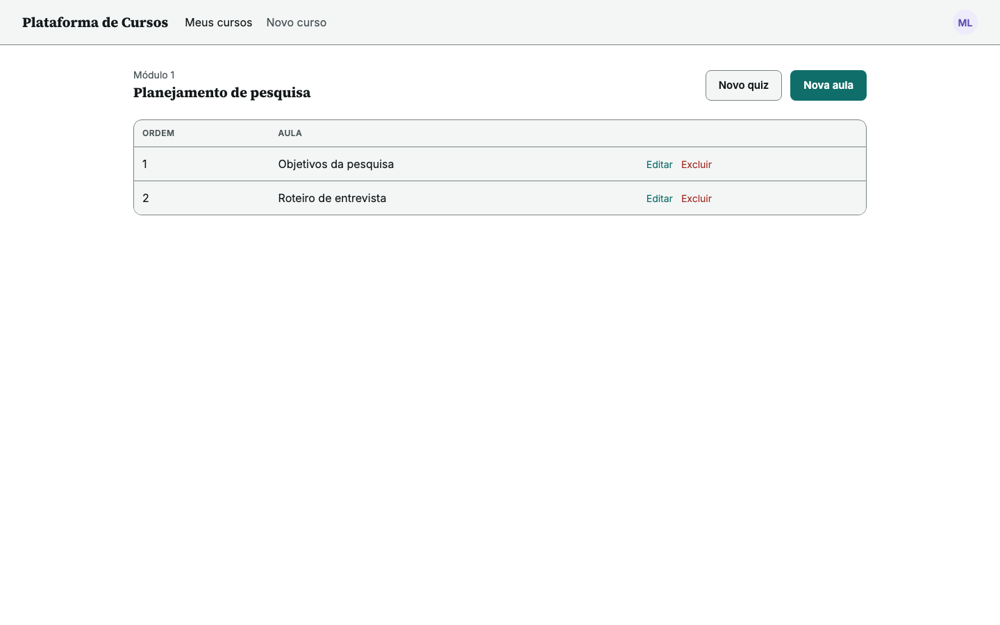

  *Figura 0 – UC004, fluxo básico: botão "Novo quiz" na tela "Aulas do módulo"*

  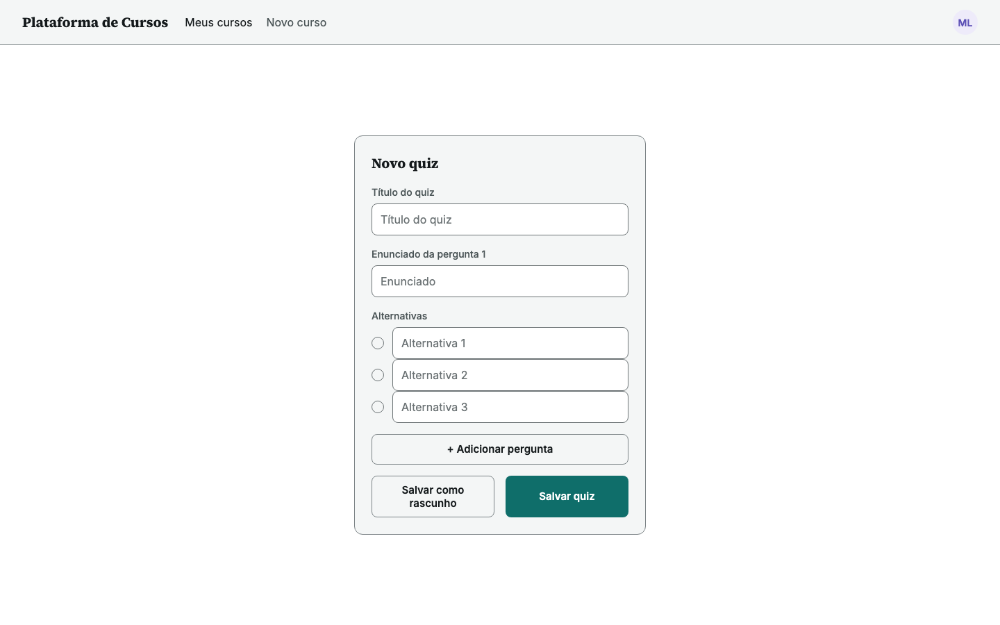

  *Figura 0 – UC004, fluxo básico: formulário "Novo quiz" vazio*

  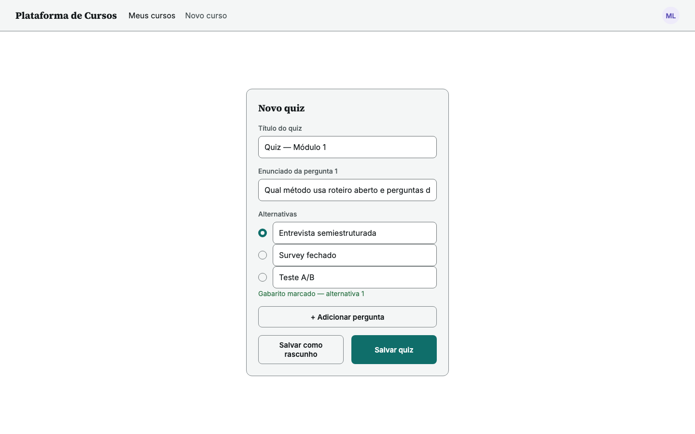

  *Figura 0 – UC004, fluxo básico: formulário "Novo quiz" com alternativa correta marcada*

  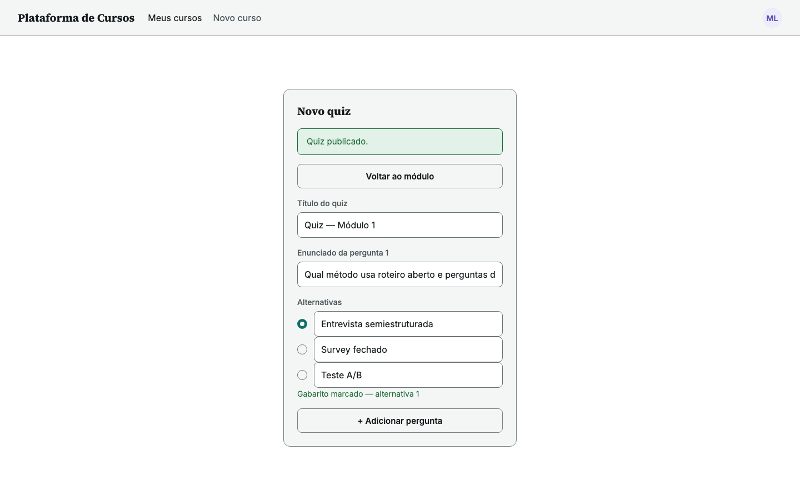

  *Figura 0 – UC004, fluxo básico: formulário "Novo quiz" após publicar com "Voltar ao módulo"*
- **Fluxos alternativos:**
  - **A1 – O Instrutor edita uma pergunta já existente**
    - A-1.1 O Instrutor seleciona a pergunta a editar e altera o enunciado, as alternativas ou o gabarito.
    - A-1.2 O sistema mantém o histórico de respostas e as notas já lançadas.
    - A-1.3 Este caso de uso retorna ao fluxo básico (passo 5).

    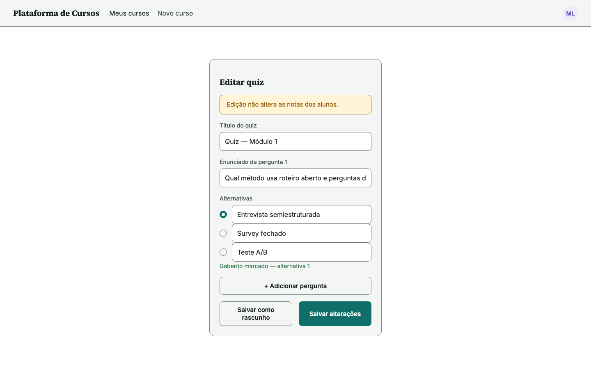

    *Figura 0 – UC004, fluxo alternativo A1: formulário "Editar quiz" com aviso de notas*
  - **A2 – O Instrutor salva o quiz como rascunho**
    - A-2.1 O Instrutor aciona “Salvar como rascunho” em vez de publicar.
    - A-2.2 O sistema salva o quiz sem torná-lo visível aos alunos.
    - A-2.3 Este caso de uso é finalizado.

    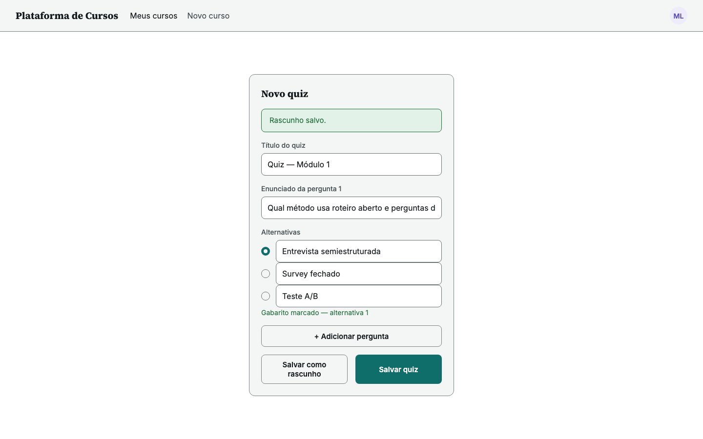

    *Figura 0 – UC004, fluxo alternativo A2: formulário "Novo quiz" após salvar rascunho*
  - **A3 – O Instrutor cancela o cadastro do quiz**
    - A-3.1 O Instrutor aciona “Cancelar” no formulário.
    - A-3.2 O sistema descarta as alterações sem gravar nenhum registro no banco e recarrega a visualização do módulo.
    - A-3.3 Este caso de uso é finalizado.
- **Fluxos de exceção:**
  - **E1 – Pergunta com menos de duas alternativas**
    - E-1.1 O sistema identifica uma pergunta com menos de duas alternativas cadastradas.
    - E-1.2 O sistema bloqueia o salvamento e pede para cadastrar ao menos duas alternativas.
    - E-1.3 Este caso de uso retorna ao fluxo básico (passo 3).

    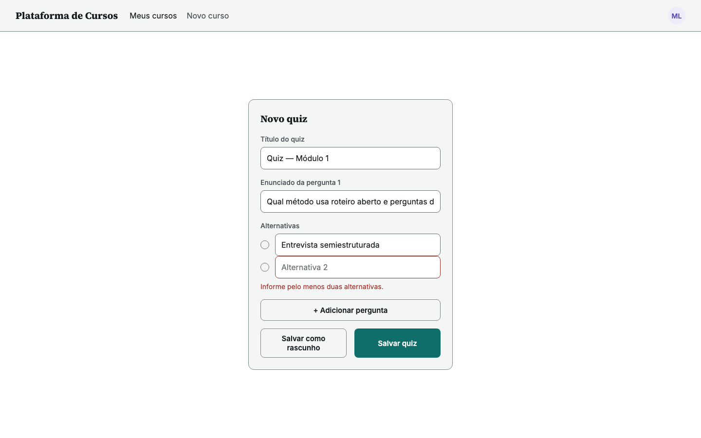

    *Figura 0 – UC004, fluxo de exceção E1: erro "Informe pelo menos duas alternativas"*
  - **E2 – Pergunta sem alternativa marcada como correta**
    - E-2.1 O sistema identifica uma pergunta sem gabarito definido.
    - E-2.2 O sistema bloqueia o salvamento e pede para marcar a alternativa correta.
    - E-2.3 Este caso de uso retorna ao fluxo básico (passo 4).

    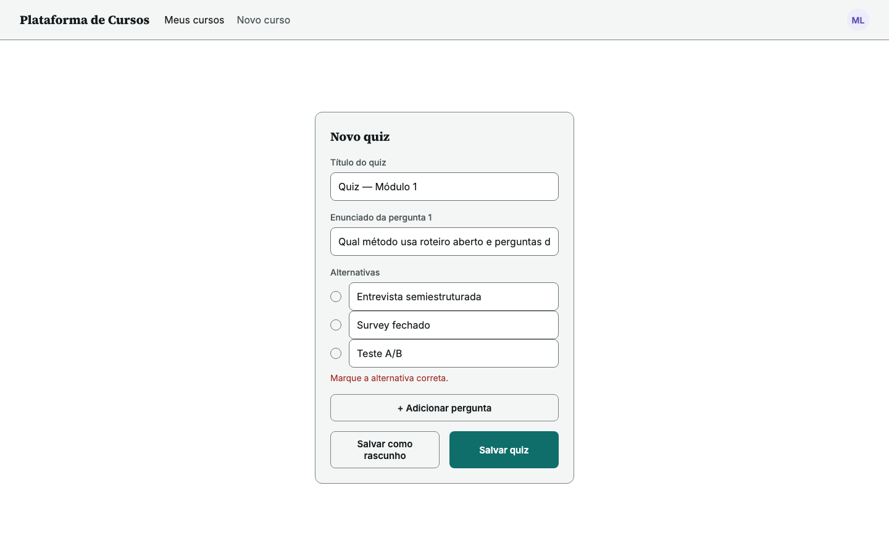

    *Figura 0 – UC004, fluxo de exceção E2: erro "Marque a alternativa correta"*
  - **E3 – Instrutor não é dono do curso**
    - E-3.1 O sistema identifica que o curso pertence a outro Instrutor.
    - E-3.2 O sistema nega o acesso (403) e não executa nenhuma alteração.
    - E-3.3 Este caso de uso é finalizado.

    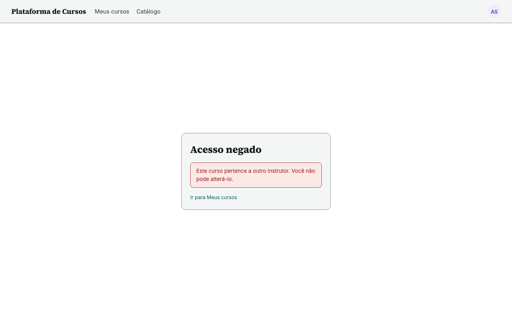

    *Figura 0 – UC004, fluxo de exceção E3: acesso negado: curso de outro Instrutor*
  - **E4 – Módulo inexistente ou sem permissão de edição**
    - E-4.1 O sistema identifica que o módulo informado não existe ou foi removido.
    - E-4.2 O sistema informa o erro e não cadastra o quiz.
    - E-4.3 Este caso de uso é finalizado.

    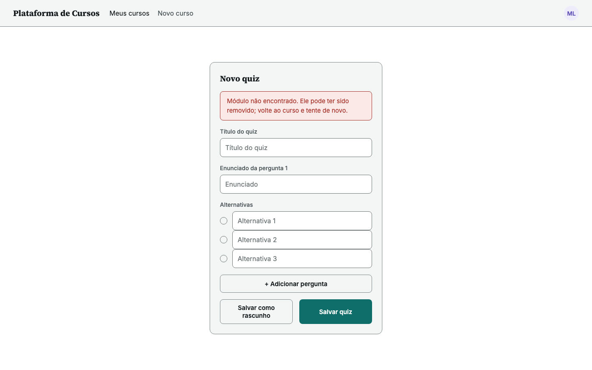

    *Figura 0 – UC004, fluxo de exceção E4: erro "Módulo não encontrado" no formulário de quiz*

## 7. UC006 – Cadastrar Curso

- **Nome do caso de uso:** Cadastrar Curso
- **Ator(es):** Instrutor.
- **Descrição:** o Instrutor cria, edita, exclui e lista os cursos do seu catálogo (US004, RF002).
- **Pré-condições:** o Instrutor ter realizado login na plataforma.
- **Pós-condições:** curso criado ou atualizado disponível no catálogo do Instrutor, com status rascunho, publicado ou arquivado.
- **Regras de negócio:** R-1 o curso é criado com status rascunho por padrão; R-2 a exclusão é bloqueada se houver alunos matriculados (nesse caso, o Instrutor só pode despublicar o curso, pelo arquivamento do A4); R-3 o curso arquivado sai do catálogo, mas os alunos já matriculados mantêm o acesso às aulas.
- **Protótipo(s) de tela:** formulário de cadastro de curso com título, descrição, preço e categoria. As telas de cada fluxo aparecem junto ao fluxo, abaixo.
- **Fluxo básico:**
  1. O Instrutor acessa “Meus cursos”. (A-2)
  2. O Instrutor aciona “Novo curso”.
  3. O Instrutor preenche título, descrição, preço e categoria. (A-3)
  4. O sistema salva o curso com status rascunho. (E-1)
  5. O Instrutor aciona “Publicar” quando estiver pronto.
  6. O sistema torna o curso visível no catálogo. (A-1)
  7. Este caso de uso é finalizado.

  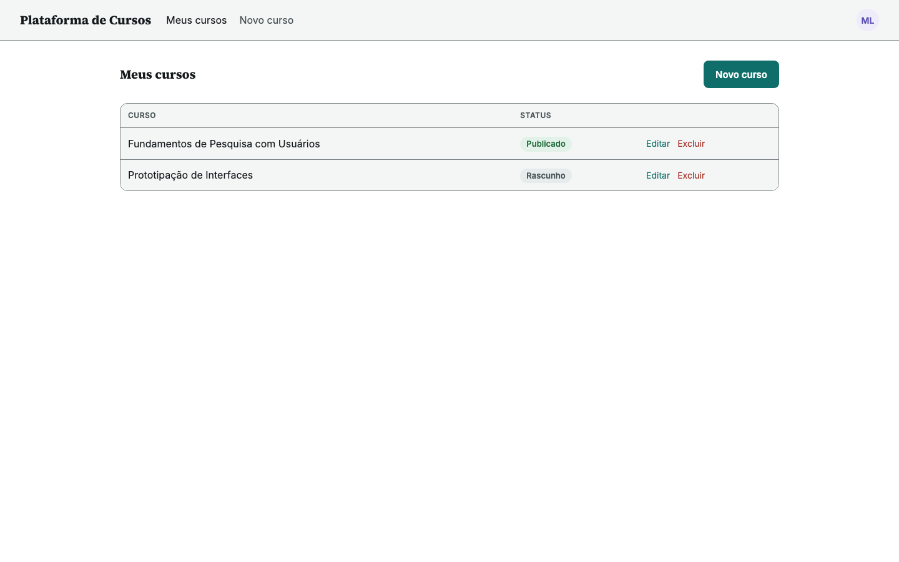

  *Figura 0 – UC006, fluxo básico: lista "Meus cursos" do instrutor*

  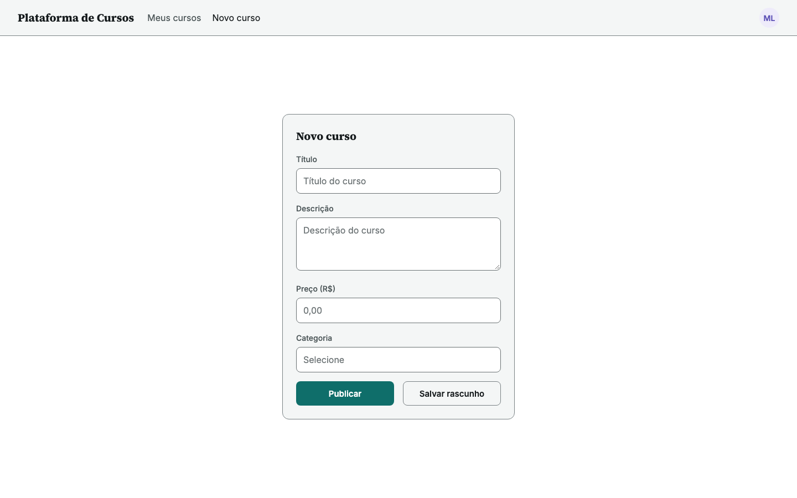

  *Figura 0 – UC006, fluxo básico: formulário "Novo curso" vazio*

  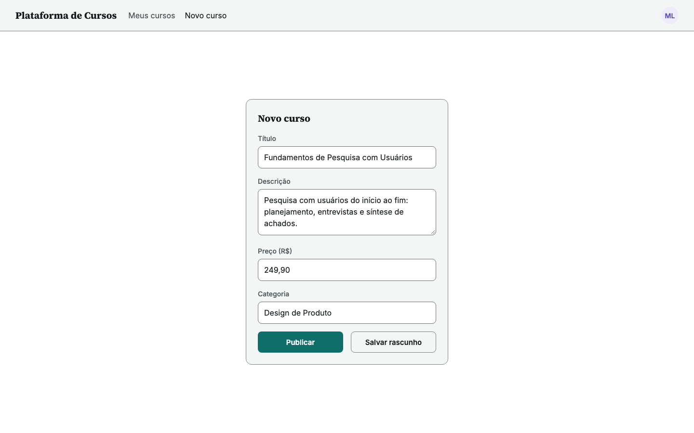

  *Figura 0 – UC006, fluxo básico: formulário "Novo curso" preenchido*

  

  *Figura 0 – UC006, fluxo básico: lista "Meus cursos" após salvar rascunho*

  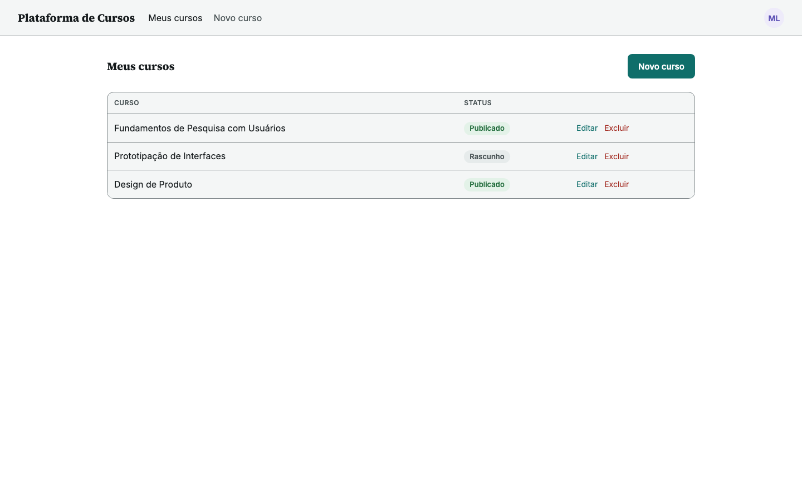

  *Figura 0 – UC006, fluxo básico: lista "Meus cursos" com curso publicado*
- **Fluxos alternativos:**
  - **A1 – O Instrutor edita um curso já publicado**
    - A-1.1 O Instrutor altera título, descrição ou preço do curso.
    - A-1.2 O sistema salva as alterações e as reflete no catálogo, sem afetar as matrículas existentes.
    - A-1.3 Este caso de uso é finalizado.

    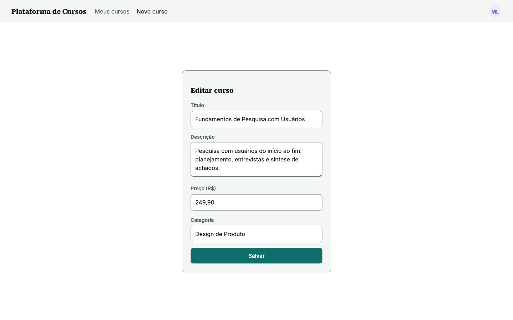

    *Figura 0 – UC006, fluxo alternativo A1: formulário "Editar curso" com dados atuais*
  - **A2 – O Instrutor exclui um curso sem matrículas**
    - A-2.1 O Instrutor aciona “Excluir curso”. (E-2)
    - A-2.2 O sistema confirma que não há alunos matriculados e solicita confirmação de exclusão.
    - A-2.3 O Instrutor confirma a exclusão. (Caso acione “Cancelar” na confirmação, a operação é abortada sem alterar os cursos).
    - A-2.4 O sistema remove o curso logicamente do catálogo e atualiza a lista.
    - A-2.5 Este caso de uso é finalizado.

    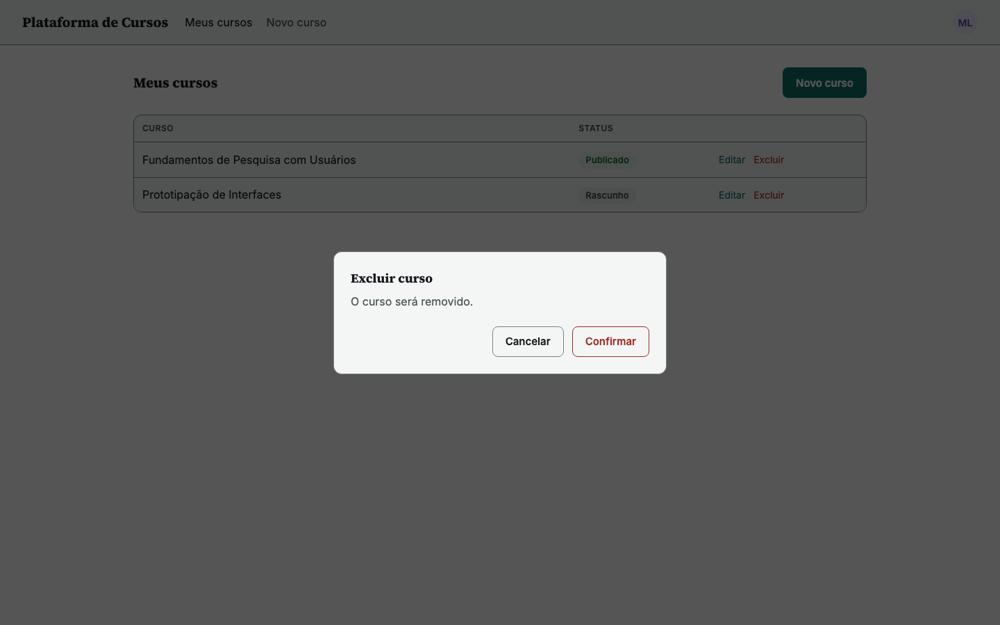

    *Figura 0 – UC006, fluxo alternativo A2: confirmação de exclusão do curso na lista*
  - **A3 – O Instrutor cancela o cadastro do curso**
    - A-3.1 O Instrutor aciona “Cancelar” no formulário de criação de curso.
    - A-3.2 O sistema fecha o formulário sem persistir nenhuma informação no banco e retorna à lista “Meus cursos”.
    - A-3.3 Este caso de uso é finalizado.
  - **A4 – O Instrutor arquiva um curso publicado**
    - A-4.1 O Instrutor aciona “Arquivar” em um curso publicado. O Administrador também aciona este fluxo no UC018, ao excluir o Instrutor e optar por despublicar os cursos dele.
    - A-4.2 O sistema muda o status do curso de publicado para arquivado e o retira do catálogo.
    - A-4.3 O sistema mantém o acesso dos alunos já matriculados às aulas do curso e não apaga nenhum dado.
    - A-4.4 Este caso de uso é finalizado.
- **Fluxos de exceção:**
  - **E1 – Campos obrigatórios não preenchidos**
    - E-1.1 O sistema identifica título, descrição ou preço ausente.
    - E-1.2 O sistema bloqueia o salvamento e indica os campos pendentes.
    - E-1.3 Este caso de uso retorna ao fluxo básico (passo 3).

    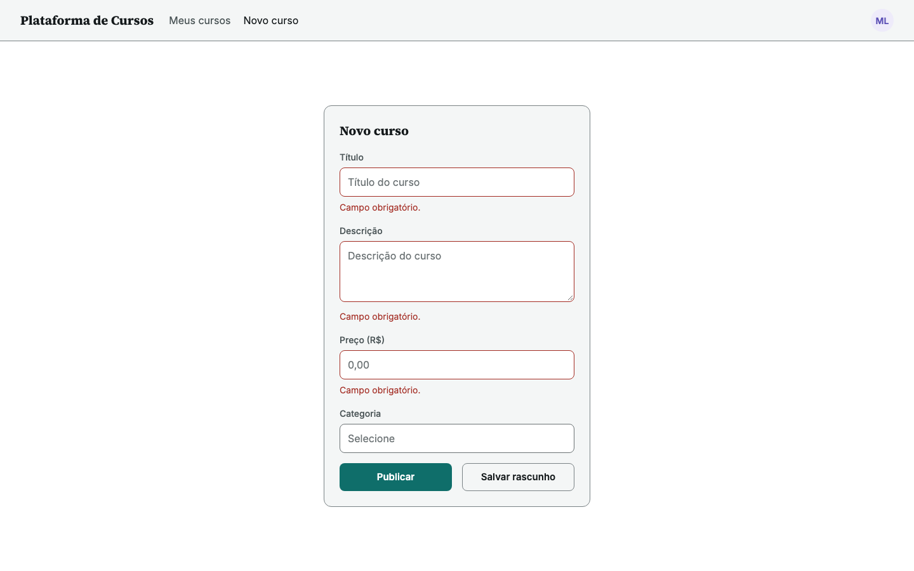

    *Figura 0 – UC006, fluxo de exceção E1: erro "Campo obrigatório" no título*
  - **E2 – Tentativa de excluir curso com alunos matriculados**
    - E-2.1 O sistema identifica matrículas ativas vinculadas ao curso.
    - E-2.2 O sistema impede a exclusão e sugere despublicar o curso (arquivamento, A4).
    - E-2.3 Este caso de uso é finalizado.

    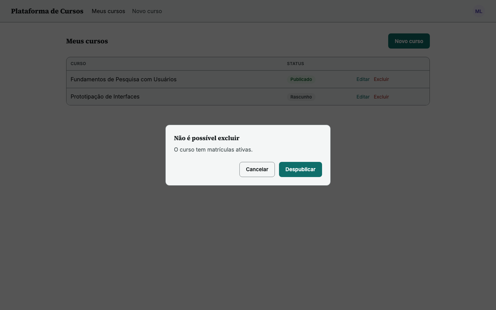

    *Figura 0 – UC006, fluxo de exceção E2: exclusão bloqueada na lista "Meus cursos"*
  - **E3 – Instrutor não é dono do curso**
    - E-3.1 O sistema identifica que o curso pertence a outro Instrutor.
    - E-3.2 O sistema nega o acesso (403) e não executa nenhuma alteração.
    - E-3.3 Este caso de uso é finalizado.

  - **E4 – Publicação de curso sem módulos ou aulas**
    - E-4.1 O sistema identifica que o curso não tem módulos ou aulas cadastrados ao acionar “Publicar”.
    - E-4.2 O sistema mantém o curso como rascunho e indica o que falta.
    - E-4.3 Este caso de uso retorna ao fluxo básico.

    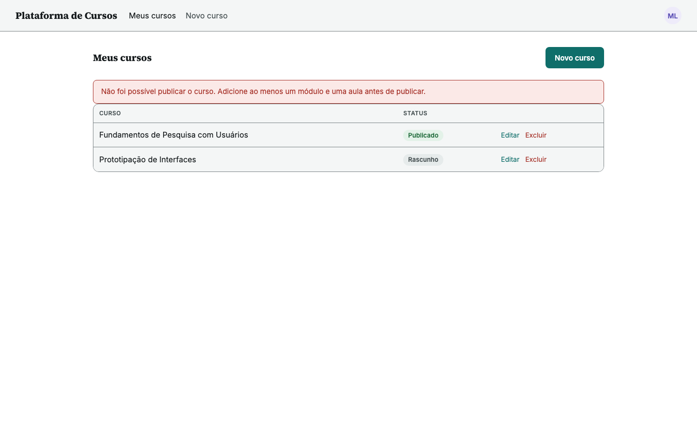

    *Figura 0 – UC006, fluxo de exceção E4: erro ao publicar curso sem módulos ou aulas*

## 8. UC014 – Gerenciar Módulos do Curso

- **Nome do caso de uso:** Gerenciar Módulos do Curso
- **Ator(es):** Instrutor.
- **Descrição:** o Instrutor cria, edita, reordena e exclui módulos de um curso seu, definindo título e posição (US005, RF003).
- **Pré-condições:** o Instrutor ter realizado login e ter cadastrado o curso (UC006).
- **Pós-condições:** módulo criado, alterado ou excluído (quando sem histórico de alunos) e lista de módulos do curso atualizada; histórico de alunos preservado caso a exclusão seja bloqueada.
- **Regras de negócio:** R-1 só o Instrutor dono do curso gerencia os seus módulos; R-2 a posição do módulo deve ser única dentro do curso; R-3 a exclusão de um módulo sem histórico de alunos remove as suas aulas e o seu quiz; R-4 a exclusão de um módulo é bloqueada se algum Aluno tiver progresso registrado em aula do módulo ou resposta ao quiz do módulo (nesse caso o histórico de progresso, respostas e notas é preservado e o Instrutor pode editar o módulo, mas não removê-lo).
- **Protótipo(s) de tela:** tela do curso com lista de módulos, botão “Novo módulo”, formulário de título e posição e aviso de exclusão bloqueada. As telas de cada fluxo aparecem junto ao fluxo, abaixo.
- **Fluxo básico:**
  1. O Instrutor acessa o curso. (A-1) (A-2) (A-3) (E-3)
  2. O Instrutor aciona “Novo módulo”.
  3. O Instrutor informa o título e a posição do módulo.
  4. O sistema valida os dados informados. (E-1) (E-2)
  5. O sistema salva o módulo e atualiza a lista de módulos.
  6. Este caso de uso é finalizado.

  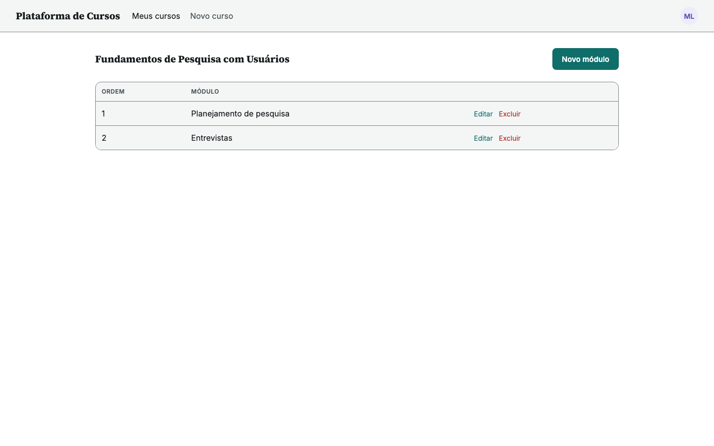

  *Figura 0 – UC014, fluxo básico: tela "Módulos do curso" com botão "Novo módulo"*

  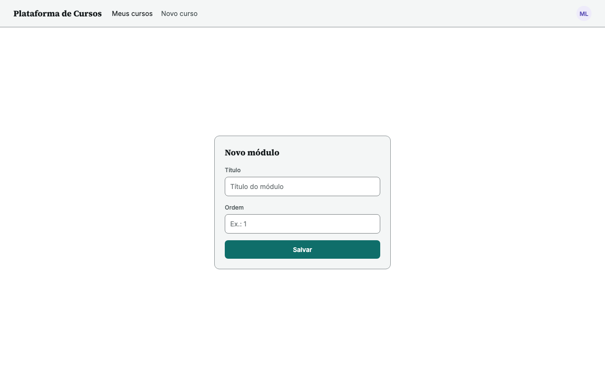

  *Figura 0 – UC014, fluxo básico: formulário "Novo módulo" vazio*

  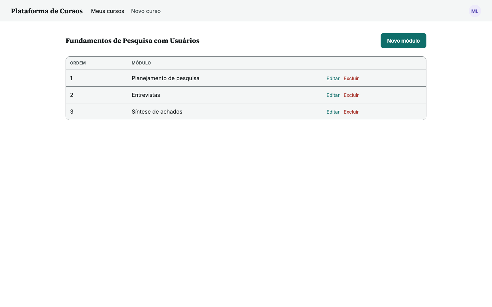

  *Figura 0 – UC014, fluxo básico: tela "Módulos do curso" após criar módulo*
- **Fluxos alternativos:**
  - **A1 – O Instrutor edita ou reordena um módulo**
    - A-1.1 O Instrutor seleciona um módulo existente.
    - A-1.2 O sistema exibe o formulário preenchido com os dados atuais.
    - A-1.3 O Instrutor altera o título ou a posição do módulo.
    - A-1.4 Este caso de uso retorna ao fluxo básico (passo 4).

    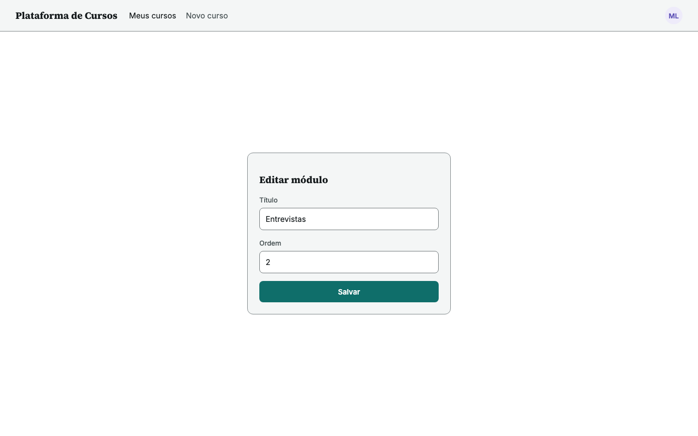

    *Figura 0 – UC014, fluxo alternativo A1: formulário "Editar módulo" com dados atuais*
  - **A2 – O Instrutor exclui um módulo**
    - A-2.1 O Instrutor aciona “Excluir” em um módulo.
    - A-2.2 O sistema verifica se há histórico de alunos no módulo. (E-4)
    - A-2.3 O sistema avisa que as aulas e o quiz do módulo também serão removidos e pede confirmação.
    - A-2.4 O Instrutor confirma a exclusão. (A-3)
    - A-2.5 O sistema remove logicamente (`deleted_at`) o módulo, as suas aulas e o seu quiz e atualiza a lista.
    - A-2.6 Este caso de uso é finalizado.

    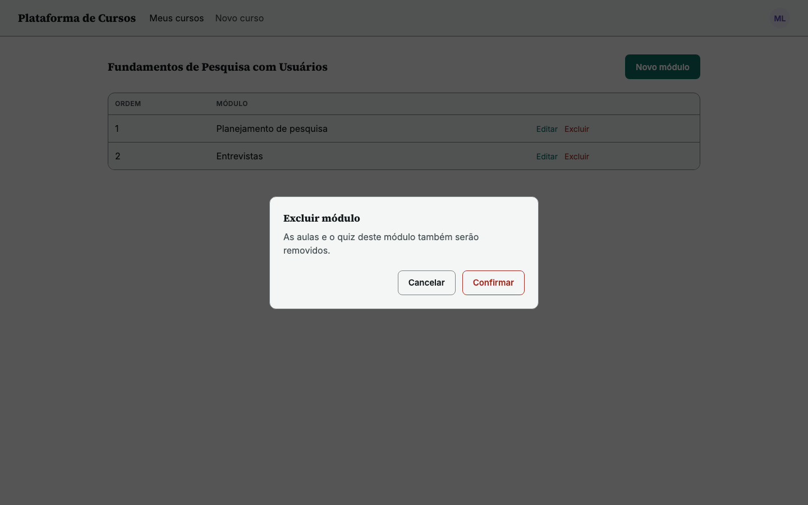

    *Figura 0 – UC014, fluxo alternativo A2: confirmação de exclusão do módulo*
  - **A3 – O Instrutor cancela a exclusão do módulo**
    - A-3.1 O Instrutor aciona “Excluir” em um módulo.
    - A-3.2 O sistema exibe o diálogo de confirmação de exclusão.
    - A-3.3 O Instrutor aciona “Cancelar” na confirmação.
    - A-3.4 O sistema fecha o diálogo sem remover o módulo nem alterar suas aulas ou quiz.
    - A-3.5 Este caso de uso é finalizado.
- **Fluxos de exceção:**
  - **E1 – Título ausente**
    - E-1.1 O sistema identifica que o título não foi informado.
    - E-1.2 O sistema bloqueia o salvamento e indica o campo obrigatório.
    - E-1.3 Este caso de uso retorna ao fluxo básico (passo 3).

    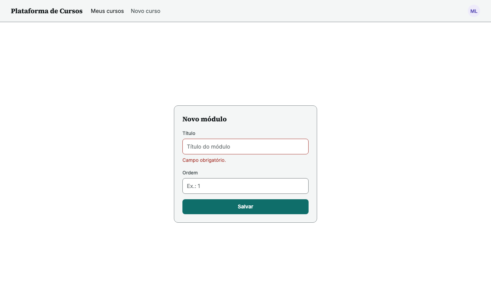

    *Figura 0 – UC014, fluxo de exceção E1: erro "Campo obrigatório" no título do módulo*
  - **E2 – Posição já utilizada**
    - E-2.1 O sistema identifica que a posição informada já pertence a outro módulo do curso.
    - E-2.2 O sistema informa o conflito e solicita outra posição.
    - E-2.3 Este caso de uso retorna ao fluxo básico (passo 3).

    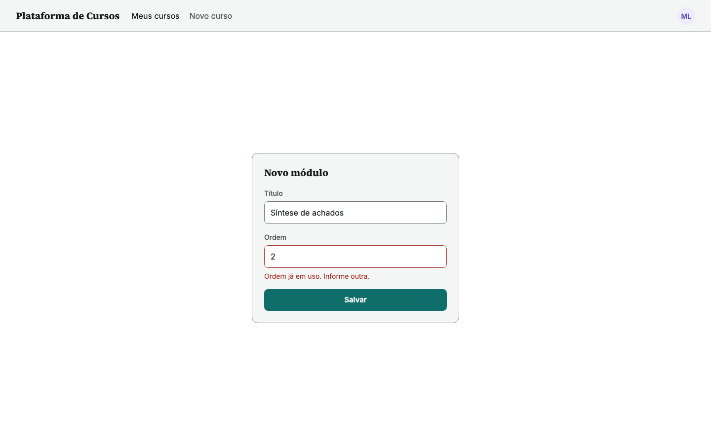

    *Figura 0 – UC014, fluxo de exceção E2: erro "Posição já em uso" no módulo*
  - **E3 – Instrutor não é dono do curso**
    - E-3.1 O sistema identifica que o curso pertence a outro Instrutor (R-1).
    - E-3.2 O sistema nega o acesso (403) e não executa nenhuma alteração nos módulos.
    - E-3.3 Este caso de uso é finalizado.
  - **E4 – Tentativa de excluir módulo com histórico de alunos**
    - E-4.1 O sistema identifica progresso registrado em aula ou resposta ao quiz do módulo por algum Aluno.
    - E-4.2 O sistema impede a exclusão, informa que o módulo possui histórico de alunos e orienta que o módulo pode ser editado, mas não removido.
    - E-4.3 Este caso de uso é finalizado.

    

    *Figura 0 – UC014, fluxo de exceção E4: exclusão bloqueada na tela "Módulos do curso"*

## 9. UC015 – Gerenciar Aulas do Curso

- **Nome do caso de uso:** Gerenciar Aulas do Curso
- **Ator(es):** Instrutor.
- **Descrição:** o Instrutor cria, edita e exclui aulas de um módulo, incluindo o envio do vídeo e de materiais complementares da aula pela API (US006, RF004).
- **Pré-condições:** o Instrutor ter realizado login e ter cadastrado o módulo (UC014).
- **Pós-condições:** aula salva com o vídeo e materiais armazenados ou aula sem histórico excluída logicamente; transcrição e indexação do conteúdo iniciadas para uso do Tutor de IA; histórico de alunos preservado caso a exclusão seja bloqueada.
- **Regras de negócio:** R-1 só o Instrutor dono do curso gerencia as suas aulas; R-2 o vídeo aceita os formatos mp4 e webm, com até 500 MB por arquivo (RNF018); R-3 os arquivos de vídeo e de materiais complementares são enviados diretamente à API (`multipart/form-data`), que grava no armazenamento Cloudflare R2 por meio do `media-service` e registra suas chaves e metadados; R-4 a transcrição e a indexação do conteúdo são geradas uma única vez por aula/vídeo (RNF004); R-5 a exclusão de uma aula é bloqueada se algum Aluno tiver progresso registrado na aula (nesse caso o histórico de progresso é preservado e o Instrutor pode editar a aula, mas não removê-la); R-6 os materiais complementares aceitam formato PDF com até 50 MB por arquivo, com título e ordem definidos pelo Instrutor.
- **Protótipo(s) de tela:** tela do módulo com lista de aulas, formulário de título, descrição, ordem, indicador de prévia e seleção do vídeo e aviso de exclusão bloqueada. As telas de cada fluxo aparecem junto ao fluxo, abaixo.
- **Fluxo básico:**
  1. O Instrutor acessa o módulo. (A-1) (A-2) (A-3) (A-4) (E-3)
  2. O Instrutor aciona “Nova aula”.
  3. O Instrutor informa título, descrição, ordem e se a aula é prévia, e anexa o arquivo de vídeo.
  4. O sistema valida o formato e o tamanho do vídeo. (E-1)
  5. O Instrutor aciona “Salvar aula”; o arquivo de vídeo é transmitido via API ao `media-service`, que grava o objeto no Cloudflare R2 (CLOUDFLARE, 2022) e devolve a chave do vídeo (`video_key`), tipo de mídia MIME (*Multipurpose Internet Mail Extensions*) e tamanho em bytes. (E-2)
  6. O sistema salva a aula com a chave do vídeo obrigatória (`video_key`), duração e metadados, e inicia a transcrição e a indexação do conteúdo.
  7. Este caso de uso é finalizado.

  

  *Figura 0 – UC015, fluxo básico: tela "Aulas do módulo" com botões "Novo quiz" e "Nova aula"*

  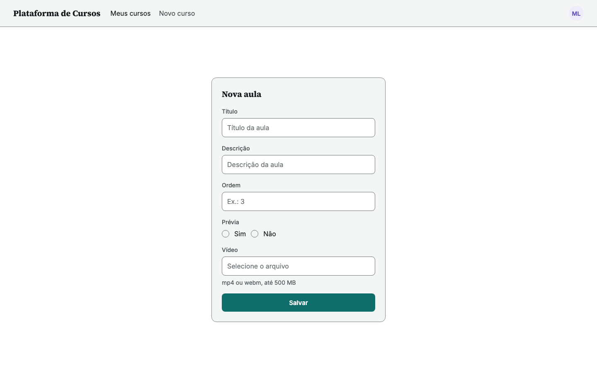

  *Figura 0 – UC015, fluxo básico: formulário "Nova aula" vazio*

  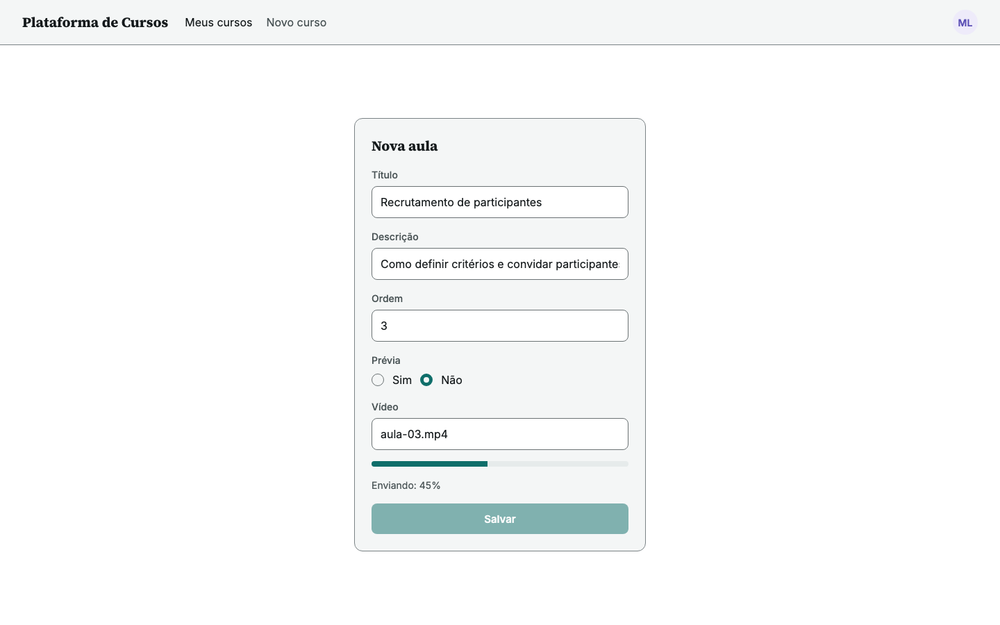

  *Figura 0 – UC015, fluxo básico: formulário "Nova aula" com envio em andamento*

  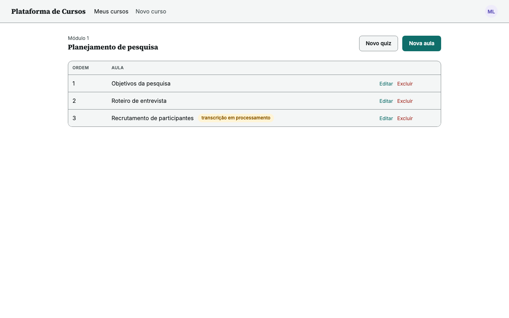

  *Figura 0 – UC015, fluxo básico: tela "Aulas do módulo" após salvar aula*
- **Fluxos alternativos:**
  - **A1 – O Instrutor edita a aula ou substitui o vídeo**
    - A-1.1 O Instrutor seleciona uma aula existente.
    - A-1.2 O sistema exibe o formulário preenchido com os dados atuais.
    - A-1.3 O Instrutor altera os dados da aula ou escolhe um novo arquivo de vídeo.
    - A-1.4 Se um novo vídeo foi escolhido, o arquivo é validado e enviado via API ao `media-service` para gravação no R2, atualizando a chave e disparando o reprocessamento da transcrição e da indexação em substituição às anteriores (única exceção a R-4: a geração única vale por vídeo). Se nenhum novo vídeo foi enviado, os dados da aula são atualizados sem reprocessar a transcrição.
    - A-1.5 Este caso de uso retorna ao fluxo básico (passo 4).

    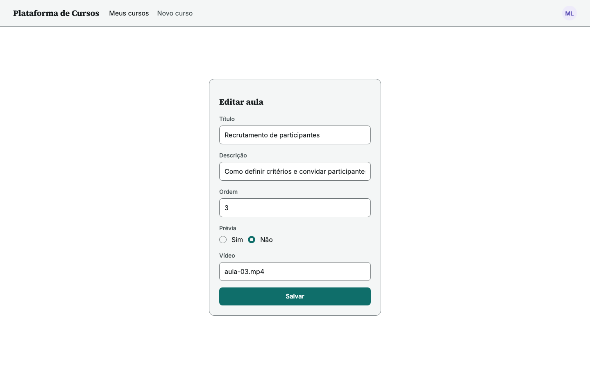

    *Figura 0 – UC015, fluxo alternativo A1: formulário "Editar aula" com dados atuais*
  - **A2 – O Instrutor exclui uma aula**
    - A-2.1 O Instrutor aciona “Excluir” em uma aula.
    - A-2.2 O sistema verifica se há histórico de alunos na aula. (E-4)
    - A-2.3 O sistema avisa que a aula deixará de aparecer no curso e pede confirmação.
    - A-2.4 O Instrutor confirma a exclusão. (A-3)
    - A-2.5 O sistema remove a aula logicamente (`deleted_at`) e marca a exclusão lógica dos materiais vinculados; o arquivo de vídeo e os materiais permanecem no Cloudflare R2, preservados para o histórico, e a lista é atualizada.
    - A-2.6 Este caso de uso é finalizado.

    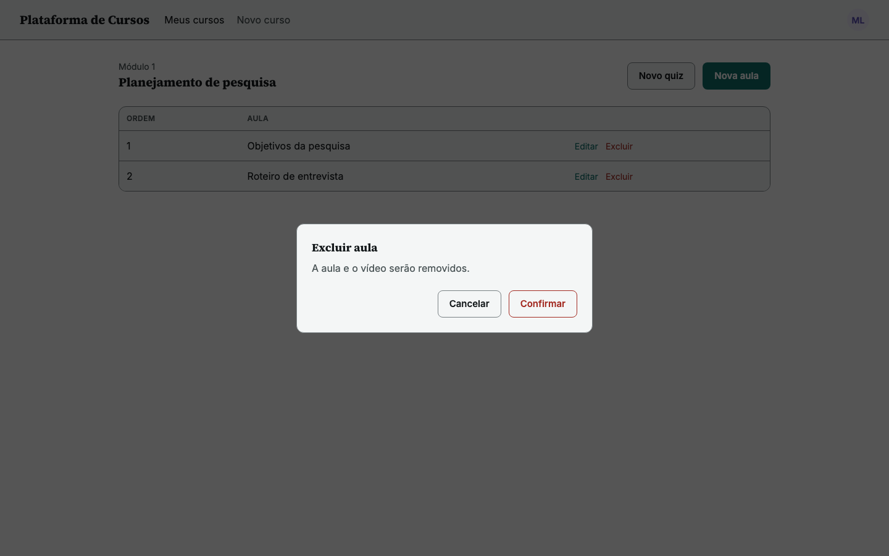

    *Figura 0 – UC015, fluxo alternativo A2: confirmação de exclusão da aula*
  - **A3 – O Instrutor cancela a exclusão da aula**
    - A-3.1 O Instrutor aciona “Excluir” em uma aula existente.
    - A-3.2 O sistema exibe o diálogo de confirmação.
    - A-3.3 O Instrutor aciona “Cancelar” no diálogo de confirmação.
    - A-3.4 O sistema fecha o diálogo sem remover a aula nem o vídeo, mantendo a lista de aulas inalterada.
    - A-3.5 Este caso de uso é finalizado.
  - **A4 – O Instrutor gerencia materiais complementares da aula**
    - A-4.1 O Instrutor seleciona a aula e aciona “Adicionar material”.
    - A-4.2 O Instrutor informa o título, a ordem e seleciona o arquivo PDF.
    - A-4.3 O sistema valida o formato e o tamanho do material. (E-5)
    - A-4.4 O arquivo é transmitido via API ao `media-service`, armazenado em bucket no Cloudflare R2 (CLOUDFLARE, 2022) e registrado na tabela de materiais da aula (`LessonMaterial`).
    - A-4.5 O material fica disponível para download pelos alunos matriculados na aula.
    - A-4.6 O Instrutor pode excluir um material complementar existente, o que marca a exclusão lógica do registro (`deleted_at`); o arquivo permanece no Cloudflare R2.
    - A-4.7 Este caso de uso é finalizado.
- **Fluxos de exceção:**
  - **E1 – Formato ou tamanho de vídeo inválido**
    - E-1.1 O sistema identifica que o vídeo está fora dos formatos ou do tamanho permitidos.
    - E-1.2 O sistema recusa o arquivo e informa os limites aceitos.
    - E-1.3 Este caso de uso retorna ao fluxo básico (passo 3).

    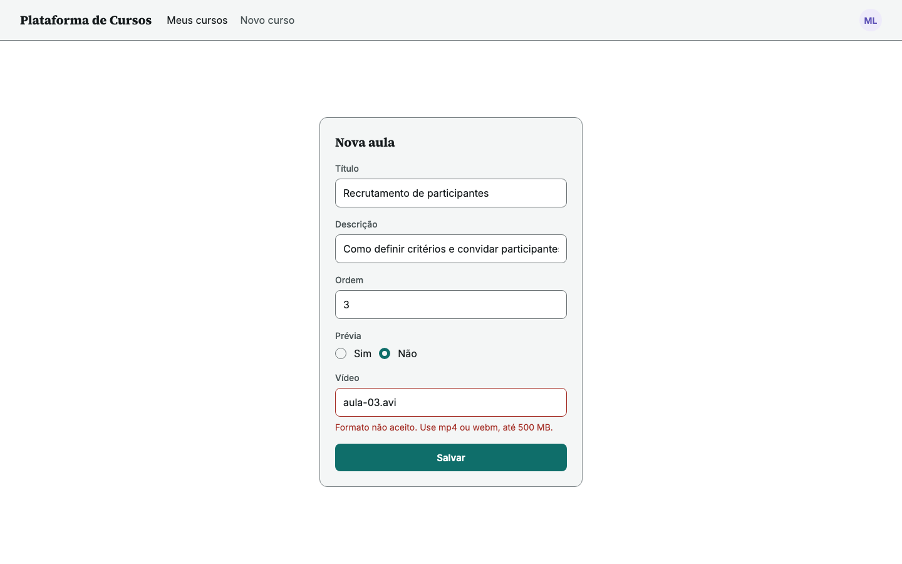

    *Figura 0 – UC015, fluxo de exceção E1: erro "Formato não aceito" no vídeo*
  - **E2 – Falha no envio do vídeo ou no armazenamento**
    - E-2.1 O sistema identifica falha no envio do vídeo à API ou erro na comunicação com o `media-service`.
    - E-2.2 O sistema responde 503 `SERVICE_UNAVAILABLE` com `Retry-After`, informa o erro e permite nova tentativa de envio.
    - E-2.3 Este caso de uso retorna ao fluxo básico (passo 5).

    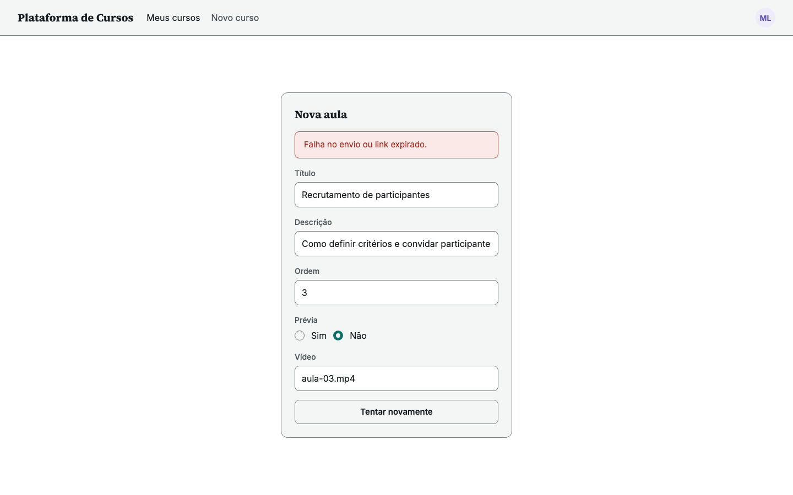

    *Figura 0 – UC015, fluxo de exceção E2: erro "Falha no envio" com botão "Tentar novamente"*
  - **E3 – Instrutor não é dono do curso**
    - E-3.1 O sistema identifica que o curso da aula pertence a outro Instrutor (R-1).
    - E-3.2 O sistema nega o acesso (403), sem alterar a aula.
    - E-3.3 Este caso de uso é finalizado.
  - **E4 – Tentativa de excluir aula com histórico de alunos**
    - E-4.1 O sistema identifica progresso registrado na aula por algum Aluno.
    - E-4.2 O sistema impede a exclusão, informa que a aula possui histórico de alunos e orienta que a aula pode ser editada, mas não removida.
    - E-4.3 Este caso de uso é finalizado.

    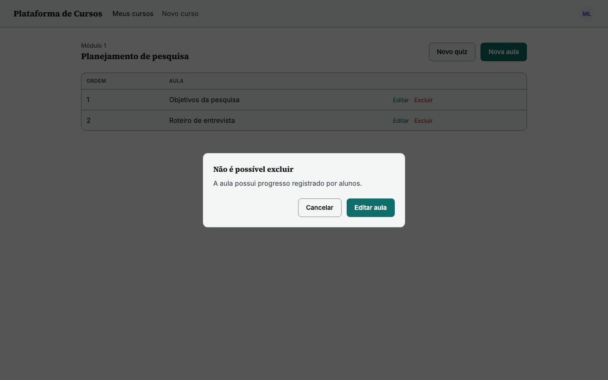

    *Figura 0 – UC015, fluxo de exceção E4: exclusão bloqueada na tela "Aulas do módulo"*
  - **E5 – Formato ou tamanho de material complementar inválido**
    - E-5.1 O sistema identifica que o material complementar informado não é do formato PDF ou excede o limite máximo de 50 MB (R-6).
    - E-5.2 O sistema recusa o arquivo, informa os limites aceitos e não persiste o registro.
    - E-5.3 Este caso de uso retorna ao fluxo alternativo A4 (passo A-4.2).
