## 16. UC001 – Conversar com Tutor de IA

- **Nome do caso de uso:** Conversar com Tutor de IA
- **Ator(es):** Aluno (primário); Tutor de IA (ator sistêmico, secundário).
- **Descrição:** o Aluno faz uma pergunta sobre o conteúdo da aula ao Tutor de IA do curso e recebe uma resposta que cita a origem no material (US012, RF009). Iniciado a partir do UC009 (Assistir Aula), fluxo alternativo A3: UC001 «extend» UC009 (a seta sai do UC001 e aponta para o UC009).
- **Pré-condições:** o Aluno ter realizado login e estar matriculado no curso; a aula já ter sido transcrita e indexada.
- **Pós-condições:** pergunta e resposta salvas no histórico de conversa do Aluno com aquele curso.
- **Regras de negócio:** R-1 o Tutor de IA só responde com base no material do próprio curso; R-2 cada Aluno possui uma cota de 20 mensagens por hora por Aluno, em janela deslizante controlada no Redis; ao estourar o limite, o envio é bloqueado com código HTTP 429 `TOO_MANY_REQUESTS` e cabeçalho `Retry-After` informando os segundos restantes até a liberação de envio, a menos que possua mensagem disponível em pacote de créditos extras (RF020, RNF022); R-3 a pergunta pode opcionalmente referenciar o segundo do vídeo da aula (`videoTimestampSeconds`), permitindo contextualização temporal precisa da dúvida pedagógica.
- **Protótipo(s) de tela:** chat na lateral da reprodução do vídeo, com a resposta indicando a aula e o minuto do vídeo de origem. As telas de cada fluxo aparecem junto ao fluxo, abaixo.
- **Fluxo básico:**
  1. O Aluno abre o chat na página da aula. (A-2)
  2. O Aluno digita a pergunta, opcionalmente informando o segundo do vídeo da aula (`videoTimestampSeconds`), e aciona “Enviar”. (E-2)
  3. O Tutor de IA busca os trechos do material do curso relacionados à pergunta. (A-1) (E-1)
  4. O Tutor de IA gera a resposta citando a aula e o minuto do vídeo de origem.
  5. O sistema exibe a resposta no chat e a salva no histórico de conversa.
  6. Este caso de uso é finalizado.

  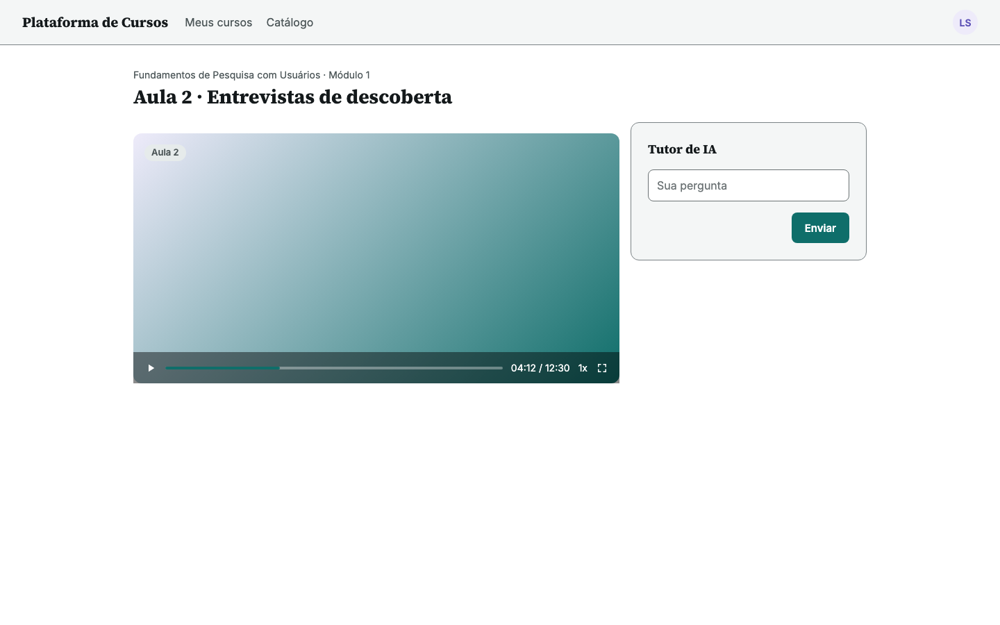

  *Figura 0 – UC001, fluxo básico: tutor de IA aberto e vazio*

  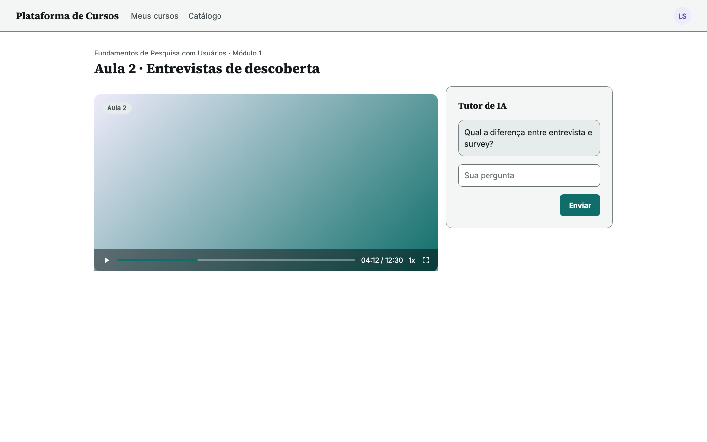

  *Figura 0 – UC001, fluxo básico: pergunta enviada ao Tutor de IA*

  

  *Figura 0 – UC001, fluxo básico: resposta do Tutor de IA*
- **Fluxos alternativos:**
  - **A1 – O Aluno faz pergunta fora do escopo do curso**
    - A-1.1 O Tutor de IA não encontra correspondência para a pergunta no material do curso.
    - A-1.2 O Tutor de IA informa que não tem essa informação no material do curso e sugere reformular a pergunta.
    - A-1.3 Este caso de uso retorna ao fluxo básico (passo 2).

    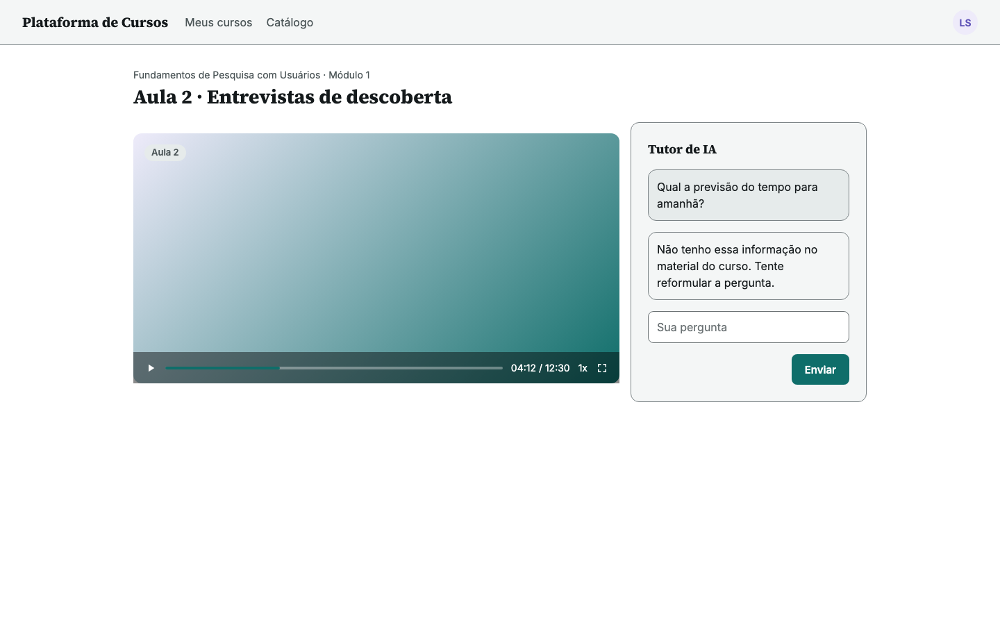

    *Figura 0 – UC001, fluxo alternativo A1: tutor sem informação no material*
  - **A2 – O Aluno reabre uma conversa anterior**
    - A-2.1 O Aluno acessa o histórico de conversa da aula.
    - A-2.2 O sistema carrega as mensagens anteriores no chat.
    - A-2.3 Este caso de uso retorna ao fluxo básico (passo 2).

    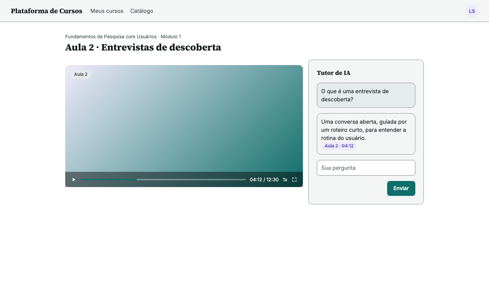

    *Figura 0 – UC001, fluxo alternativo A2: histórico de perguntas no chat*
  - **A3 – O Aluno adquire pacote de créditos extras do Tutor de IA**
    - A-3.1 Ao atingir o limite ou pelo painel do assistente, o Aluno solicita a compra de um pacote de mensagens extras com pagamento simulado (RF020, RNF022).
    - A-3.2 O sistema processa o pagamento simulado (`Payment` com `purpose = tutor_credits`) e ativa o pacote de créditos (`tutor_credit_packs`).
    - A-3.3 As mensagens do pacote são consumidas automaticamente quando a cota horária regular de 20 mensagens estiver esgotada.
    - A-3.4 Este caso de uso retorna ao fluxo básico (passo 2).
- **Fluxos de exceção:**
  - **E1 – Aula ainda não processada**
    - E-1.1 O sistema verifica que a aula ainda não foi transcrita e indexada.
    - E-1.2 O sistema avisa que o conteúdo ainda está sendo preparado e sugere tentar novamente mais tarde.
    - E-1.3 Este caso de uso é finalizado.

    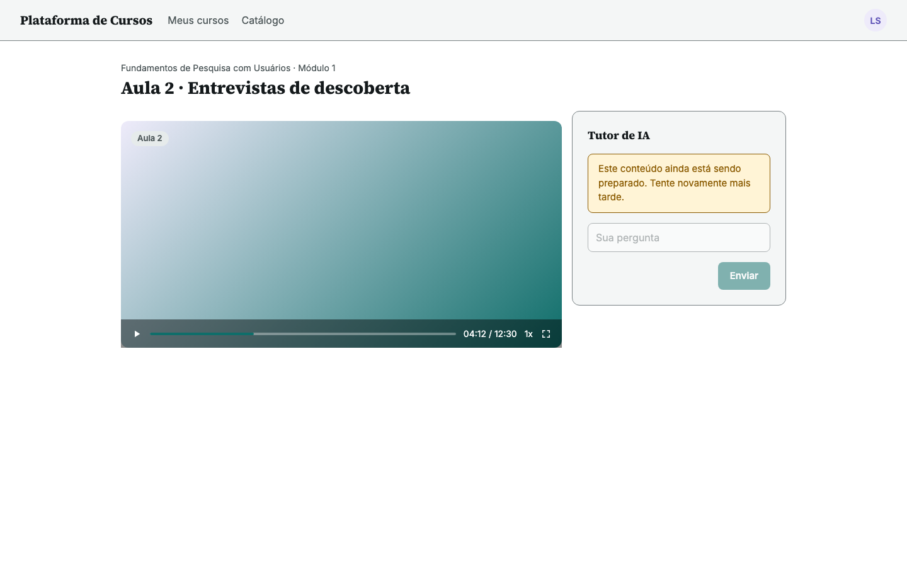

    *Figura 0 – UC001, fluxo de exceção E1: conteúdo em preparo*
  - **E2 – Limite de mensagens atingido**
    - E-2.1 O sistema identifica que o Aluno atingiu a cota de 20 mensagens por hora, em janela deslizante no Redis, e não possui mensagem disponível em pacote de créditos extras.
    - E-2.2 O sistema bloqueia o novo envio com HTTP 429 `TOO_MANY_REQUESTS`, informa o tempo restante no cabeçalho `Retry-After` e oferece a aquisição de pacote de créditos extras (A-3).
    - E-2.3 Este caso de uso é finalizado.

    

    *Figura 0 – UC001, fluxo de exceção E2: limite de mensagens atingido*
  - **E3 – Tutor de IA indisponível**
    - E-3.1 O sistema identifica falha ou indisponibilidade na busca ou na geração da resposta do Tutor de IA.
    - E-3.2 O sistema informa o erro no chat, mantém a pergunta digitada e oferece tentar novamente.
    - E-3.3 Este caso de uso é finalizado.

    

    *Figura 0 – UC001, fluxo de exceção E3: Tutor de IA indisponível, pergunta mantida*
  - **E4 – Aluno sem matrícula no curso**
    - E-4.1 O sistema identifica que o Aluno não está matriculado no curso da aula.
    - E-4.2 O sistema não abre o chat e sugere a matrícula no curso (UC003).
    - E-4.3 Este caso de uso é finalizado.

    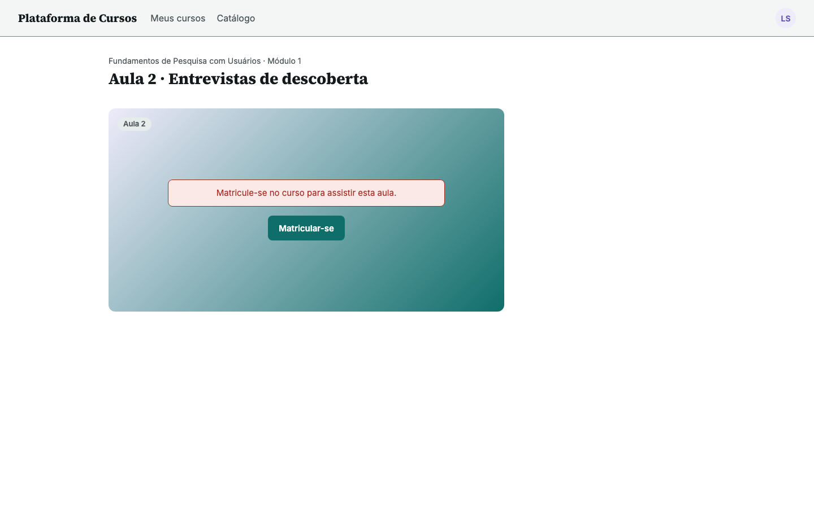

    *Figura 0 – UC001, fluxo de exceção E4: aula bloqueada: matricule-se para assistir e usar o Tutor de IA*

## 17. UC007 – Ver Dashboard com Filtro

- **Nome do caso de uso:** Ver Dashboard com Filtro
- **Ator(es):** Instrutor, Administrador.
- **Descrição:** o Instrutor ou o Administrador consulta o dashboard de progresso e engajamento dos alunos, filtrando por período e por curso, para identificar quem está avançando e quem está parado e comparar períodos (US013, RF010).
- **Pré-condições:** o Instrutor ou o Administrador ter realizado login; existir ao menos um curso com alunos matriculados.
- **Pós-condições:** dashboard exibe as métricas agregadas conforme o filtro aplicado.
- **Regras de negócio:** R-1 as métricas consideram apenas o período selecionado (`startDate` e `endDate`); R-2 o Instrutor só vê dados dos próprios cursos, e o Administrador vê os de todos os cursos; R-3 as métricas são calculadas a partir dos registros de progresso de aula (RF006) e de matrícula (RF005), agregadas por dia, semana ou mês (`groupBy` com valores `day`, `week`, `month`), o que permite ver tendências de engajamento e comparar intervalos.
- **Protótipo(s) de tela:** dashboard com gráficos de progresso e engajamento, seletor de intervalo de datas e filtro por curso. As telas de cada fluxo aparecem junto ao fluxo, abaixo.
- **Fluxo básico:**
  1. O Instrutor ou o Administrador acessa o dashboard. (A-2)
  2. O usuário seleciona um intervalo de datas. (E-1)
  3. O usuário opcionalmente filtra por curso (`courseId`). (A-1)
  4. O sistema agrega o progresso e o engajamento do período selecionado. (E-2)
  5. O sistema exibe os gráficos atualizados no dashboard.
  6. Este caso de uso é finalizado.

  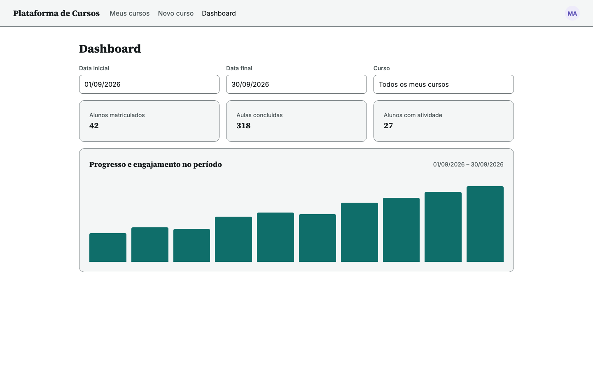

  *Figura 0 – UC007, fluxo básico: dashboard do Instrutor com todos os cursos*
- **Fluxos alternativos:**
  - **A1 – O Instrutor ou o Administrador filtra por um curso específico**
    - A-1.1 O Instrutor seleciona um dos seus cursos no filtro (`courseId`); o Administrador seleciona qualquer curso da plataforma.
    - A-1.2 O sistema restringe a agregação aos dados desse curso.
    - A-1.3 Este caso de uso retorna ao fluxo básico (passo 4).

    

    *Figura 0 – UC007, fluxo alternativo A1: dashboard filtrado pelo curso "Fundamentos de Pesquisa"*
  - **A2 – O Administrador visualiza todos os cursos**
    - A-2.1 O Administrador acessa o dashboard sem restrição de Instrutor.
    - A-2.2 O sistema considera os dados de todos os cursos da plataforma.
    - A-2.3 Este caso de uso retorna ao fluxo básico (passo 2).

    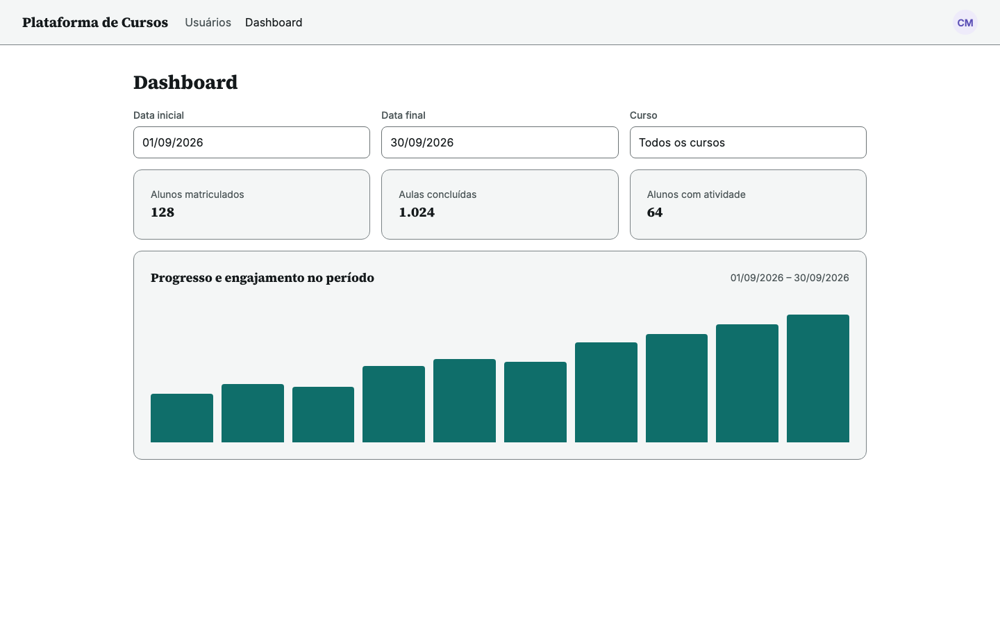

    *Figura 0 – UC007, fluxo alternativo A2: dashboard do Administrador com todos os cursos*
- **Fluxos de exceção:**
  - **E1 – Intervalo de datas inválido**
    - E-1.1 O sistema identifica data final anterior à data inicial (`endDate < startDate`).
    - E-1.2 O sistema exibe mensagem de erro e mantém o último intervalo válido selecionado.
    - E-1.3 Este caso de uso retorna ao fluxo básico (passo 2).

    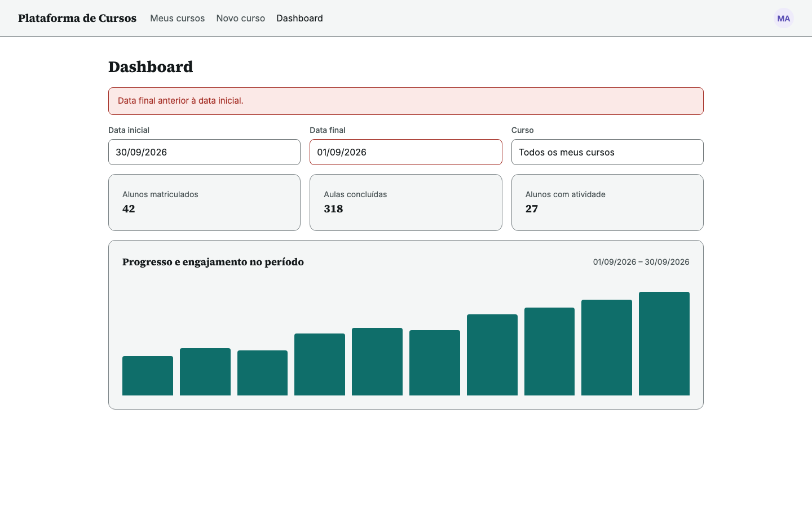

    *Figura 0 – UC007, fluxo de exceção E1: erro "Data final anterior à data inicial"*
  - **E2 – Nenhum aluno com atividade no período selecionado**
    - E-2.1 O sistema identifica ausência de dados de progresso ou engajamento no período.
    - E-2.2 O sistema exibe um aviso claro de que não há dados, sem erro.
    - E-2.3 Este caso de uso é finalizado.

    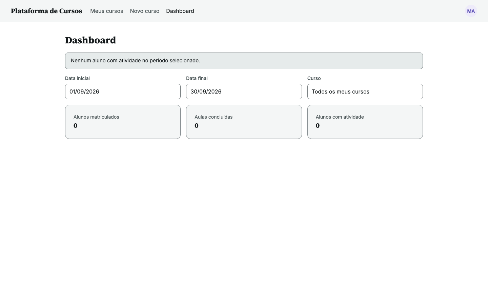

    *Figura 0 – UC007, fluxo de exceção E2: aviso "Nenhum aluno com atividade no período selecionado"*

## 18. UC008 – Gerenciar Usuários

- **Nome do caso de uso:** Gerenciar Usuários
- **Ator(es):** Administrador.
- **Descrição:** o Administrador consulta os usuários da plataforma e gerencia o seu perfil de acesso e o seu status de acesso: bloqueio e desbloqueio (US016, RF012). A exclusão lógica fica no UC018, acionado a partir desta lista.
- **Pré-condições:** o Administrador ter realizado login na plataforma.
- **Pós-condições:** status do usuário atualizado e aplicado imediatamente (revogando ou restaurando o acesso com registro de auditoria), ou perfil de acesso do usuário alterado, válido a partir do próximo login após invalidação de sessão.
- **Regras de negócio:** R-1 o Administrador não pode bloquear nem desbloquear a própria conta (auto-bloqueio e auto-desbloqueio proibidos); R-2 o Administrador não pode alterar o próprio perfil; R-3 os perfis possíveis são Aluno, Instrutor e Administrador; R-4 toda alteração de perfil, bloqueio e desbloqueio é registrada na trilha de auditoria (RNF016); R-5 ao trocar o perfil de um usuário, a API revoga as sessões de refresh (`RefreshSession.revokedAt`) e insere o `jti` do token atual na blocklist do Redis; o próximo acesso exige login e passa a valer o novo perfil (D-TC243, UC016); R-6 a rota de status (`PUT /api/v1/admin/users/{id}/status`) aceita exclusivamente os valores `active` e `blocked`; o envio de `deleted` é rejeitado com HTTP 422 `VALIDATION_FAILED`, pois a exclusão é exclusiva do UC018 (D-TC246).
- **Protótipo(s) de tela:** lista de usuários com busca, filtro por perfil e ações de bloquear, desbloquear, alterar perfil e excluir. As telas de cada fluxo aparecem junto ao fluxo, abaixo.
- **Fluxo básico:**
  1. O Administrador busca um usuário por nome, e-mail ou perfil. (A-1)
  2. O Administrador seleciona a ação: bloquear, desbloquear, alterar perfil ou excluir. (A-3) (A-4) (A-5)
  3. O Administrador confirma a ação. (A-2)
  4. O sistema aplica a mudança de status. (E-1) (E-2)
  5. O sistema revoga o acesso imediatamente (em caso de bloqueio, via blocklist no Redis e revogação de refresh tokens) ou restaura o acesso (em caso de desbloqueio) e grava o evento em `AuditLog`.
  6. Este caso de uso é finalizado.

  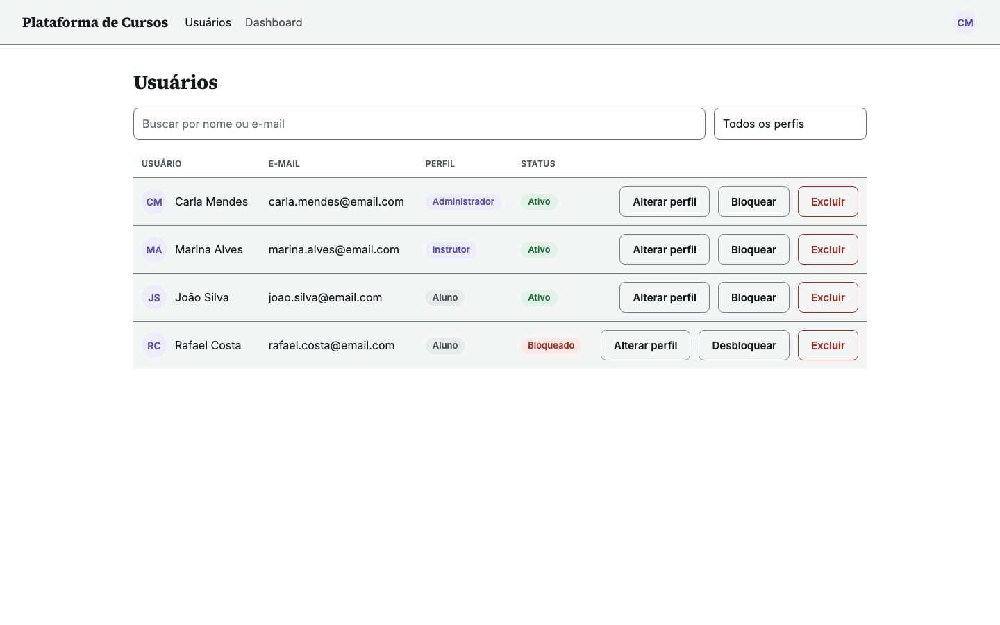

  *Figura 0 – UC008, fluxo básico: lista de usuários com avatar e perfis*

  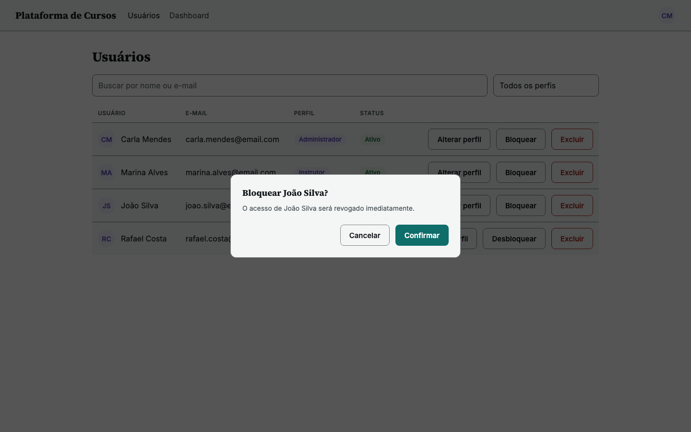

  *Figura 0 – UC008, fluxo básico: modal de confirmação "Bloquear João Silva?"*

  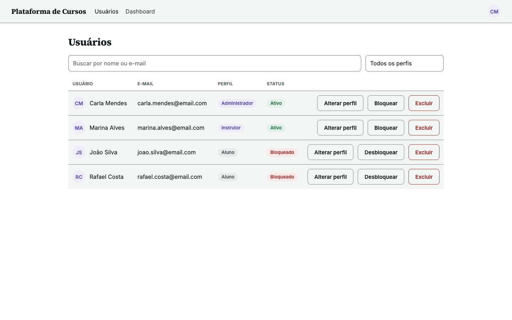

  *Figura 0 – UC008, fluxo básico: lista com João Silva bloqueado*
- **Fluxos alternativos:**
  - **A1 – O Administrador filtra a lista por perfil**
    - A-1.1 O Administrador seleciona um perfil no filtro: Aluno, Instrutor ou Administrador.
    - A-1.2 O sistema exibe somente os usuários daquele perfil.
    - A-1.3 Este caso de uso retorna ao fluxo básico (passo 1).

    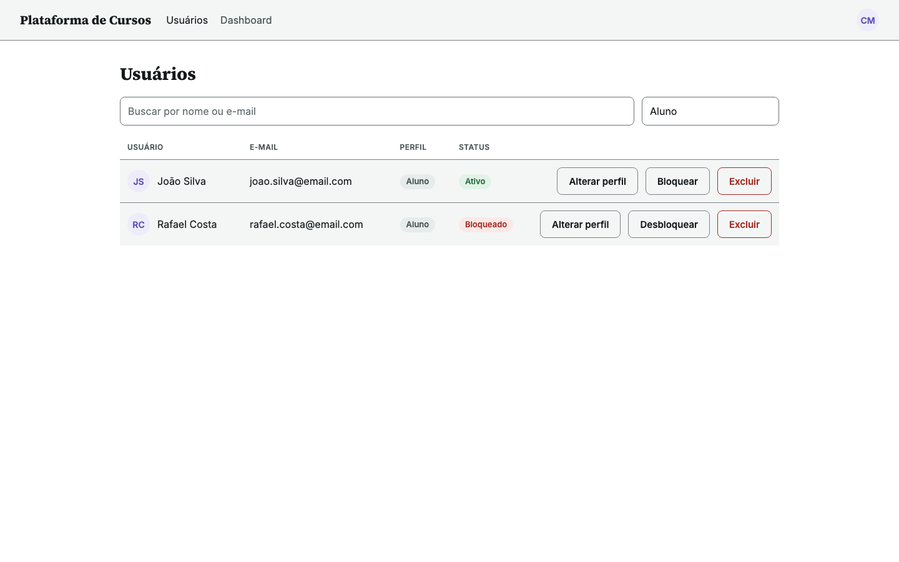

    *Figura 0 – UC008, fluxo alternativo A1: lista filtrada pelo perfil Aluno*
  - **A2 – O Administrador cancela a ação na confirmação**
    - A-2.1 O Administrador aciona “Cancelar” na tela de confirmação.
    - A-2.2 O sistema descarta a ação selecionada, sem alterar o status do usuário.
    - A-2.3 Este caso de uso retorna ao fluxo básico (passo 1).

    

    *Figura 0 – UC008, fluxo alternativo A2: lista de usuários sem alteração após cancelar*
  - **A3 – O Administrador aciona “Excluir”**
    - A-3.1 O Administrador aciona “Excluir” na linha do usuário.
    - A-3.2 O sistema executa o UC018 – Excluir e Anonimizar Usuário.
    - A-3.3 Este caso de uso retorna ao fluxo básico (passo 1).
  - **A4 – O Administrador altera o perfil de um usuário**
    - A-4.1 O Administrador aciona a alteração de perfil de um usuário. (E-3)
    - A-4.2 O Administrador escolhe o novo perfil: Aluno, Instrutor ou Administrador.
    - A-4.3 O sistema pede confirmação da alteração de perfil. (A-2)
    - A-4.4 O Administrador confirma a alteração.
    - A-4.5 O sistema grava o novo perfil, revoga as sessões de refresh ativas, adiciona o `jti` do token atual na blocklist do Redis, registra a alteração na trilha de auditoria (`ROLE_CHANGE`) e atualiza a lista de usuários.
    - A-4.6 Este caso de uso retorna ao fluxo básico (passo 1).

    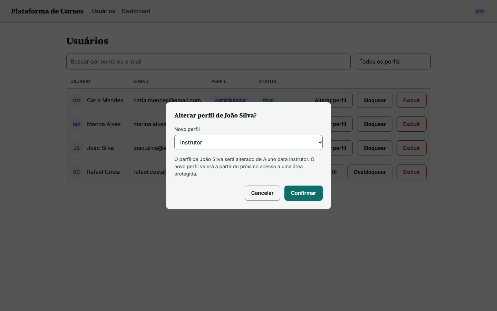

    *Figura 0 – UC008, fluxo alternativo A4: modal de confirmação "Alterar perfil de João Silva?"*
  - **A5 – O Administrador desbloqueia um usuário**
    - A-5.1 O Administrador aciona “Desbloquear” na linha de um usuário com status `blocked`. (E-1)
    - A-5.2 O Administrador confirma o desbloqueio. (A-2)
    - A-5.3 O sistema altera o status do usuário de `blocked` para `active`, grava o registro em `AuditLog` (`USER_UNBLOCK`), restaura o acesso e atualiza a lista de usuários.
    - A-5.4 Este caso de uso retorna ao fluxo básico (passo 1).
- **Fluxos de exceção:**
  - **E1 – Tentativa de bloquear ou desbloquear a própria conta de Administrador**
    - E-1.1 O sistema identifica que o usuário-alvo é a própria conta do Administrador que está logado.
    - E-1.2 O sistema impede a ação e exibe um aviso informando que não é permitido alterar o status da própria conta.
    - E-1.3 Este caso de uso retorna ao fluxo básico (passo 1).

    

    *Figura 0 – UC008, fluxo de exceção E1: erro "Não é possível bloquear a própria conta"*
  - **E2 – Usuário-alvo já removido por outro Administrador**
    - E-2.1 O sistema identifica que o usuário-alvo não existe mais.
    - E-2.2 O sistema informa que o usuário não foi encontrado e atualiza a lista.
    - E-2.3 Este caso de uso retorna ao fluxo básico (passo 1).

    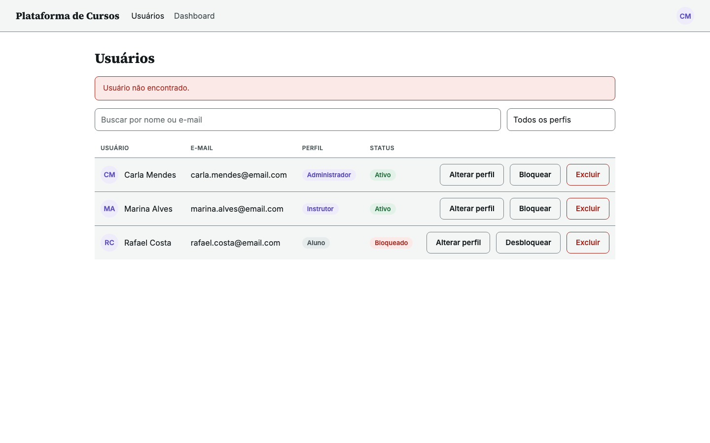

    *Figura 0 – UC008, fluxo de exceção E2: erro "Usuário não encontrado"*
  - **E3 – Tentativa de alterar o próprio perfil**
    - E-3.1 O sistema identifica que o usuário-alvo é a própria conta do Administrador que está logado.
    - E-3.2 O sistema impede a ação e exibe um aviso.
    - E-3.3 Este caso de uso retorna ao fluxo básico (passo 1).

    

    *Figura 0 – UC008, fluxo de exceção E3: aviso "Não é possível alterar o próprio perfil"*

## 19. UC016 – Acessar Área Protegida por Perfil

- **Nome do caso de uso:** Acessar Área Protegida por Perfil
- **Ator(es):** Usuário (Aluno, Instrutor ou Administrador).
- **Descrição:** o Usuário acessa uma área da plataforma e o sistema libera ou nega o acesso conforme a sessão e o perfil do Usuário (US015, RF018). Incluído pelo UC005 (Realizar Login): UC005 «include» UC016.
- **Pré-condições:** o Usuário ter conta na plataforma.
- **Pós-condições:** área exibida se o perfil for compatível; caso contrário, acesso negado e registrado na trilha de auditoria.
- **Regras de negócio:** R-1 os perfis são Aluno, Instrutor e Administrador; R-2 todas as áreas protegidas verificam o token e o perfil do Usuário (RNF001); R-3 toda negação de acesso por perfil é registrada na trilha de auditoria (RNF016); R-4 tokens invalidados colocados na blocklist do Redis ou sessões revogadas impedem o acesso a áreas protegidas (D7).
- **Protótipo(s) de tela:** sem tela própria; usa a tela de login (UC005), a página inicial de cada perfil e uma mensagem de acesso negado. As telas de cada fluxo aparecem junto ao fluxo, abaixo.
- **Fluxo básico:**
  1. O Usuário acessa uma área da plataforma. (A-1)
  2. O sistema verifica o token JWT (`JwtGuard.parseToken(token)`), checando se a sessão está ativa e se o identificador `jti` não consta na blocklist do Redis. (E-1)
  3. O sistema verifica se o perfil do Usuário é o exigido pela área via `JwtGuard.authorize(user, role)`. (E-2)
  4. O sistema exibe a área solicitada.
  5. Este caso de uso é finalizado.

- **Fluxos alternativos:**
  - **A1 – O Usuário chega após o login**
    - A-1.1 O Usuário conclui o login (UC005).
    - A-1.2 O sistema direciona o Usuário à página inicial do seu perfil.
    - A-1.3 Este caso de uso retorna ao fluxo básico (passo 4).

    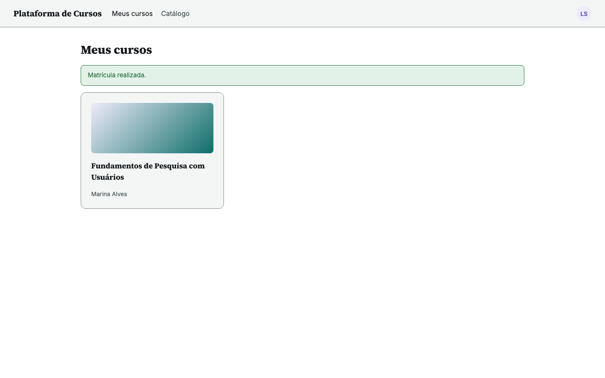

    *Figura 0 – UC016, fluxo alternativo A1: página inicial do Aluno*

    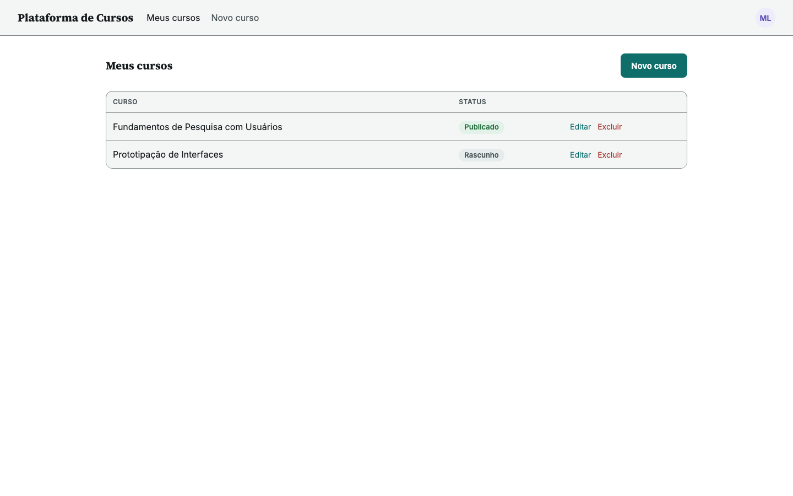

    *Figura 0 – UC016, fluxo alternativo A1: página inicial do Instrutor*

    

    *Figura 0 – UC016, fluxo alternativo A1: página inicial do Administrador*

- **Fluxos de exceção:**
  - **E1 – Sessão ausente, expirada ou token revogado**
    - E-1.1 O sistema identifica que não há sessão ativa, que o token JWT expirou ou que seu identificador `jti` consta na blocklist do Redis.
    - E-1.2 O sistema direciona o Usuário ao login (UC005), sem exibir os dados da área solicitada.
    - E-1.3 Este caso de uso é finalizado.

    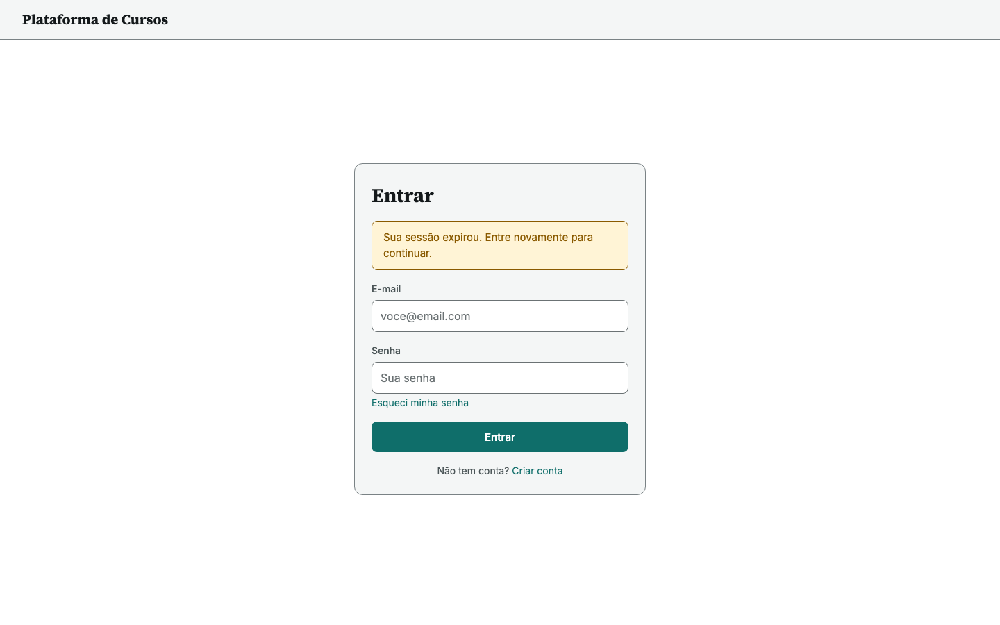

    *Figura 0 – UC016, fluxo de exceção E1: login com aviso de sessão expirada*
  - **E2 – Perfil sem permissão**
    - E-2.1 O sistema identifica que o perfil do Usuário não é o exigido pela área.
    - E-2.2 O sistema nega o acesso, registra a tentativa na trilha de auditoria via `AuditService.logAccessDenied` (`ACCESS_DENIED`, RNF016) e direciona o Usuário à sua área inicial.
    - E-2.3 Este caso de uso é finalizado.

    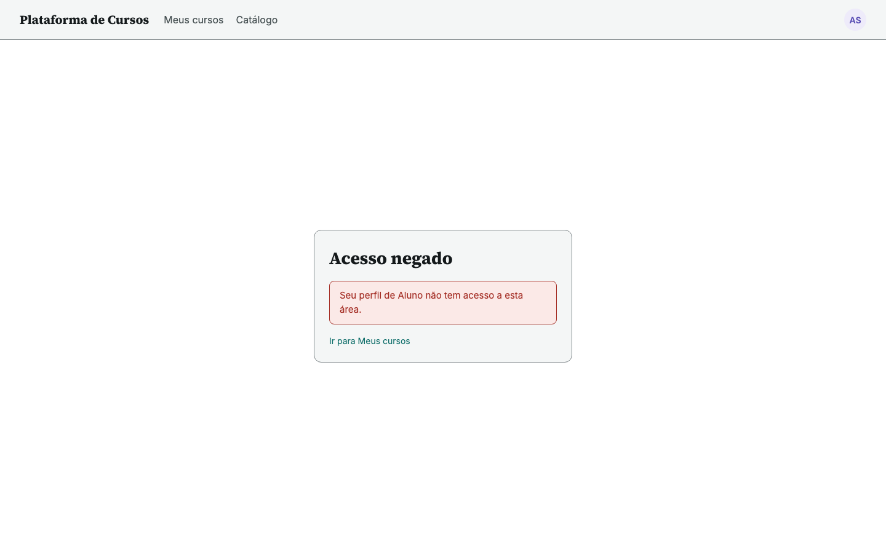

    *Figura 0 – UC016, fluxo de exceção E2: tela "Acesso negado" com aviso de perfil sem acesso*

## 20. UC018 – Excluir e Anonimizar Usuário

- **Nome do caso de uso:** Excluir e Anonimizar Usuário
- **Ator(es):** Administrador.
- **Descrição:** o Administrador exclui a conta de um usuário através de exclusão lógica (`status = deleted`, `deleted_at = NOW()`), revoga acessos imediatos via blocklist no Redis e revogação das sessões de refresh; o histórico de matrícula, pagamento, notas de quiz e progresso de aula permanece íntegro e associado ao mesmo `userId` (D-TC265); o Administrador pode reativar contas excluídas antes da anonimização; a anonimização de dados pessoais (LGPD) é um passo posterior irreversível (US016, RF012, ADR-0014, D-TC268). Estende o UC008 – Gerenciar Usuários, a partir da ação “Excluir”.
- **Pré-condições:** o Administrador ter realizado login e estar na lista de usuários (UC008).
- **Pós-condições:** conta marcada com exclusão lógica (`status = deleted`, `deleted_at`), acessos revogados imediatamente, histórico acadêmico preservado e ação registrada na trilha de auditoria.
- **Regras de negócio:** R-1 a exclusão de usuário é lógica: define `status = deleted` e preenche `deleted_at`; o histórico acadêmico (`QuizAttempt`, `LessonProgress`, matrículas e pagamentos) permanece íntegro e associado ao mesmo `userId` (D-TC265, ADR-0014); R-2 o Administrador não pode excluir a própria conta; R-3 a confirmação da exclusão é solicitada na interface (A1); a exclusão lógica revoga imediatamente os acessos do usuário via inclusão do token atual na blocklist do Redis e revogação das sessões de refresh (`RefreshSession`). O Administrador pode reativar a conta excluída (A2). A anonimização é um passo separado e irreversível, executado a pedido do titular ou automaticamente após 30 dias de exclusão sem reativação; conta já anonimizada não pode ser reativada, sendo qualquer tentativa rejeitada com HTTP 422 `VALIDATION_FAILED` (D-TC268); R-4 toda exclusão e reativação é registrada na trilha de auditoria (`USER_DELETE`, `USER_RESTORE`), sem armazenar dados pessoais no log (RNF016); R-5 ao excluir um usuário com perfil Instrutor que possui cursos publicados, o Administrador deve escolher entre despublicar os cursos (`status = archived`), preservando o acesso dos alunos matriculados, ou aplicar exclusão lógica em cascata nos cursos, módulos, aulas e quizzes com `deleted_at` (D-TC266).
- **Protótipo(s) de tela:** modal de confirmação “Excluir usuário?” sobre a lista de usuários. As telas de cada fluxo aparecem junto ao fluxo, abaixo.
- **Fluxo básico:**
  1. O sistema exibe a confirmação de exclusão com o nome do usuário. (A-1)
  2. O Administrador aciona “Excluir”.
  3. O sistema valida o usuário-alvo. (E-1) (E-2)
  4. Se o usuário-alvo for Instrutor com cursos publicados, o sistema solicita a escolha de tratamento dos cursos (A-4).
  5. O sistema aplica a exclusão lógica (`status = deleted`, `deleted_at = NOW()`), revoga imediatamente os tokens ativos na blocklist do Redis, revoga as sessões de refresh e registra `USER_DELETE` na trilha de auditoria (sem dados pessoais no log).
  6. O sistema remove o usuário da listagem de usuários ativos e confirma a exclusão.
  7. Este caso de uso é finalizado.

  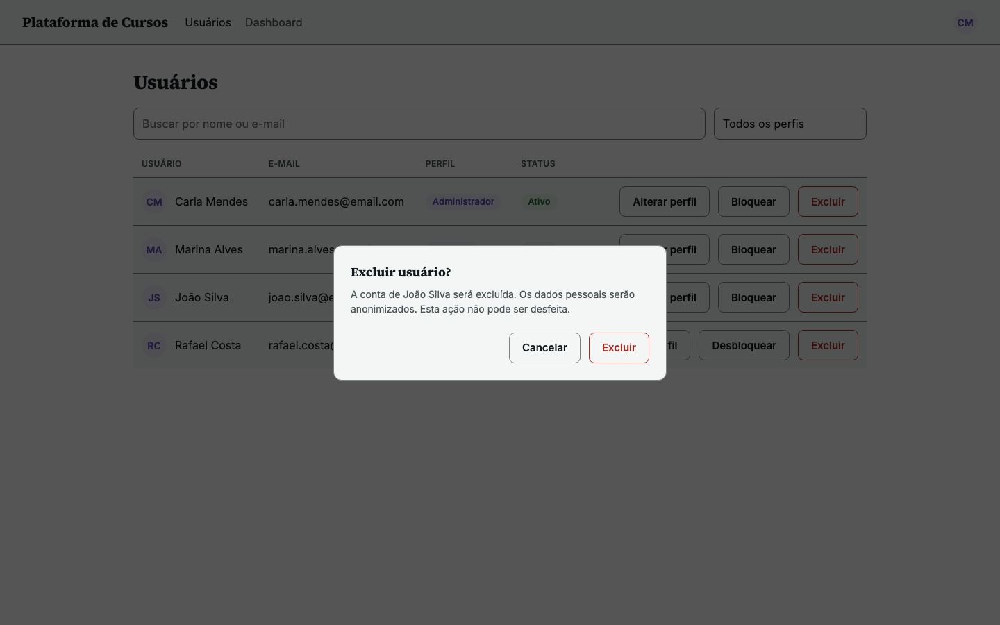

  *Figura 0 – UC018, fluxo básico: modal de confirmação com aviso de anonimização irreversível*

  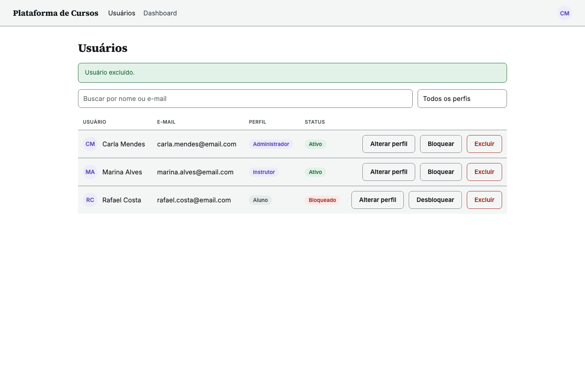

  *Figura 0 – UC018, fluxo básico: lista sem o usuário excluído e aviso "Usuário excluído"*
- **Fluxos alternativos:**
  - **A1 – O Administrador cancela a exclusão**
    - A-1.1 O Administrador aciona “Cancelar” na confirmação.
    - A-1.2 O sistema fecha a confirmação sem alterar o usuário.
    - A-1.3 Este caso de uso é finalizado.

    

    *Figura 0 – UC018, fluxo alternativo A1: lista de usuários sem alteração após cancelar*
  - **A2 – O Administrador reativa um usuário excluído**
    - A-2.1 O Administrador seleciona um usuário com status `deleted` e `anonymized_at` nulo na listagem e solicita sua reativação.
    - A-2.2 O Administrador confirma a reativação.
    - A-2.3 O sistema valida se a conta não foi anonimizada (E-3).
    - A-2.4 O sistema restaura o usuário (`status = active`, `deleted_at = null`), registra `USER_RESTORE` na trilha de auditoria e restabelece a possibilidade de login.
    - A-2.5 Este caso de uso é finalizado.
  - **A3 – Execução da anonimização irreversível (LGPD)**
    - A-3.1 A pedido do titular ou após 30 dias de exclusão lógica sem reativação, a rotina de anonimização é executada.
    - A-3.2 O sistema limpa ou substitui por dados sintéticos os campos identificáveis (nome, e-mail sintético, CPF, telefone, foto) e preenche `anonymized_at = NOW()`, preservando o `userId` para integridade referencial do histórico acadêmico, e registra a ação `USER_ANONYMIZE` em `audit_logs` (RNF016).
    - A-3.3 Este caso de uso é finalizado.
  - **A4 – Exclusão de Instrutor com cursos publicados**
    - A-4.1 Ao selecionar a exclusão de um Instrutor com cursos publicados, o sistema solicita a escolha entre despublicar os cursos (`archived`) ou aplicar exclusão lógica em cascata.
    - A-4.2 O Administrador escolhe a opção desejada e confirma.
    - A-4.3 O sistema aplica a opção aos cursos, procede com a exclusão lógica do Instrutor, revoga acessos e registra em auditoria.
    - A-4.4 Este caso de uso retorna ao fluxo básico (passo 5).
- **Fluxos de exceção:**
  - **E1 – Tentativa de excluir a própria conta**
    - E-1.1 O sistema identifica que o usuário-alvo é a própria conta do Administrador que está logado.
    - E-1.2 O sistema impede a exclusão e exibe um aviso.
    - E-1.3 Este caso de uso é finalizado.

    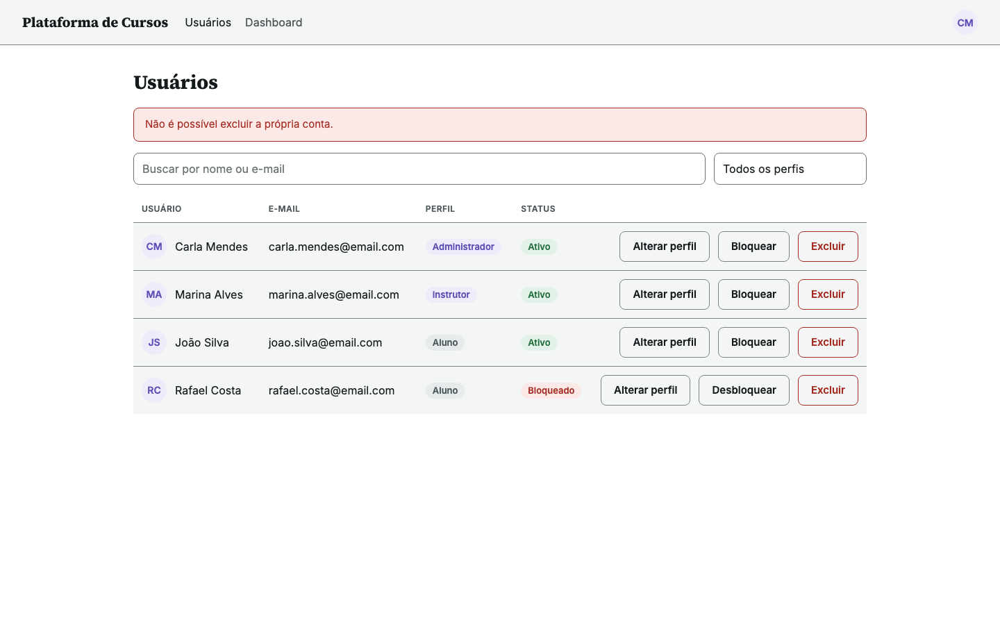

    *Figura 0 – UC018, fluxo de exceção E1: erro "Não é possível excluir a própria conta"*
  - **E2 – Usuário-alvo já removido por outro Administrador**
    - E-2.1 O sistema identifica que o usuário-alvo não existe mais.
    - E-2.2 O sistema informa que o usuário não foi encontrado e atualiza a lista.
    - E-2.3 Este caso de uso é finalizado.

    

    *Figura 0 – UC018, fluxo de exceção E2: erro "Usuário não encontrado"*
  - **E3 – Tentativa de reativar conta já anonimizada**
    - E-3.1 O Administrador tenta reativar uma conta cujo `anonymized_at` já foi preenchido.
    - E-3.2 O sistema impede a ação e responde HTTP 422 `VALIDATION_FAILED` com erro em `fields.user`, informando que a anonimização é irreversível pela LGPD.
    - E-3.3 Este caso de uso é finalizado.
