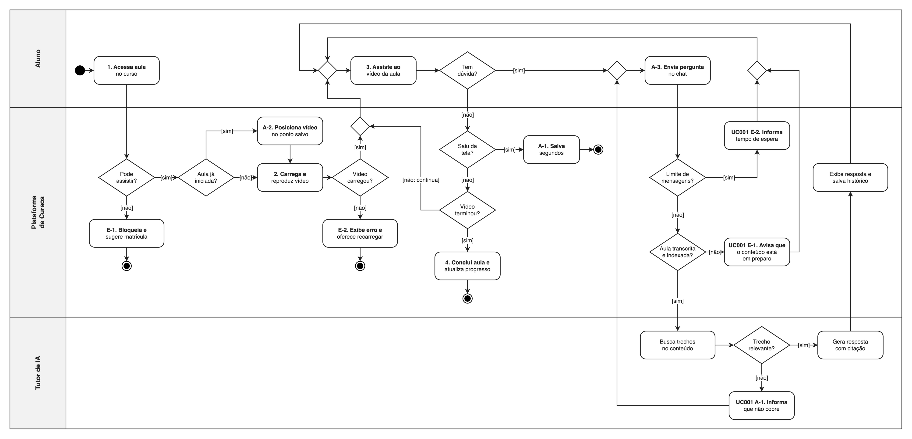

# 11 DIAGRAMA DE ATIVIDADES

Fonte: `especificacao/diagramas/11-atividades.drawio` (draw.io, [ADR-0012](../docs/adr/0012-diagramas-do-ra1-em-drawio.md)).

Diagrama de atividades do UC009 (Assistir aula), com o UC001 (Conversar com Tutor de IA) iniciado pelo fluxo alternativo A-3. Os números nas atividades indicam o passo do fluxo básico (passos 1 a 4), e A-x e E-x indicam o fluxo alternativo ou de exceção. O fluxo é particionado em raias horizontais por ator responsável (Aluno, Plataforma de Cursos e Tutor de IA), com o fluxo principal orientado da esquerda para a direita, arestas de retorno para os passos que se repetem (voltar a assistir ao vídeo e reformular a pergunta) e arestas ortogonais sem sobreposição de rótulos. O diagrama verifica se a aula já foi transcrita e indexada antes da busca (E-1 do UC001). Para manter a leitura, o diagrama não representa o fluxo A-4 do UC009 (Visitante em aula prévia) nem os fluxos A-2 e E-3 do UC001; eles estão descritos no item 10.

*Figura 0 – Diagrama de Atividades do UC009 (Assistir Aula)*
