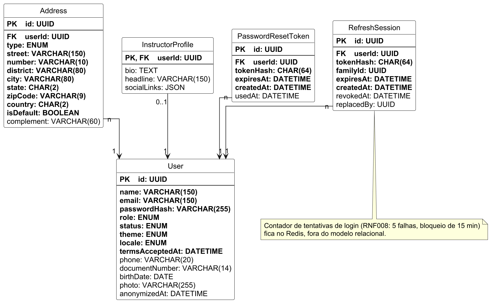

## 1. Área A – Acesso e conta

Tabelas que sustentam o cadastro, o login, a recuperação e a alteração de senha e a edição do perfil (UC005, UC011, UC012, UC013 e UC017; RF001, RF013, RF017 e RF019). `User`, `Address` e `InstructorProfile` vêm do plano técnico; `PasswordResetToken` e `RefreshSession` são novas: a primeira guarda o link de redefinição de uso único com validade de 30 minutos (RNF017) e a segunda, o refresh token rotacionado do «manter conectado» (ADR-0008). O contador de tentativas de login (RNF008) fica no Redis, fora do modelo relacional.

*Figura 0 – Modelo lógico relacional da Área A (Acesso e conta)*

Decisões do modelo:

- `InstructorProfile` existe só para o Usuário com perfil de Instrutor (UC012 A1 e UC013 A1): a linha nasce vazia no cadastro como Instrutor e usa a própria chave do `User` (PK e FK), o que faz do Instrutor e do seu perfil uma relação 1 para 1. Como Aluno e Administrador não têm linha nessa tabela, do lado do `User` a relação é `0..1`.
- `User.locale` guarda o idioma da interface e das mensagens (pt-BR ou en, RNF013); o padrão é pt-BR. Os textos ficam em arquivos de tradução e a API devolve o `code` do erro, que é estável, com a mensagem no idioma do usuário.
- `User.termsAcceptedAt` registra o aceite dos termos e da política de privacidade no cadastro (RNF020, UC012 R-4).
- Os tokens de redefinição e de refresh são guardados só como hash (`tokenHash`); o valor original nunca é persistido.

| ATRIBUTO | CLASSE | DOMÍNIO | TAMANHO | DESCRIÇÃO |
|---|---|---|---|---|
| **Tabela: User** | | | | |
| id | Determinante | UUID | - | Identificador único do usuário. |
| name | Simples | Texto | 150 | Nome completo. |
| email | Simples | Texto | 150 | E-mail, único; usado no login. |
| passwordHash | Simples | Texto | 255 | Hash da senha (RNF007). |
| role | Simples | Texto | - | Perfil: student, instructor ou admin. |
| status | Simples | Texto | - | Ativo, bloqueado ou excluído. |
| theme | Simples | Texto | - | Tema da interface: claro, escuro ou sistema (UC013 R-7). |
| locale | Simples | Texto | 5 | Idioma da interface e das mensagens: pt-BR (padrão) ou en (RNF013). |
| termsAcceptedAt | Simples | Data e hora | - | Quando o usuário aceitou os termos no cadastro. |
| phone | Simples | Texto | 20 | Telefone com DDD (opcional). |
| documentNumber | Simples | Texto | 14 | CPF (opcional). |
| birthDate | Simples | Data | - | Data de nascimento (opcional). |
| photo | Simples | Texto | 255 | Chave da foto de perfil no storage (opcional). |
| anonymizedAt | Simples | Data e hora | - | Anonimização na exclusão da conta; nulo enquanto não anonimizada. |
| **Tabela: Address** | | | | |
| id | Determinante | UUID | - | Identificador único do endereço. |
| userId | Simples | UUID | - | FK para `User.id`, dono do endereço. |
| type | Simples | Texto | - | Tipo: cobrança ou entrega. |
| street | Simples | Texto | 150 | Logradouro. |
| number | Simples | Texto | 10 | Número. |
| district | Simples | Texto | 80 | Bairro. |
| city | Simples | Texto | 80 | Cidade. |
| state | Simples | Texto | 2 | UF. |
| zipCode | Simples | Texto | 9 | CEP. |
| country | Simples | Texto | 2 | País (ISO 3166-1 alpha-2). |
| isDefault | Simples | Booleano | - | Endereço padrão do usuário. |
| complement | Simples | Texto | 60 | Complemento (opcional). |
| **Tabela: InstructorProfile** | | | | |
| userId | Determinante | UUID | - | PK e FK para `User.id`, do Instrutor. |
| bio | Simples | Texto | - | Minibiografia (UC013 A1). |
| headline | Simples | Texto | 150 | Chamada de apresentação. |
| socialLinks | Composto | JSON | - | Links de redes sociais. |
| **Tabela: PasswordResetToken** | | | | |
| id | Determinante | UUID | - | Identificador único do pedido de redefinição. |
| userId | Simples | UUID | - | FK para `User.id`. |
| tokenHash | Simples | Texto | 64 | Hash do token enviado por e-mail. |
| expiresAt | Simples | Data e hora | - | Validade: 30 minutos após o pedido (RNF017). |
| createdAt | Simples | Data e hora | - | Quando o link foi gerado; um novo link invalida o anterior (UC011 A1). |
| usedAt | Simples | Data e hora | - | Quando o token foi usado (uso único); nulo enquanto válido. |
| **Tabela: RefreshSession** | | | | |
| id | Determinante | UUID | - | Identificador único do refresh token. |
| userId | Simples | UUID | - | FK para `User.id`. |
| tokenHash | Simples | Texto | 64 | Hash do refresh token opaco. |
| familyId | Simples | UUID | - | Agrupa os tokens de uma sessão; reuso de token consumido revoga a família. |
| expiresAt | Simples | Data e hora | - | Validade de 30 dias. |
| createdAt | Simples | Data e hora | - | Emissão do token. |
| revokedAt | Simples | Data e hora | - | Revogação (rotação, logout, bloqueio ou exclusão); nulo enquanto ativo. |
| replacedBy | Simples | UUID | - | Token que substituiu este na rotação. |
