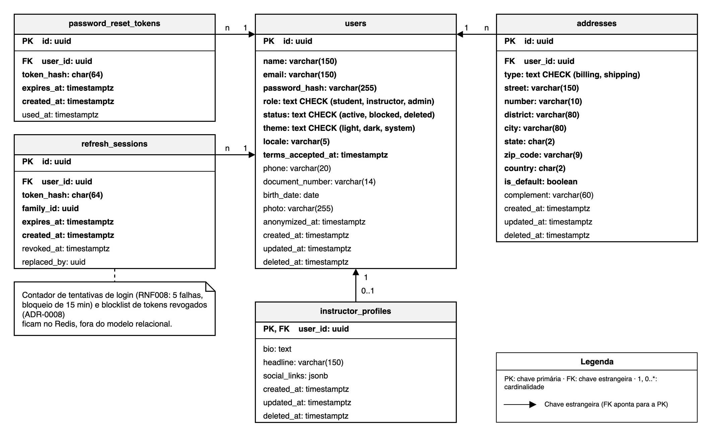

## 1. Área A – Acesso e conta

Tabelas que sustentam o cadastro, o login, a recuperação e a alteração de senha e a edição do perfil (UC005, UC011, UC012, UC013 e UC017; RF001, RF013, RF017 e RF019). `users`, `addresses` e `instructor_profiles` vêm do plano técnico; `password_reset_tokens` e `refresh_sessions` sustentam o link de redefinição de uso único com validade de 30 minutos (RNF017) e o refresh token rotacionado do «manter conectado» (ADR-0008). O contador de tentativas de login (RNF008) e a blocklist de `jti` para revogação imediata (ADR-0008) residem no Redis, fora do modelo relacional.

*Figura 0 – Modelo lógico relacional da Área A (Acesso e conta)*

Decisões do modelo:

- **Convenção por camada e tipos PostgreSQL (ADR-0015, ADR-0017):** Tabelas e colunas persistem estritamente em inglês e snake_case (`user_id`, `password_hash`, `terms_accepted_at`, `deleted_at`). Os tipos de dados adotam os padrões nativos do PostgreSQL 16: `uuid` para identificadores primários e estrangeiros, `timestamptz` para carimbos de data/hora, `jsonb` para estruturas semiestruturadas (`social_links`) e restrições `CHECK` para campos enumerados (`role`, `status`, `theme`, `type`).
- **InstructorProfile e promoção a Instrutor (TC236):** `instructor_profiles` existe apenas para o Usuário com perfil de Instrutor (`role = 'instructor'`). A linha nasce vazia tanto no momento do cadastro direto como Instrutor (UC012 A1) quanto no ato da promoção de perfil realizada pelo Administrador (UC008 A4, TC236), utilizando a própria chave primária do usuário (`users.id`) como chave primária e estrangeira (`PK, FK`), caracterizando relacionamento 1 para 1 do lado do Instrutor e `0..1` do lado do `users`.
- **Unicidade de e-mail e LGPD (ADR-0014, ADR-0017):** A coluna `email` possui índice único parcial declarativo no PostgreSQL (`UNIQUE (email) WHERE anonymized_at IS NULL`). Isso garante unicidade para todas as contas ativas ou excluídas logicamente, viabilizando que a rotina de anonimização (passo irreversível pós-30 dias ou sob demanda do titular) substitua o e-mail original por identificador sintético descaracterizado preenchendo `anonymized_at`, liberando o e-mail para eventuais novos cadastros legítimos sem violar a restrição.
- **Exclusão lógica transversal (ADR-0014):** Toda tabela de negócio da Área A (`users`, `addresses` e `instructor_profiles`) implementa a coluna `deleted_at: timestamptz` (trait `SoftDeletes` do Eloquent). Nenhuma operação da aplicação realiza exclusão física (`DELETE`) no banco transacional, garantindo integridade referencial com matrículas, histórico acadêmico e logs de auditoria, além de viabilizar a reativação de contas excluídas pelo Administrador antes da anonimização (UC018).
- **Idioma e internacionalização (RNF013):** `users.locale` armazena o idioma preferencial da interface e das mensagens (`pt-BR` padrão; `en` e `es` são suportados sem necessidade de migração de schema). A coluna é tipada como `varchar(5)` com validação contra lista de idiomas permitidos; os textos da aplicação residem em arquivos de tradução e a API devolve código de erro estável (`code`).
- **Termos e privacidade (RNF020, UC012 R-4):** `users.terms_accepted_at` registra o aceite obrigatório dos termos de uso e da política de privacidade no cadastro.
- **Segurança de credenciais e tokens (RNF007, RNF017, ADR-0008):** Senhas nunca são persistidas em texto claro (somente `password_hash`). Tokens de redefinição de senha e de refresh session são gravados exclusivamente sob hash SHA-256 (`token_hash`), impedindo vazamento de credenciais mesmo em caso de dump do banco de dados.

| ATRIBUTO | CLASSE | DOMÍNIO | TAM. | DESCRIÇÃO |
|---|---|---|---|---|
| **Tabela: users** | | | | Entidade central de contas de usuários (alunos, instrutores e administradores). |
| id | Determinante | uuid | - | Identificador único universal do usuário (PK). |
| name | Simples | varchar | 150 | Nome completo do usuário. |
| email | Simples | varchar | 150 | E-mail para login; índice único parcial (`UNIQUE WHERE anonymized_at IS NULL`). |
| password_hash | Simples | varchar | 255 | Hash criptográfico seguro da senha (RNF007). |
| role | Simples | text CHECK | 20 | Perfil de acesso: `student`, `instructor` ou `admin`. |
| status | Simples | text CHECK | 20 | Situação cadastral: `active` (ativo), `blocked` (bloqueado) ou `deleted` (excluído). |
| theme | Simples | text CHECK | 20 | Tema da interface: `light` (claro), `dark` (escuro) ou `system` (sistema) (UC013 R-7). |
| locale | Simples | varchar | 5 | Idioma da interface: `pt-BR` (padrão), validado contra idiomas ativos (RNF013). |
| terms_accepted_at | Simples | timestamptz | - | Timestamp de aceite dos termos de uso e privacidade no cadastro (RNF020). |
| phone | Simples | varchar | 20 | Telefone de contato com DDD (opcional). |
| document_number | Simples | varchar | 14 | CPF formatado do titular (opcional). |
| birth_date | Simples | date | - | Data de nascimento do usuário (opcional). |
| photo | Simples | varchar | 255 | Chave da foto de perfil no Cloudflare R2 (opcional). |
| anonymized_at | Simples | timestamptz | - | Timestamp da anonimização LGPD; nulo enquanto a conta não for anonimizada (ADR-0014). |
| created_at | Simples | timestamptz | - | Timestamp de criação do registro. |
| updated_at | Simples | timestamptz | - | Timestamp da última atualização dos dados cadastrais. |
| deleted_at | Simples | timestamptz | - | Exclusão lógica (soft delete); nulo para contas ativas (ADR-0014). |
| **Tabela: addresses** | | | | Endereços cadastrados pelo usuário. |
| id | Determinante | uuid | - | Identificador único do endereço (PK). |
| user_id | Simples | uuid | - | Chave estrangeira para `users.id`, proprietário do endereço. |
| type | Simples | text CHECK | 20 | Tipo do endereço: `billing` (cobrança) ou `shipping` (entrega). |
| street | Simples | varchar | 150 | Logradouro. |
| number | Simples | varchar | 10 | Número predial. |
| complement | Simples | varchar | 60 | Complemento de endereço (opcional). |
| district | Simples | varchar | 80 | Bairro. |
| city | Simples | varchar | 80 | Município. |
| state | Simples | char | 2 | Unidade Federativa (UF). |
| zip_code | Simples | varchar | 9 | Código de Endereçamento Postal (CEP formatado). |
| country | Simples | char | 2 | Código do país de 2 dígitos conforme a norma ISO 3166-1 alpha-2 (ISO, 2020), padrão 'BR'. |
| is_default | Simples | boolean | - | Indica se o endereço é o padrão para o usuário. |
| created_at | Simples | timestamptz | - | Timestamp de criação do registro. |
| updated_at | Simples | timestamptz | - | Timestamp da última atualização. |
| deleted_at | Simples | timestamptz | - | Exclusão lógica (soft delete); nulo para endereços ativos (ADR-0014). |
| **Tabela: instructor_profiles** | | | | Dados complementares públicos exclusivos de instrutores (UC013 A1). |
| user_id | Determinante | uuid | - | Chave primária e estrangeira vinculada a `users.id` (1:0..1). |
| bio | Simples | text | - | Minibiografia profissional de apresentação (opcional). |
| headline | Simples | varchar | 150 | Título / chamada de apresentação pública (opcional). |
| social_links | Composto | jsonb | - | Estrutura semiestruturada de links sociais (Twitter, LinkedIn, GitHub). |
| created_at | Simples | timestamptz | - | Timestamp de criação do perfil. |
| updated_at | Simples | timestamptz | - | Timestamp da última modificação. |
| deleted_at | Simples | timestamptz | - | Exclusão lógica (soft delete); nulo para perfis ativos (ADR-0014). |
| **Tabela: password_reset_tokens** | | | | Tokens temporários para redefinição de senha (UC011). |
| id | Determinante | uuid | - | Identificador único do pedido de redefinição (PK). |
| user_id | Simples | uuid | - | Chave estrangeira para `users.id`. |
| token_hash | Simples | char | 64 | Hash SHA-256 do token de redefinição de uso único (RNF017). |
| expires_at | Simples | timestamptz | - | Validade limite de 30 minutos a partir da emissão (RNF017). |
| created_at | Simples | timestamptz | - | Timestamp de geração; novos pedidos invalidam anteriores (UC011 A1). |
| used_at | Simples | timestamptz | - | Timestamp em que o token foi consumido; nulo enquanto válido. |
| **Tabela: refresh_sessions** | | | | Sessões de longa duração do recurso «manter conectado» (ADR-0008). |
| id | Determinante | uuid | - | Identificador único da sessão de refresh (PK). |
| user_id | Simples | uuid | - | Chave estrangeira para `users.id`. |
| token_hash | Simples | char | 64 | Hash SHA-256 do refresh token opaco (ADR-0008). |
| family_id | Simples | uuid | - | Identificador da família da sessão para detecção de reuso (ADR-0008). |
| expires_at | Simples | timestamptz | - | Data e hora de expiração da sessão (30 dias). |
| created_at | Simples | timestamptz | - | Timestamp de emissão do token. |
| revoked_at | Simples | timestamptz | - | Data e hora de revogação explícita; nulo enquanto ativa. |
| replaced_by | Simples | uuid | - | Identificador do token sucessor gerado na rotação. |
