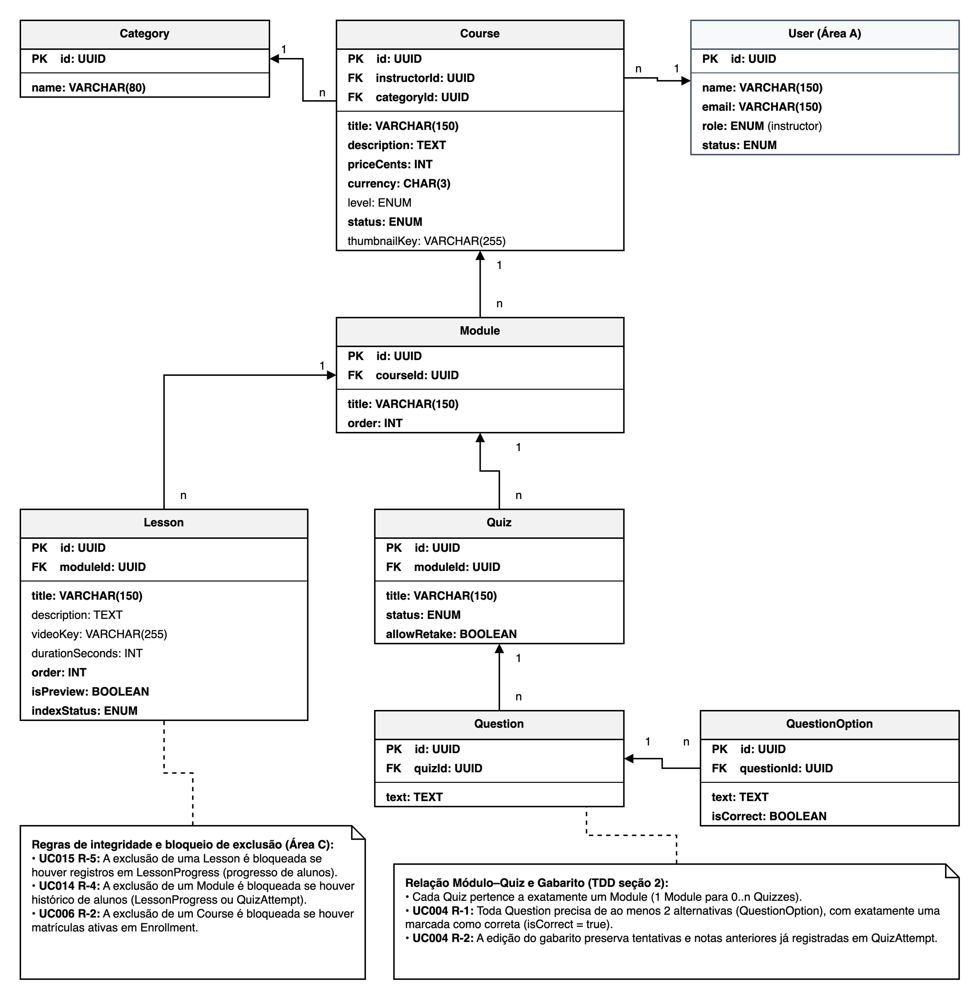

## 2. Área B – Autoria do instrutor

Tabelas que sustentam a criação e gestão de cursos, módulos, aulas e quizzes com gabarito pelo Instrutor (UC004, UC006, UC014 e UC015; RF002, RF003, RF004 e RF007; US004, US005, US006 e US010). As entidades `Category`, `Course`, `Module`, `Lesson`, `Quiz`, `Question` e `QuestionOption` derivam diretamente do plano técnico e do modelo do TDD. A relação entre `Course` e `User` (Área A) expressa a autoria via `instructorId`. As regras de integridade com as tabelas de progresso e tentativas de alunos da Área C (`LessonProgress`, `QuizAttempt` e `Enrollment`) garantem que cursos com matrículas ativas (UC006 R-2), módulos com histórico de aulas assistidas ou respostas a quizzes (UC014 R-4) e aulas com registros de progresso (UC015 R-5) tenham sua exclusão estritamente bloqueada, preservando o histórico acadêmico.

*Figura 0 – Modelo lógico relacional da Área B (Autoria do instrutor)*

Decisões do modelo:

- **Relação Módulo–Quiz resolvida (TDD seção 2):** cada `Quiz` pertence a exatamente um `Module` (`Quiz.moduleId` obrigatório), e cada `Module` pode conter zero ou mais quizzes (`0..n`). Isso resolve a hierarquia pedagógica do curso, permitindo avaliações modulares pontuais ou finais de módulo.
- **Normalização até a 3ª Forma Normal (3FN):** todas as tabelas da Área B encontram-se rigorosamente na 3FN. As chaves primárias são UUIDs únicos, todos os atributos não-chave dependem exclusivamente da chave primária inteira (sem dependências parciais) e não há dependências transitivas entre atributos não-chave.
- **Bloqueio de exclusão e integridade com a Área C:**
  - A exclusão de um `Course` é bloqueada se houver alunos com matrículas ativas em `Enrollment` (UC006 R-2 e E2, retornando HTTP `409 Conflict`), permitindo apenas a alteração de status para despublicado / rascunho (`draft`).
  - A exclusão de um `Module` é bloqueada se houver histórico de alunos registrado em `LessonProgress` (para qualquer aula do módulo) ou em `QuizAttempt` (para qualquer quiz do módulo) (UC014 R-4 e E4, retornando HTTP `409 Conflict`). Caso não haja histórico, a exclusão em cascata remove as aulas e os quizzes do módulo.
  - A exclusão de uma `Lesson` é bloqueada se houver qualquer registro em `LessonProgress` (UC015 R-5 e E4, retornando HTTP `409 Conflict`). Caso contrário, a exclusão remove o registro da aula e aciona a exclusão do vídeo no Cloudflare R2.
- **Gestão de vídeo e indexação vetorial (UC015, RNF002, RNF004, RNF018):** a tabela `Lesson` armazena apenas a chave de referência do vídeo (`videoKey: VARCHAR(255)`) no Cloudflare R2, a duração em segundos (`durationSeconds: INT`) e o status da indexação vetorial e transcrição (`indexStatus: VARCHAR(20)`), sem trafegar binários pela API principal. O upload é feito diretamente ao storage via URLs pré-assinadas com validade estrita de 15 minutos (RNF002). O processamento assíncrono é acionado apenas quando há envio de novo arquivo de vídeo (UC015 R-4).
- **Estrutura de Quiz, Gabarito e Retentativas (UC004 R-1, R-2):** cada `Quiz` possui status de publicação (`status: VARCHAR(20)`, com valores `draft` ou `published`) e controle de novas tentativas (`allowRetake: BOOLEAN`, padrão `true`). Cada `Question` possui enunciado próprio e associa-se a pelo menos duas alternativas em `QuestionOption`, das quais exatamente uma possui `isCorrect = true` (R-1). A edição de enunciados ou do gabarito preserva o histórico de respostas e as notas já atribuídas em `QuizAttempt` (R-2).
- **Mapeamento de Enums e Internacionalização:** conforme a arquitetura do sistema, todos os valores enumerados são persistidos no banco de dados em língua inglesa (ex.: `status` em `Course` e `Quiz` como `draft` e `published`; `level` em `Course` como `beginner`, `intermediate` e `advanced`; `indexStatus` em `Lesson` como `pending`, `indexed` e `failed`). As camadas de apresentação (frontend) e de contrato da API realizam o mapeamento bidirecional desses valores para os respectivos rótulos em português exibidos ao usuário (ex.: `draft` → 'Rascunho', `published` → 'Publicado'; `pending` → 'Pendente', `indexed` → 'Indexado', `failed` → 'Falhou'; `beginner` → 'Iniciante', `intermediate` → 'Intermediário', `advanced` → 'Avançado').
- **Valores monetários e localização:** `Course.priceCents` armazena o preço em centavos como número inteiro para evitar imprecisões de arredondamento de ponto flutuante, com `Course.currency` fixada no código ISO 4217 (`BRL` por padrão).

| ATRIBUTO | CLASSE | DOMÍNIO | TAMANHO | DESCRIÇÃO |
|---|---|---|---|---|
| **Tabela: Category** | | | | |
| id | Determinante | UUID | - | Identificador único da categoria. |
| name | Simples | Texto | 80 | Nome descritivo da categoria de curso (obrigatório). |
| **Tabela: Course** | | | | |
| id | Determinante | UUID | - | Identificador único do curso. |
| instructorId | Simples | UUID | - | FK para `User.id` (Área A), identificando o instrutor proprietário do curso. |
| categoryId | Simples | UUID | - | FK para `Category.id`, categorização temática do curso. |
| title | Simples | Texto | 150 | Título oficial do curso (obrigatório). |
| description | Simples | Texto longo | TEXT | Descrição detalhada do conteúdo programático (obrigatório). |
| priceCents | Simples | Numérico | - | Preço do curso expresso em centavos (inteiro, obrigatório). |
| currency | Simples | Texto | 3 | Código ISO 4217 da moeda (padrão 'BRL', obrigatório). |
| level | Simples | Texto | 20 | Nível de dificuldade: 'beginner', 'intermediate', 'advanced' (opcional). |
| status | Simples | Texto | 20 | Estado de publicação: 'draft' ou 'published' (obrigatório, padrão 'draft'). |
| thumbnailKey | Simples | Texto | 255 | Chave da imagem de capa no storage Cloudflare R2 (opcional). |
| **Tabela: Module** | | | | |
| id | Determinante | UUID | - | Identificador único do módulo. |
| courseId | Simples | UUID | - | FK para `Course.id`, curso ao qual o módulo pertence. |
| title | Simples | Texto | 150 | Título do módulo (obrigatório). |
| order | Simples | Numérico | - | Posição sequencial do módulo dentro do curso (única por curso, obrigatório). |
| **Tabela: Lesson** | | | | |
| id | Determinante | UUID | - | Identificador único da aula. |
| moduleId | Simples | UUID | - | FK para `Module.id`, módulo ao qual a aula pertence. |
| title | Simples | Texto | 150 | Título da aula (obrigatório). |
| description | Simples | Texto longo | TEXT | Descrição do conteúdo da aula (opcional). |
| videoKey | Simples | Texto | 255 | Chave do arquivo de vídeo no storage R2 (opcional até a conclusão do upload). |
| durationSeconds | Simples | Numérico | - | Duração total do vídeo em segundos (opcional). |
| order | Simples | Numérico | - | Posição sequencial da aula dentro do módulo (obrigatório). |
| isPreview | Simples | Booleano | - | Flag indicando se a aula pode ser assistida gratuitamente como degustação (padrão false). |
| indexStatus | Simples | Texto | 20 | Status do processamento de transcrição e indexação vetorial: 'pending', 'indexed', 'failed' (obrigatório, padrão 'pending'). |
| **Tabela: Quiz** | | | | |
| id | Determinante | UUID | - | Identificador único do quiz. |
| moduleId | Simples | UUID | - | FK para `Module.id`, vinculando o quiz ao módulo correspondente. |
| title | Simples | Texto | 150 | Título do quiz (obrigatório). |
| status | Simples | Texto | 20 | Estado de publicação do quiz: 'draft' ou 'published' (obrigatório, padrão 'draft'). |
| allowRetake | Simples | Booleano | - | Flag indicando se novas tentativas de resolução são permitidas após submissão (padrão true, obrigatório). |
| **Tabela: Question** | | | | |
| id | Determinante | UUID | - | Identificador único da questão. |
| quizId | Simples | UUID | - | FK para `Quiz.id`, quiz proprietário da questão. |
| text | Simples | Texto longo | TEXT | Enunciado da questão (obrigatório). |
| **Tabela: QuestionOption** | | | | |
| id | Determinante | UUID | - | Identificador único da alternativa. |
| questionId | Simples | UUID | - | FK para `Question.id`, questão à qual a alternativa pertence. |
| text | Simples | Texto longo | TEXT | Texto descritivo da alternativa (obrigatório). |
| isCorrect | Simples | Booleano | - | Indica se a alternativa compõe o gabarito oficial (obrigatório). |
