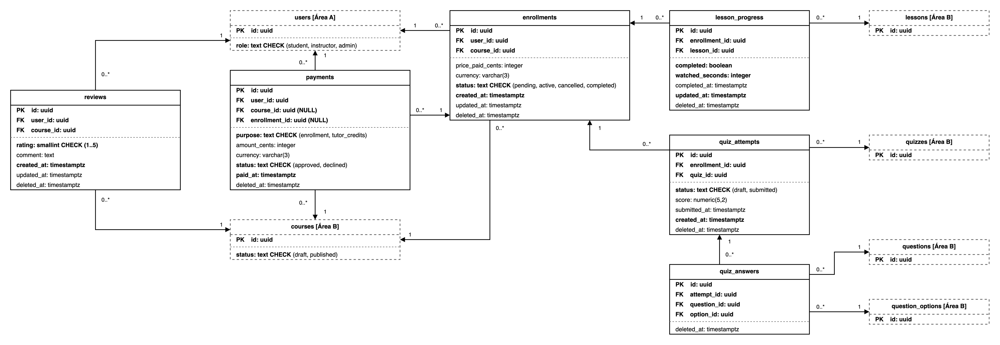

## 3. Área C – Aprendizagem do aluno

Tabelas que sustentam a matrícula do aluno, o processamento de pagamento simulado (matrícula e créditos do tutor de IA), o registro contínuo de progresso nas aulas, a realização de quizzes com correção automática e a avaliação de cursos (UC002, UC003, UC009, UC010, UC019 e UC020; RF005, RF006, RF008, RF011, RF014 e RF015). As tabelas `enrollments`, `payments`, `lesson_progress`, `quiz_attempts`, `quiz_answers` e `reviews` derivam do TDD (seção 2), das decisões arquiteturais D1 a D6 e das ADRs 0014 a 0017. As convenções de nomenclatura adotam rigorosamente `snake_case` para tabelas e colunas no banco de dados relacional PostgreSQL 16 (ADR-0015 e ADR-0017), com tipos nativos (`uuid`, `integer`, `varchar(3)`, `text CHECK`, `timestamptz`, `boolean`, `numeric(5,2)`, `smallint CHECK`, `text`). Todas as tabelas de negócio contêm `deleted_at: timestamptz NULL` para controle de exclusão lógica (ADR-0014). Chaves estrangeiras conectam este núcleo aos domínios de Acesso (`users`, Área A) e Autoria (`courses`, `lessons`, `quizzes`, `questions` e `question_options`, Área B).

*Figura 0 – Modelo lógico relacional da Área C (Aprendizagem do aluno)*

Decisões do modelo:

- **Ciclo de vida da matrícula (`enrollments.status`):** estrutura formalmente o ciclo nos valores `pending`, `active`, `cancelled` e `completed` via restrição `CHECK` (UC003, UC019; US007, US018). Em curso gratuito, a matrícula nasce diretamente com status `active` (UC003 R-4). Em curso pago, nasce como `pending` e passa a `active` somente após a confirmação e aprovação do pagamento simulado (UC003 R-3, UC019). A tabela possui índice único parcial sobre `(user_id, course_id) WHERE deleted_at IS NULL`, impedindo matrículas ativas duplicadas para o mesmo curso (UC003 R-2, UC019 E3); a regra vale só para registros não excluídos logicamente (ADR-0014).
- **Pagamento simulado e compras de tutor (`payments`):** materializa o registro transacional do pagamento simulado (ADR-0007), sem campos de cartão de crédito, dados bancários ou `payoutInfo`. Armazena o valor (`amount_cents`), moeda (`currency`), finalidade (`purpose`: `enrollment` ou `tutor_credits`, conforme RF020 e RNF022), data (`paid_at`), e referências ao aluno (`user_id`), curso (`course_id`, opcional se avulso) e matrícula associada (`enrollment_id`, opcional/nulo quando o pagamento for para pacote de créditos do tutor de IA fora de matrícula direta). Relação: uma `enrollments` possui 0..* `payments` (tentativas recusadas e aprovadas ficam registradas). O campo `status` recebe `approved` ou `declined`: em caso de recusa (UC019 E1), o registro é persistido para auditoria e a matrícula permanece `pending`, sem liberação do acesso às aulas.
- **Progresso contínuo de aulas (`lesson_progress`):** registra os segundos assistidos (`watched_seconds`) e a conclusão (`completed`) de cada aula pelo aluno matriculado, desacoplado do quiz (atendendo à análise do professor sobre o fluxo de progresso e regras R-4 e R-5 do UC009). Permite retomar a reprodução no ponto exato em que o aluno parou (UC009 A2), persistido independentemente do dispositivo utilizado (UC009 R-3). Possui índice único parcial sobre `(enrollment_id, lesson_id) WHERE deleted_at IS NULL`, de modo que cada aula tem um único registro de progresso por matrícula.
- **Tentativas e respostas de quizzes (`quiz_attempts` e `quiz_answers`):** registram o histórico de submissão do quiz vinculado à matrícula (`enrollment_id`) e as respostas assinaladas para cada questão (`quiz_answers`). A nota calculada imediatamente por comparação com o gabarito é armazenada em `score` (UC002 R-2): acertos divididos pelo total de questões, multiplicados por 100, em escala `numeric(5,2)` de 0,00 a 100,00, arredondada a 2 casas decimais (meio para cima). A interface exibe a nota inteira seguida de %, por exemplo 67% para 66,67. `quiz_attempts.status` recebe `draft` (rascunho, UC002 A2, quando o aluno salva respostas parciais) ou `submitted` (enviada); enquanto estiver em `draft`, `score` e `submitted_at` permanecem nulos, e o gabarito jamais é retornado pela API antes da submissão (UC002 R-4). Se o instrutor permitir refazer o quiz (UC002 A1, R-3), uma nova tentativa (`quiz_attempts`) é gerada, mantendo o histórico de tentativas anteriores inalterado (UC004 R-2).
- **Avaliação de cursos (`reviews`):** consolida a nota de 1 a 5 (`rating: smallint CHECK (rating BETWEEN 1 AND 5)`) e o comentário opcional (`comment: text`) do aluno sobre o curso (UC010 R-3). Exige como pré-requisito de negócio a conclusão de ao menos uma aula no curso (UC010 R-1). Possui índice único parcial sobre `(user_id, course_id) WHERE deleted_at IS NULL`: cada aluno mantém exatamente uma avaliação por curso, de modo que uma nova avaliação substitui a anterior via `INSERT ... ON CONFLICT (user_id, course_id) DO UPDATE` (UC010 R-2, A1).
- **Mapeamento de Enums e Internacionalização:** conforme a arquitetura do sistema, todos os valores enumerados são persistidos no banco de dados em língua inglesa (`enrollments.status`: pending, active, cancelled, completed; `payments.status`: approved, declined; `payments.purpose`: enrollment, tutor_credits; `quiz_attempts.status`: draft, submitted). As camadas de apresentação (frontend) e contratos de API realizam o mapeamento bidirecional para os respectivos rótulos em português (ex.: pending → 'Pendente', active → 'Ativa'; approved → 'Aprovado', declined → 'Recusado'; draft → 'Rascunho', submitted → 'Enviada').
- **Normalização e Desvio Justificado:** `enrollments`, `lesson_progress`, `quiz_attempts`, `quiz_answers` e `reviews` estão na 3FN (Terceira Forma Normal): as chaves primárias são UUIDs únicos, cada atributo não chave depende exclusivamente da chave primária e não há atributos multivalorados. A tabela `payments` apresenta um desvio deliberado da 3FN: `user_id` e `course_id` derivam de `enrollments` (via `enrollment_id`), dependendo transitivamente da chave primária nos pagamentos de matrícula. Essas colunas são mantidas no registro de pagamento porque ele constitui o comprovante financeiro imutável da transação (identificando aluno e curso mesmo diante de mutações ou cancelamentos posteriores da matrícula) e atende também à compra direta de créditos do tutor de IA onde `enrollment_id` pode ser nulo.
- **Exclusão lógica (ADR-0014):** todas as tabelas contêm a coluna `deleted_at: timestamptz NULL`. Registros ativos possuem `deleted_at IS NULL`; operações de exclusão realizam soft delete preenchendo o timestamp corrente, assegurando integridade referencial com o histórico acadêmico e financeiro.

| ATRIBUTO | CLASSE | DOMÍNIO | TAMANHO | DESCRIÇÃO |
|---|---|---|---|---|
| **Tabela: enrollments** | | | | |
| id | Determinante | uuid | - | Identificador único da matrícula (PK). |
| user_id | Simples | uuid | - | FK para `users.id` (Área A), aluno matriculado. |
| course_id | Simples | uuid | - | FK para `courses.id` (Área B), curso da matrícula. |
| price_paid_cents | Simples | integer | - | Valor pago pela matrícula, em centavos (0 para cursos gratuitos). |
| currency | Simples | varchar(3) | 3 | Código ISO 4217 da moeda da transação (padrão 'BRL'). |
| status | Simples | text CHECK | 20 | Status da matrícula: 'pending', 'active', 'cancelled', 'completed' (UC003, UC019). |
| created_at | Simples | timestamptz | - | Data e hora de criação da matrícula. |
| updated_at | Simples | timestamptz | - | Data e hora da última alteração de status (opcional). |
| deleted_at | Simples | timestamptz | - | Data e hora de exclusão lógica (nulo se ativo, ADR-0014). |
| **Tabela: payments** | | | | |
| id | Determinante | uuid | - | Identificador único do pagamento simulado (PK). |
| user_id | Simples | uuid | - | FK para `users.id` (Área A), aluno pagador. |
| course_id | Simples | uuid | - | FK para `courses.id` (Área B), curso associado (opcional/NULL em avulso). |
| enrollment_id | Simples | uuid | - | FK para `enrollments.id`, matrícula associada (0..* por matrícula, NULL se cota extra). |
| purpose | Simples | text CHECK | 20 | Finalidade do pagamento: 'enrollment' ou 'tutor_credits' (RF020, RNF022). |
| amount_cents | Simples | integer | - | Valor cobrado no pagamento simulado, em centavos. |
| currency | Simples | varchar(3) | 3 | Código ISO 4217 da moeda (padrão 'BRL'). |
| status | Simples | text CHECK | 20 | Status do pagamento: 'approved' ou 'declined' (UC019). |
| paid_at | Simples | timestamptz | - | Data e hora do pagamento aprovado; nulo na recusa. |
| deleted_at | Simples | timestamptz | - | Data e hora de exclusão lógica (nulo se ativo, ADR-0014). |
| **Tabela: lesson_progress** | | | | |
| id | Determinante | uuid | - | Identificador único do progresso da aula (PK). |
| enrollment_id | Simples | uuid | - | FK para `enrollments.id`, matrícula do aluno. |
| lesson_id | Simples | uuid | - | FK para `lessons.id` (Área B), aula assistida. |
| completed | Simples | boolean | - | Indica se a aula foi concluída pelo aluno (true/false). |
| watched_seconds | Simples | integer | - | Posição em segundos assistidos para retomada da aula (UC009 R-2). |
| completed_at | Simples | timestamptz | - | Data e hora em que a aula foi concluída (nulo se não concluída). |
| updated_at | Simples | timestamptz | - | Data e hora da última sincronização do progresso. |
| deleted_at | Simples | timestamptz | - | Data e hora de exclusão lógica (nulo se ativo, ADR-0014). |
| **Tabela: quiz_attempts** | | | | |
| id | Determinante | uuid | - | Identificador único da tentativa de resolução do quiz (PK). |
| enrollment_id | Simples | uuid | - | FK para `enrollments.id`, matrícula do aluno. |
| quiz_id | Simples | uuid | - | FK para `quizzes.id` (Área B), quiz respondido. |
| status | Simples | text CHECK | 20 | Status da tentativa: 'draft' (rascunho) ou 'submitted' (enviada) (UC002 A2). |
| score | Simples | numeric(5,2) | - | Nota calculada da tentativa: acertos / total de questões × 100, escala decimal de 0,00 a 100,00, arredondada a 2 casas (meio para cima); nula enquanto 'draft' (UC002 R-2). |
| submitted_at | Simples | timestamptz | - | Data e hora de submissão e correção das respostas; nula enquanto 'draft'. |
| created_at | Simples | timestamptz | - | Data e hora de início/criação da tentativa. |
| deleted_at | Simples | timestamptz | - | Data e hora de exclusão lógica (nulo se ativo, ADR-0014). |
| **Tabela: quiz_answers** | | | | |
| id | Determinante | uuid | - | Identificador único da resposta individual do quiz (PK). |
| attempt_id | Simples | uuid | - | FK para `quiz_attempts.id`, tentativa à qual a resposta pertence. |
| question_id | Simples | uuid | - | FK para `questions.id` (Área B), pergunta respondida. |
| option_id | Simples | uuid | - | FK para `question_options.id` (Área B), alternativa assinalada pelo aluno. |
| deleted_at | Simples | timestamptz | - | Data e hora de exclusão lógica (nulo se ativo, ADR-0014). |
| **Tabela: reviews** | | | | |
| id | Determinante | uuid | - | Identificador único da avaliação do curso (PK). |
| user_id | Simples | uuid | - | FK para `users.id` (Área A), aluno autor da avaliação. |
| course_id | Simples | uuid | - | FK para `courses.id` (Área B), curso avaliado. |
| rating | Simples | smallint CHECK | - | Nota atribuída ao curso pelo aluno, de 1 a 5 (UC010 R-3). |
| comment | Simples | text | - | Comentário textual opinativo sobre o curso (opcional) (UC010 R-3). |
| created_at | Simples | timestamptz | - | Data e hora de publicação ou substituição da avaliação. |
| updated_at | Simples | timestamptz | - | Data e hora da última edição da avaliação (opcional). |
| deleted_at | Simples | timestamptz | - | Data e hora de exclusão lógica (nulo se ativo, ADR-0014). |
