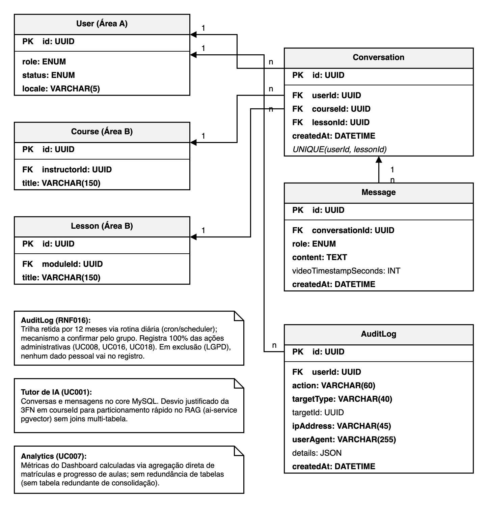

## 4. Área D – Tutor de IA, analytics e administração

Tabelas que sustentam a interação do Aluno com o assistente pedagógico no contexto da aula, a visualização analítica de progresso e engajamento e a gestão administrativa de usuários e perfis com registro auditável (UC001, UC007, UC008, UC016 e UC018; RF009, RF010, RF012, RF018 e RF020; RNF003, RNF004, RNF016 e RNF022). As tabelas `conversations` e `messages` estruturam o histórico contextual do chat pedagógico; `tutor_credit_packs` armazena os pacotes de créditos extras adquiridos pelo Aluno via pagamento simulado para extensão do uso do Tutor de IA além da cota regular (RF020, RNF022); e `audit_logs` assegura a rastreabilidade e a responsabilização das operações administrativas e de segurança no PostgreSQL 16 (ADR-0016, ADR-0017). As métricas do Dashboard (UC007) são calculadas dinamicamente via agregação das tabelas transacionais de matrícula e progresso (`enrollments` e `lesson_progress`, da Área C), sem necessidade de tabelas redundantes de consolidação.

*Figura 0 – Modelo lógico relacional da Área D (Tutor de IA, analytics e administração)*

Decisões do modelo:

- **Banco unificado em PostgreSQL 16 (POSTGRESQL GLOBAL DEVELOPMENT GROUP, 2023) (ADR-0017):** todo o armazenamento transacional do core reside no PostgreSQL 16 (database `core`), unificando a tecnologia de banco com a instância gerenciada do microsserviço físico `ai-service` (database `ai` com extensão `pgvector`). Cada serviço mantém seu banco lógico, usuário e permissões isoladas.
- **Convenção de nomes por camada (ADR-0015):** todas as tabelas e colunas relacionais são estruturadas em inglês e no padrão `snake_case` (`user_id`, `course_id`, `created_at`, `deleted_at`).
- **Exclusão lógica em todo o sistema (ADR-0014):** todas as tabelas de negócio (`conversations`, `messages`, `tutor_credit_packs`) possuem a coluna `deleted_at` (`timestamptz` nulo por padrão, trait `SoftDeletes` do Eloquent). Nenhuma operação de domínio executa `DELETE` físico.
- **Histórico e cota do Tutor de IA (UC001, RF009, RF020, RNF003):** cada conversa é estritamente vinculada a um Aluno (`user_id`), a um curso (`course_id`) e à aula assistida (`lesson_id`). A tabela `conversations` possui a restrição de unicidade `UNIQUE(user_id, lesson_id)`, garantindo exatamente uma conversa aberta por aluno em cada aula. A presença redundante de `course_id` em `conversations` é um desvio deliberado e justificado da 3FN: viabiliza filtragem relacional imediata no pipeline RAG do `ai-service` (`where('course_id', $courseId)`, RNF004) sem necessidade de junções de múltiplas tabelas transacionais a cada mensagem enviada.
- **Créditos extras do Tutor de IA (`tutor_credit_packs`, RF020, RNF022):** tabela que registra pacotes adicionais de mensagens (`pack_type`, ex.: `pack_50` com 50 mensagens, RNF022) comprados pelo Aluno através de pagamento simulado (`payment_id` referenciando `payments`, com `purpose = 'tutor_credits'`). A cota horária regular de 20 mensagens por Aluno é controlada por janela deslizante no Redis (RNF022). Ao esgotar a cota horária, o uso de crédito extra segue ciclo em três etapas com a restrição `CHECK (messages_used + messages_reserved <= messages_total)`: reserva atômica (`messages_reserved + 1`) antes da chamada ao `ai-service`, confirmação no sucesso (`messages_reserved - 1`, `messages_used + 1`) e devolução na falha (`messages_reserved - 1`, TC218).
- **Trilha de auditoria e retenção (`audit_logs`, RNF016, ADR-0016):** registra 100% das ações administrativas do Administrador e eventos de controle de acesso (bloqueio e desbloqueio no UC008, alteração de perfil no UC008 A4, negação de acesso no UC016 E2 e exclusão/reativação/anonimização no UC018). A tabela é particionada mensalmente por data (`PARTITION BY RANGE (created_at)`) e adota **chave primária composta `(id, created_at)`**, exigência do particionamento declarativo no PostgreSQL 16 (POSTGRESQL GLOBAL DEVELOPMENT GROUP, 2023). A retenção ativa no PostgreSQL 16 é de 12 meses; a rotina agendada diária `audit:archive` (cron à meia-noite) exporta as partições com mais de 12 meses para o Cloudflare R2 no formato JSON (*JavaScript Object Notation*) Lines compactado e criptografado e desanexa a partição (`DETACH PARTITION`), mantendo o arquivo por 5 anos. Os registros de acesso à aplicação seguem retenção mínima legal de 6 meses (art. 15 da Lei nº 12.965/2014 — Marco Civil da Internet (BRASIL, 2014)), enquanto logs técnicos de erro ficam 90 dias (ADR-0016). Na exclusão e na anonimização de usuário (UC018 R-4 e A3), `details` não grava dados cadastrais diretos (nome, e-mail, CPF, telefone); os campos `ip_address`, `user_agent`, `user_id` e `target_id` constituem dados pessoais indiretos/pseudonimizados mantidos sob base legal (LGPD, art. 5º, I e art. 7º, II; Marco Civil, art. 15 (BRASIL, 2014)) e acesso restrito.
- **Exclusão de Instrutor com cursos publicados (UC018 A4, TC266):** o Administrador escolhe entre despublicar os cursos (`courses.status = 'archived'`, que preserva o acesso dos alunos matriculados) ou aplicar exclusão lógica em cascata (`deleted_at`) nos cursos, módulos, aulas e quizzes. Nenhuma das duas opções apaga registro.
- **Normalização de `audit_logs`:** exceção deliberada à 1FN no campo `details` (`jsonb`) para metadados contextuais flexíveis via formato JSON nativo (BRAY, 2017; POSTGRESQL GLOBAL DEVELOPMENT GROUP, 2023) (ex.: perfil anterior e novo), e dependência funcional transitiva mantida de propósito em `target_type` para evitar junções com tabelas auxiliares em consultas pontuais de eventos.
- **Campo lido de outra área:** `lessons.index_status` (`pending`, `indexed`, `failed`) pertence à Área B, que o grava. A Área D apenas lê o campo para responder com `LESSON_NOT_INDEXED` (UC001 E1).
- **Mapeamento de valores enumerados (persistidos em inglês, mapeados para pt-BR na interface):**
  - `messages.role`: `user` (Aluno) e `assistant` (Tutor de IA).
  - `audit_logs.action`: `USER_BLOCK` (Bloqueio de usuário), `USER_UNBLOCK` (Desbloqueio de usuário), `ROLE_CHANGE` (Alteração de perfil de acesso), `USER_DELETE` (Exclusão lógica de usuário), `USER_RESTORE` (Reativação de usuário excluído), `USER_ANONYMIZE` (Anonimização irreversível conforme LGPD), `ACCESS_DENIED` (Tentativa de acesso não autorizada a área protegida).
  - Enums referenciados de `users`: `role` (`student` = Aluno, `instructor` = Instrutor, `admin` = Administrador); `status` (`active` = Ativo, `blocked` = Bloqueado, `deleted` = Excluído); `theme` (`light` = Claro, `dark` = Escuro, `system` = Sistema).

| ATRIBUTO | CLASSE | DOMÍNIO | TAM. | DESCRIÇÃO |
|---|---|---|---|---|
| **Tabela: conversations** | | | | Conversa do Aluno com o Tutor de IA contextualizada na aula (UC001, RF009). Restrição de unicidade: `UNIQUE(user_id, lesson_id)`. |
| id | Determinante | uuid | - | Identificador único da conversa. |
| user_id | Simples | uuid | - | FK para `users.id` (Área A), identificando o Aluno dono da conversa. |
| course_id | Simples | uuid | - | FK para `courses.id` (Área B), curso ao qual a conversa pertence (desvio justificado da 3FN para isolamento RAG). |
| lesson_id | Simples | uuid | - | FK para `lessons.id` (Área B), aula específica que fornece o contexto pedagógico. |
| created_at | Simples | timestamptz | - | Data e hora de criação da conversa. |
| deleted_at | Simples | timestamptz | - | Data e hora de exclusão lógica (nulo para conversas ativas, ADR-0014). |
| **Tabela: messages** | | | | Mensagem individual trocada na conversa com o Tutor de IA (UC001). |
| id | Determinante | uuid | - | Identificador único da mensagem. |
| conversation_id | Simples | uuid | - | FK para `conversations.id`, indicando a conversa à qual a mensagem pertence. |
| role | Simples | text CHECK | - | Papel do emissor: `user` (pergunta do Aluno) ou `assistant` (resposta do Tutor de IA). |
| content | Simples | text | - | Conteúdo textual da pergunta ou da resposta gerada pelo Tutor. |
| video_timestamp_seconds | Simples | integer | - | Segundo exato do vídeo da aula referenciado na resposta ou na pergunta (opcional, RF009). |
| created_at | Simples | timestamptz | - | Data e hora de envio ou geração da mensagem. |
| deleted_at | Simples | timestamptz | - | Data e hora de exclusão lógica (nulo para mensagens ativas, ADR-0014). |
| **Tabela: tutor_credit_packs** | | | | Pacote de créditos extras do Tutor de IA adquirido por Aluno com pagamento simulado (RF020, RNF022). Restrição: `CHECK (messages_used + messages_reserved <= messages_total)`. |
| id | Determinante | uuid | - | Identificador único do pacote de créditos extras. |
| user_id | Simples | uuid | - | FK para `users.id` (Área A), identificando o Aluno proprietário do pacote. |
| payment_id | Simples | uuid | - | FK para `payments.id` (Área C), identificando o pagamento simulado da aquisição. |
| pack_type | Simples | text CHECK | - | Tipo do pacote contratado (ex.: `pack_50`, RNF022). |
| messages_total | Simples | integer | - | Quantidade total de mensagens contratadas no pacote (ex.: 50). |
| messages_used | Simples | integer | - | Quantidade de mensagens efetivamente confirmadas/consumidas do pacote (padrão 0). |
| messages_reserved | Simples | integer | - | Quantidade de mensagens reservadas durante a geração de resposta do Tutor; confirmadas em `messages_used` no sucesso e devolvidas em caso de falha (padrão 0). |
| created_at | Simples | timestamptz | - | Data e hora da aquisição e ativação do pacote. |
| deleted_at | Simples | timestamptz | - | Data e hora de exclusão lógica (nulo para registros ativos, ADR-0014). |
| **Tabela: audit_logs** | | | | Trilha de auditoria das ações administrativas e de segurança no PostgreSQL 16 (RNF016, ADR-0016). Particionada por mês (`PARTITION BY RANGE (created_at)`) com chave primária composta `(id, created_at)` e exportação para R2 por 5 anos via `audit:archive`. |
| id | Determinante | uuid | - | Parte 1 da chave primária composta `(id, created_at)` do registro de auditoria. |
| created_at | Determinante | timestamptz | - | Parte 2 da chave primária composta `(id, created_at)` e chave de particionamento; data e hora exata da ocorrência do evento auditado. |
| user_id | Simples | uuid | - | FK para `users.id` (Área A), identificando o autor da ação (nulo em tentativas não autenticadas e na rotina automática de anonimização, UC018 A3). |
| action | Simples | text CHECK | - | Identificador estável da ação: `USER_BLOCK`, `USER_UNBLOCK`, `ROLE_CHANGE`, `USER_DELETE`, `USER_RESTORE`, `USER_ANONYMIZE`, `ACCESS_DENIED`. |
| target_type | Simples | text | - | Tipo da entidade ou recurso alvo da ação auditada (ex.: `User`, `ProtectedArea`). |
| target_id | Simples | uuid | - | Identificador UUID do recurso afetado (opcional; mantido na anonimização LGPD como identificador pseudonimizado). |
| ip_address | Simples | text | - | Endereço IP de origem da requisição (IPv4/IPv6); dado pessoal indireto mantido sob base legal (LGPD, art. 7º, II; Marco Civil, art. 15 (BRASIL, 2014)). |
| user_agent | Simples | text | - | Identificação do cliente HTTP/navegador que originou a requisição (dado pessoal indireto sob acesso restrito). |
| details | Composto | jsonb | - | Metadados contextuais estruturados da operação (ex.: papéis anterior e novo); sem dados cadastrais diretos (nome, e-mail, CPF, telefone) (UC018 R-4). |
