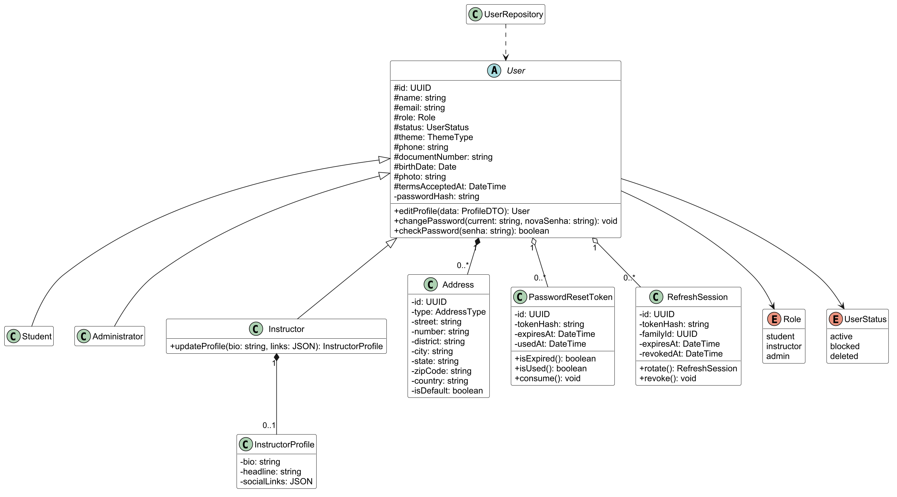
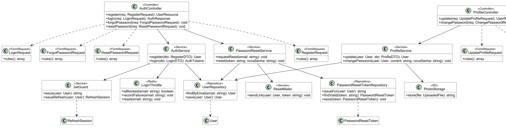

## 1. Área A – Acesso e conta

Classes dos casos de uso UC005, UC011, UC012, UC013 e UC017, em duas perspectivas do mesmo modelo. Na perspectiva negocial, `User` é abstrata e tem as subclasses `Student`, `Instructor` e `Administrator`; o `Instructor` tem um `InstructorProfile` opcional e o `User` agrega endereços, tokens de redefinição de senha e sessões de refresh. Na perspectiva de implementação, os Controllers recebem as requisições já validadas pelos Form Requests e delegam aos Services, que usam os Repositories, o `JwtGuard` (JWT de 1 hora em cookie e refresh rotacionado, ADR-0008), o `LoginThrottle` (bloqueio após 5 falhas, RNF008, guardado no Redis), o `ResetMailer` e o `PhotoStorage` (foto no Cloudflare R2).

*Figura 0 – Diagrama de classes da Área A: perspectiva negocial*

*Figura 0 – Diagrama de classes da Área A: perspectiva de implementação (MVC)*
