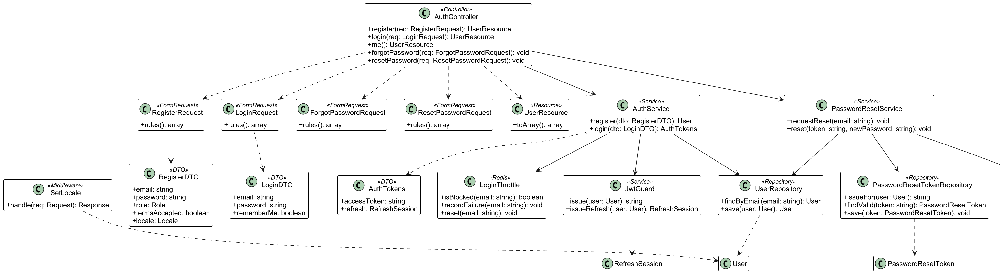
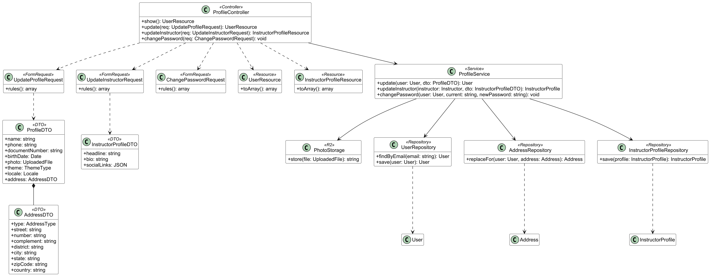

## 1. Área A – Acesso e conta

Classes dos casos de uso UC005, UC011, UC012, UC013 e UC017, em duas perspectivas do mesmo modelo. Na perspectiva negocial, `User` é abstrata e tem as subclasses `Student`, `Instructor` e `Administrator`; o `Instructor` tem exatamente um `InstructorProfile` e o `User` agrega endereços, tokens de redefinição de senha e sessões de refresh. A classe guarda o tipo (`theme: ThemeType`, `locale: Locale`) e nunca o id de uma chave estrangeira. Os identificadores e os nomes de métodos ficam em inglês; o texto que o Usuário vê fica em arquivos de tradução (pt-BR e en, RNF013), escolhido por `User.locale`.

Na perspectiva de implementação, que vem em dois diagramas para caber legível na página, os Controllers recebem as requisições já validadas pelos Form Requests, que as convertem em DTOs, e delegam aos Services. Os Services usam os Repositories, o `JwtGuard` (JWT de 1 hora em cookie e refresh rotacionado, ADR-0008), o `LoginThrottle` (bloqueio após 5 falhas, RNF008, guardado no Redis), o `ResetMailer` e o `PhotoStorage` (foto no Cloudflare R2). O middleware `SetLocale` define o idioma da requisição a partir do `User.locale` ou do cabeçalho `Accept-Language`, e as respostas saem em API Resources.

*Figura 0 – Diagrama de classes da Área A: perspectiva negocial*

*Figura 0 – Diagrama de classes da Área A: implementação (MVC) de cadastro, login e recuperação de senha*

*Figura 0 – Diagrama de classes da Área A: implementação (MVC) de perfil e troca de senha*
