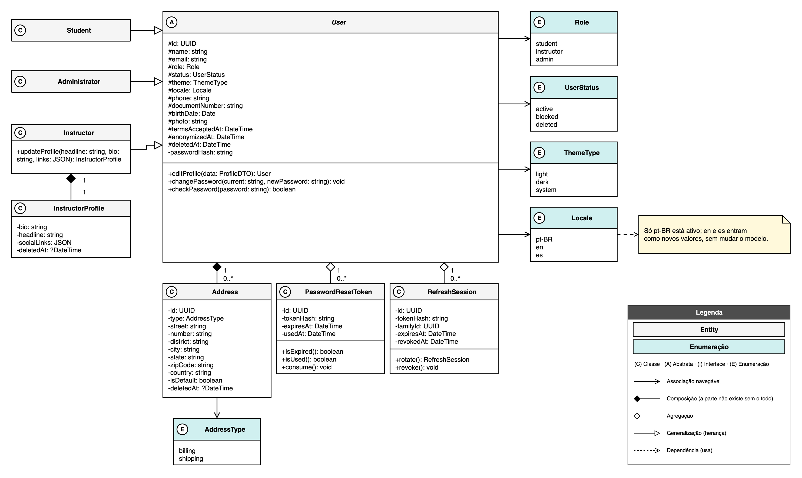
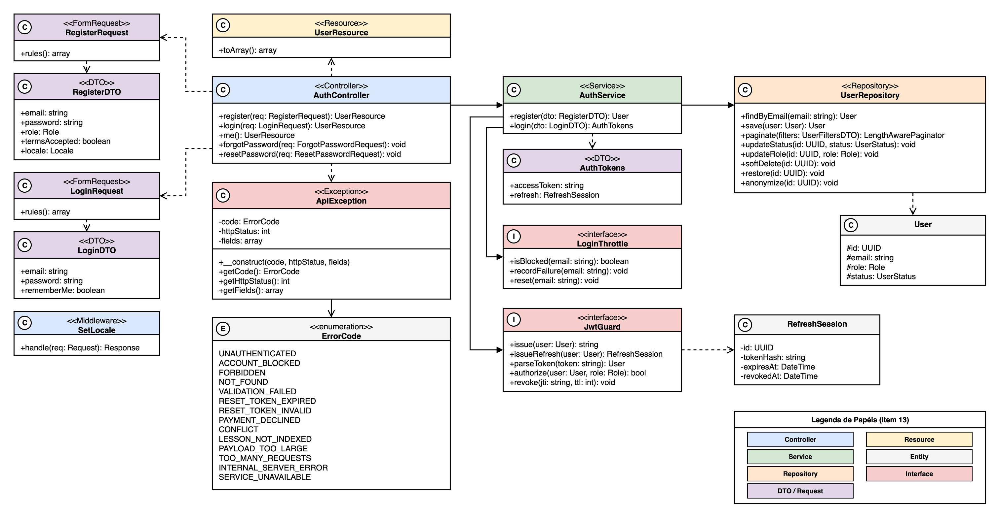
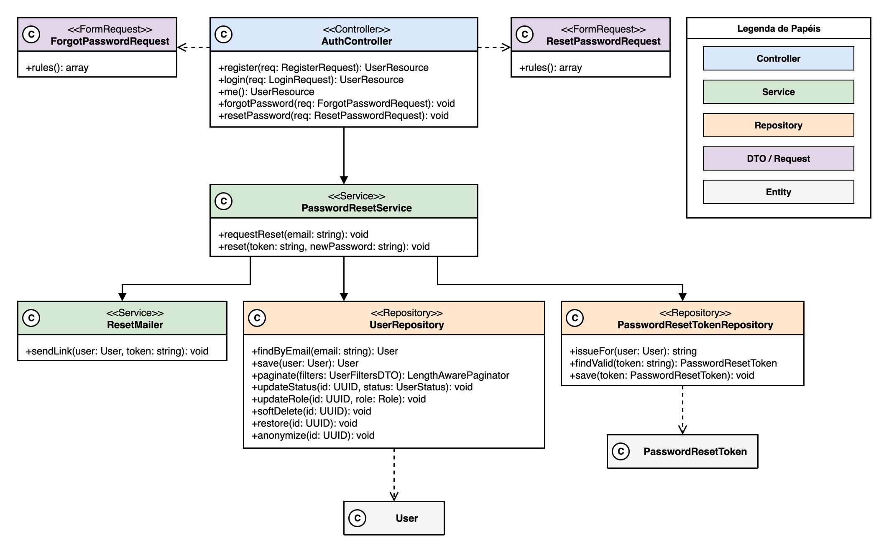
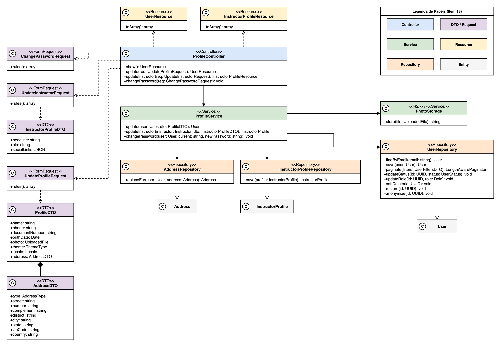

## 1. Área A – Acesso e conta

Classes dos casos de uso UC005, UC008, UC011, UC012, UC013, UC017 e UC018, estruturadas em duas perspectivas do mesmo modelo. A convenção visual segue a padronização arquitetural com círculos tipados C/A/I/E nos cabeçalhos e cores de preenchimento por papel: Controller (`#DAE8FC`), Service (`#D5E8D4`), Repository (`#FFE6CC`), DTO/Request (`#E1D5E7`), Resource (`#FFF2CC`), Entity (`#F5F5F5`) e Interface/Exceção (`#F8CECC`).

Na perspectiva negocial, `User` é uma classe abstrata com atributos de auditoria e ciclo de vida (`deletedAt: DateTime`, `anonymizedAt: DateTime`), especializada nas subclasses `Student`, `Instructor` e `Administrator`. O `Instructor` possui exatamente um `InstructorProfile` (criado automaticamente ao promover o usuário a instrutor, com headline e biografia vazios, TC236). O `User` agrega endereços (`Address`), tokens de redefinição de senha (`PasswordResetToken`) e sessões de atualização de token (`RefreshSession`). A classe armazena enums de preferência (`theme: ThemeType`, `locale: Locale`) e tipos de contato, nunca ids de chaves estrangeiras. Os identificadores e nomes de métodos seguem o inglês; o texto visível ao Usuário fica em arquivos de internacionalização (pt-BR ativo, com en e es preparados, RNF013), resolvido por `User.locale`.

Na perspectiva de implementação, apresentada em três diagramas (cadastro e login com tratamento transversal de erros, recuperação de senha, e perfil/troca de senha), a arquitetura adota fluxo Controller > Service > Repository > Entity da esquerda para a direita:

1. **Cadastro, login e tratamento transversal de erros**:
   - Os Controllers (`AuthController`) recebem requisições validadas por Form Requests (`RegisterRequest`, `LoginRequest`), que convertem os dados em DTOs e delegam aos Services.
   - O `AuthService` orquestra o registro e autenticação, acionando o `LoginThrottle` (limite de 5 tentativas consecutivas com bloqueio de 15 minutos via Redis, RNF008), o `UserRepository` e o `JwtGuard`.
   - O `JwtGuard` emite tokens JWT e gerencia sessões de refresh com rotação e detecção de reúso (ADR-0008). O método `revoke(jti: string, ttl: int): void` grava o identificador do token na blocklist do Redis com o tempo de vida restante do JWT para revogação imediata em logout e bloqueio de conta.
   - Para unificar o tratamento de erros sem proliferação de classes de exceção por cenário, a Área A declara o enum transversal `ErrorCode` (com códigos padronizados como `UNAUTHENTICATED`, `ACCOUNT_BLOCKED`, `FORBIDDEN`, `NOT_FOUND`, `VALIDATION_FAILED`, `TOO_MANY_REQUESTS`, etc., conforme TDD seção 3.1) e a classe única `ApiException(code: ErrorCode, httpStatus: int, fields: array = [])`, reutilizados por todos os módulos do monólito.
   - O middleware `SetLocale` define o idioma da requisição com base em `User.locale` ou no cabeçalho `Accept-Language`, e as respostas são envelopadas em `UserResource`.

2. **Recuperação de senha**:
   - `ForgotPasswordRequest` e `ResetPasswordRequest` validam os fluxos de solicitação e redefinição.
   - `PasswordResetService` coordena o `UserRepository`, o `PasswordResetTokenRepository` (geração de hash criptográfico com validade de 30 minutos (RNF017) e consumo único) e o envio assíncrono do link por fila através do `ResetMailer`, assegurando proteção contra enumeração de usuários (UC011 R-2).

3. **Perfil e administração de usuários**:
   - `ProfileController` e `ProfileService` atendem à consulta e atualização cadastral, atualização de dados de instrutor (`InstructorProfileDTO`), troca de senha com validação de senha atual, upload de foto via `PhotoStorage` (armazenamento de imagem no Cloudflare R2 com URL pública e CDN) e persistência de endereços (`AddressRepository`).
   - `InstructorProfileRepository.createEmpty(userId: UUID): InstructorProfile` cria a linha vazia de perfil de instrutor no momento da promoção (TC236), além do `save(profile: InstructorProfile)`.
   - O `UserRepository` fornece, além de `findByEmail(email)` e `save(user)`, os métodos de gestão administrativa do UC008 e UC018:
     - `paginate(filters: UserFiltersDTO): LengthAwarePaginator`: listagem paginada (`perPage` de 1 a 100) com filtros de busca textual, perfil e status.
     - `updateStatus(id: UUID, status: UserStatus): void`: bloqueio e desbloqueio de contas.
     - `updateRole(id: UUID, role: Role): void`: alteração de papel, instanciando `InstructorProfile` caso o papel passe a instrutor.
     - `softDelete(id: UUID): void` e `restore(id: UUID): void`: exclusão lógica e reativação via `deleted_at` (ADR-0014).
   - `RefreshSessionRepository.revokeAllByUser(userId: UUID): void` revoga todas as sessões de atualização do usuário, com `revokedAt` preenchido na entidade `RefreshSession`. É chamado no bloqueio, na troca de perfil e na exclusão lógica (D-TC243, UC008 e UC018), junto com a inclusão do `jti` na blocklist do Redis.
     - `anonymize(id: UUID): void`: anonimização irreversível dos dados pessoais para atendimento à LGPD (UC018 R-2), preenchendo `anonymized_at`, ofuscando nome/documento/telefone e liberando o email no índice único parcial.

*Figura 0 – Diagrama de classes da Área A: perspectiva negocial*

*Figura 0 – Diagrama de classes da Área A: implementação (MVC) de cadastro, login e tratamento de erros*

*Figura 0 – Diagrama de classes da Área A: implementação (MVC) de recuperação de senha*

*Figura 0 – Diagrama de classes da Área A: implementação (MVC) de perfil e troca de senha*
