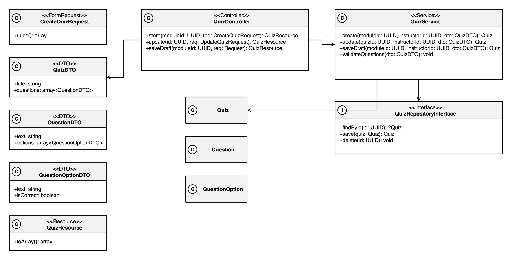

## 2. Área B – Autoria do instrutor

Classes dos casos de uso UC004, UC006, UC014 e UC015 (RF002, RF003, RF004 e RF007), estruturadas em perspectiva negocial e perspectivas de implementação técnica aderentes à arquitetura MVC do Laravel.

Na perspectiva negocial, `Instructor` herda da classe base abstrata `User` (Área A) e mantém a relação de autoria com `Course`. Um `Course` categoriza-se via `Category` e compõe recursivamente sua árvore pedagógica através de `Module`, o qual compõe suas unidades de conteúdo `Lesson` e suas avaliações `Quiz`. Cada `Quiz` é composto por instâncias de `Question`, que por sua vez compõem suas alternativas em `QuestionOption`. As classes referenciam estritamente tipos fortes de domínio (`level: CourseLevel`, `status: CourseStatus`, `course: Course`, `module: Module`), em total conformidade com as diretrizes do TE5_1, banindo referências a IDs escalares de chaves estrangeiras nos atributos de domínio.

Nas perspectivas de implementação, os controladores REST recebem requisições HTTP mapeadas nos endpoints do TDD (seção 3.3), validadas por Form Requests dedicados (`CreateCourseRequest`, `CreateModuleRequest`, `CreateLessonRequest`, `CreateQuizRequest`) que encapsulam regras de preenchimento e convertem entradas em DTOs imutáveis. Os serviços de domínio (`CourseService`, `ModuleService`, `LessonService`, `QuizService`) orquestram as operações de negócio e aplicam as travas de integridade:
- `CourseService.delete()` valida a ausência de matrículas ativas (`hasActiveEnrollments`), bloqueando a remoção de cursos já consumidos por alunos (UC006 R-2).
- `ModuleService.delete()` inspeciona se há histórico acadêmico (`hasStudentHistory`) antes de autorizar a exclusão, bloqueando a destruição de módulos com progresso em aulas ou respostas a quizzes (UC014 R-4).
- `LessonService.delete()` verifica registros de progresso de alunos (`hasStudentProgress`), impedindo a exclusão de aulas assistidas (UC015 R-5).
- `LessonService.requestUploadUrl()` interage com a interface `MediaStorageInterface` para gerar URLs pré-assinadas com validade de 15 minutos junto ao Cloudflare R2 (RNF002), e ao confirmar o envio dispara o job assíncrono de transcrição e indexação via `TranscriptionQueueInterface` (RNF004).
- `QuizService.validateQuestions()` assegura que toda questão possua ao menos 2 opções e exatamente uma correta (UC004 R-1), garantindo que alterações de gabarito preservem o histórico de tentativas e notas já calculadas (UC004 R-2).

As respostas para a camada cliente são padronizadas através de API Resources (`CourseResource`, `ModuleResource`, `LessonResource`, `QuizResource`).

*Figura 0 – Diagrama de classes da Área B: perspectiva negocial*

*Figura 0 – Diagrama de classes da Área B: implementação (MVC) de cursos e módulos*

*Figura 0 – Diagrama de classes da Área B: implementação (MVC) de aulas e upload de vídeo*

*Figura 0 – Diagrama de classes da Área B: implementação (MVC) de quizzes e gabarito*
