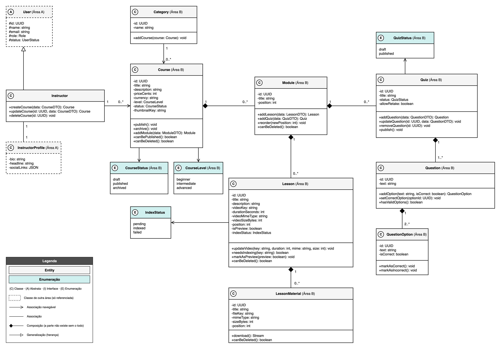
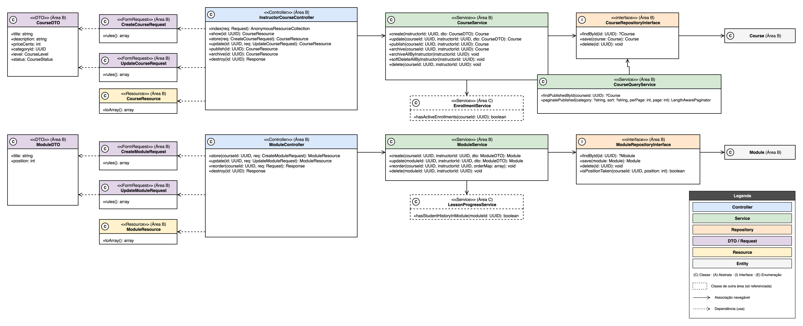
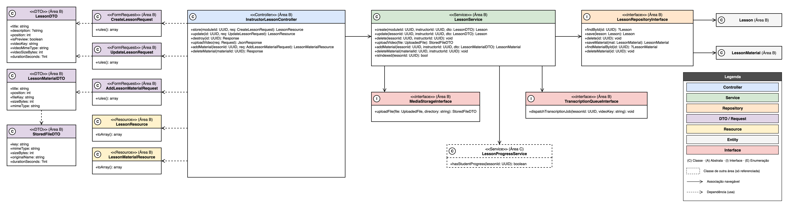

## 2. Área B – Autoria do instrutor

Classes dos casos de uso UC004, UC006, UC014 e UC015 (RF002, RF003, RF004 e RF007), estruturadas em perspectiva negocial e perspectivas de implementação técnica aderentes à arquitetura MVC do Laravel.

Na perspectiva negocial, `Instructor` herda da classe base abstrata `User` (Área A) e mantém a relação de autoria com `Course`. Um `Course` categoriza-se via `Category` e compõe recursivamente sua árvore pedagógica através de `Module`, o qual compõe suas unidades de conteúdo `Lesson` e suas avaliações `Quiz`. Cada `Quiz` é composto por instâncias de `Question`, que por sua vez compõem suas alternativas em `QuestionOption`. As classes referenciam estritamente tipos fortes de domínio (`level: CourseLevel`, `status: CourseStatus`, `course: Course`, `module: Module`), em total conformidade com as diretrizes do TE5_1, banindo referências a IDs escalares de chaves estrangeiras nos atributos de domínio.

Nas perspectivas de implementação, os controladores sob o estilo arquitetural REST (*Representational State Transfer*) recebem requisições HTTP mapeadas nos endpoints do TDD (seção 3.3), validadas por Form Requests dedicados (`CreateCourseRequest`, `UpdateCourseRequest`, `CreateModuleRequest`, `UpdateModuleRequest`, `CreateLessonRequest`, `UpdateLessonRequest`, `AddLessonMaterialRequest`, `CreateQuizRequest`, `UpdateQuizRequest`) que encapsulam regras de validação e convertem entradas em DTOs imutáveis (`CourseDTO`, `ModuleDTO`, `LessonDTO`, `LessonMaterialDTO`, `StoredFileDTO`, `QuizDTO`, `QuestionDTO`, `QuestionOptionDTO`). Todas as exceções de negócio e validação seguem o padrão unificado `ApiException(code: ErrorCode, httpStatus, fields)`, definido na Área A (item 13), com os códigos de erro da tabela do TDD (seção 3.1). Os controladores (`InstructorCourseController`, `ModuleController`, `InstructorLessonController`, `InstructorQuizController`) delegam a lógica de negócio aos serviços de domínio (`CourseService`, `CourseQueryService`, `ModuleService`, `LessonService`, `QuizAuthoringService`), que orquestram as operações e aplicam as travas de integridade:
- `CourseQueryService` expõe a interface pública somente leitura de cursos publicados e catálogo paginado para outros módulos (como Learning na Área C, em substituição ao acesso direto a `CourseRepository`, conforme ADR-0018), por meio dos métodos `findPublishedById(courseId: UUID): ?Course` e `paginatePublished(category: ?string, sort: ?string, perPage: int, page: int): LengthAwarePaginator`.
- `CourseService.delete()` consulta `EnrollmentService.hasActiveEnrollments()` (Área C) e bloqueia a remoção de cursos com matrículas ativas (UC006 R-2). Os cursos suportam os estados de ciclo de vida definidos em `CourseStatus` (`DRAFT`, `PUBLISHED`, `ARCHIVED`), além de exclusão lógica via `deleted_at` (ADR-0014). `CourseService.archive()` (UC006 A4) retira o curso publicado do catálogo sem bloquear os alunos já matriculados. `CourseService.archiveAllByInstructor(instructorId)` arquiva em lote todos os cursos de um Instrutor, sem alterar a tabela `courses` por fora; ao lado deste, `CourseService.softDeleteAllByInstructor(instructorId)` executa a exclusão lógica em cascata de cursos, módulos, aulas e quizzes (ADR-0014); ambos são acionados pela Área D no UC018.
- `ModuleService.delete()` consulta `LessonProgressService.hasStudentHistoryInModule()` (Área C) antes de autorizar a exclusão, bloqueando a remoção de módulos com progresso em aulas ou respostas a quizzes (UC014 R-4).
- `LessonService.delete()` consulta `LessonProgressService.hasStudentProgress()` (Área C), impedindo a exclusão de aulas assistidas (UC015 R-5). Em caso de exclusão autorizada, a aula e seus materiais recebem `deleted_at`; os arquivos de vídeo e de materiais permanecem no Cloudflare R2, sem remoção física (ADR-0014).
- `LessonService.uploadVideo()` realiza o envio direto do vídeo à API multipart (`media-service`), armazenando o arquivo via `MediaStorageInterface.uploadFile()` e retornando os metadados do arquivo (`StoredFileDTO`). A chave do vídeo (`videoKey`) é obrigatória na criação da aula (`LessonService.create()`), disparando o job assíncrono de transcrição e indexação via `TranscriptionQueueInterface` (RNF004).
- `LessonService.addMaterial()` e `LessonService.deleteMaterial()` gerenciam os materiais complementares em PDF (até 50 MB) da aula através da entidade `LessonMaterial`.
- `QuizAuthoringService.validateQuestions()` assegura que toda questão possua ao menos 2 opções e exatamente uma correta (UC004 R-1), garantindo que alterações de gabarito preservem o histórico de tentativas e notas já calculadas (UC004 R-2).

As respostas para a camada cliente são padronizadas através de API Resources (`CourseResource`, `ModuleResource`, `LessonResource`, `LessonMaterialResource`, `QuizResource`).

*Figura 0 – Diagrama de classes da Área B: perspectiva negocial*

*Figura 0 – Diagrama de classes da Área B: implementação (MVC) de cursos e módulos*

*Figura 0 – Diagrama de classes da Área B: implementação (MVC) de aulas e upload de vídeo*

*Figura 0 – Diagrama de classes da Área B: implementação (MVC) de quizzes e gabarito*
