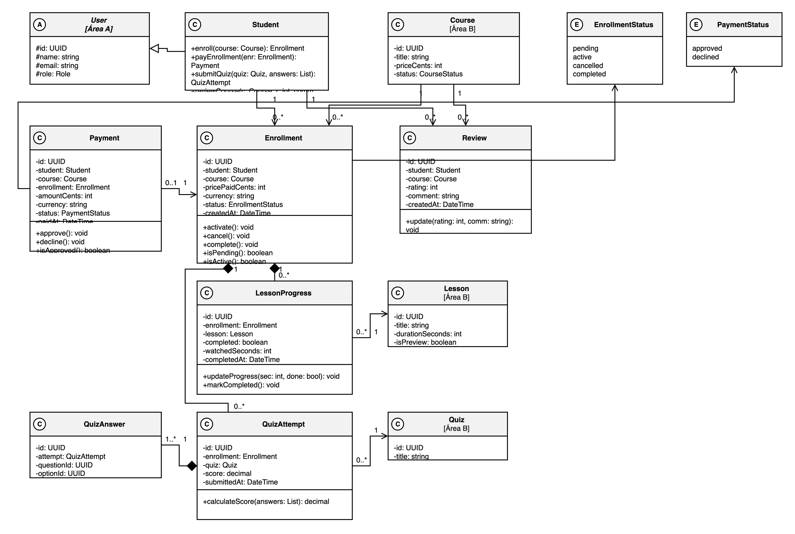
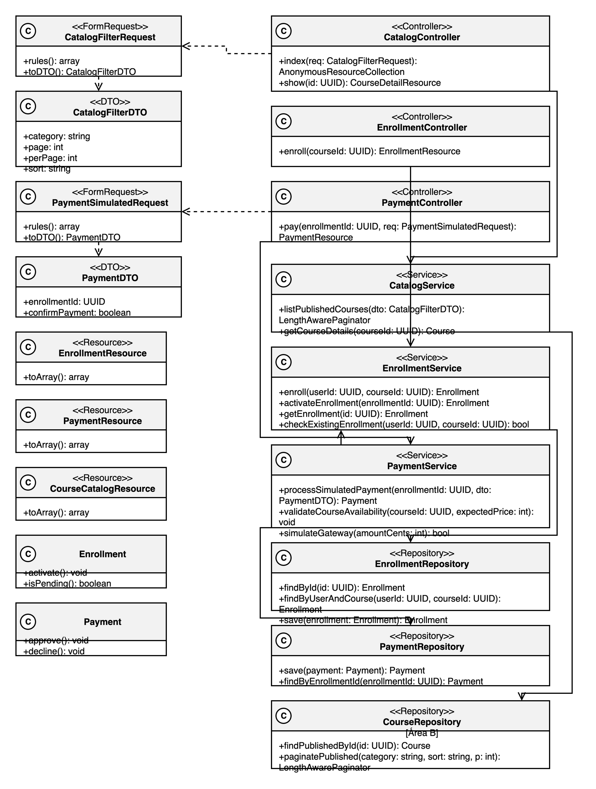

## 3. Área C – Aprendizagem do aluno

Classes dos casos de uso UC002, UC003, UC009, UC010, UC019 e UC020 (RF005, RF006, RF008, RF011, RF014 e RF015), estruturadas sob duas perspectivas complementares do mesmo modelo: negocial e de implementação técnica (MVC / arquitetura em camadas).

Na perspectiva negocial, o ator `Student` herda da classe abstrata `User` (Área A). As classes do domínio central modelam diretamente o vínculo do aluno com os cursos: `Enrollment` representa a matrícula em `Course` (Área B) com status tipado em `EnrollmentStatus` (`pending`, `active`, `cancelled`, `completed`); `Payment` representa a transação simulada (decisão #51) com status `PaymentStatus` (`approved`, `declined`), associada univocamente à respectiva matrícula; `LessonProgress` é composto por `Enrollment` e referencia a aula (`Lesson`, Área B), registrando segundos assistidos e estado de conclusão de modo desacoplado do quiz; `QuizAttempt` e suas respostas `QuizAnswer` registram o histórico de resolução de quizzes (`Quiz`, Área B) com cálculo automatizado de pontuação (`score`); e `Review` formaliza a avaliação com nota (1 a 5) e comentário do aluno sobre o curso, com restrição de unicidade para que reenvios substituam a avaliação anterior (UC010 R-2). Nenhuma classe utiliza atributos para representar IDs de chaves estrangeiras, modelando diretamente as associações tipadas e composições conforme as regras do TE5_1. Identificadores e assinaturas de métodos seguem o padrão em inglês adotado pelo projeto.

Na perspectiva de implementação técnica, dividida em dois diagramas para assegurar legibilidade na página:
1. **Catálogo, matrícula e pagamento simulado:** `CatalogController`, `EnrollmentController` e `PaymentController` recebem as requisições HTTP validadas pelos respectivos Form Requests (`CatalogFilterRequest`, `PaymentSimulatedRequest`), que as transformam em DTOs tipados (`CatalogFilterDTO`, `PaymentDTO`). Os controladores delegam o processamento a `CatalogService`, `EnrollmentService` e `PaymentService`. No fluxo de matrícula paga (UC003, UC019 e US018), `EnrollmentService.enroll()` cria a entidade `Enrollment` com status `pending`; ao confirmar a transação simulada, `PaymentService.processSimulatedPayment()` valida o preço e a disponibilidade do curso, registra a entidade `Payment` e invoca `EnrollmentService.activateEnrollment()`, promovendo a transição de estado da matrícula de `pending` para `active`. As respostas são envelopadas e formatadas via API Resources (`EnrollmentResource`, `PaymentResource`, `CourseCatalogResource`).
2. **Aulas, quizzes e avaliações:** `LessonController`, `QuizController` e `ReviewController` processam requisições validadas por `ProgressUpdateRequest`, `QuizSubmitRequest` e `ReviewRequest`, repassando DTOs a `LessonProgressService`, `QuizService` e `ReviewService`. `LessonProgressService` interage com `MediaService` para emitir URLs assinadas temporárias de 15 minutos no Cloudflare R2 (RNF002) para reprodução protegida das videoaulas. `QuizService` efetua a correção automática imediata das questões contra o gabarito cadastrado na autoria e persiste a tentativa via `QuizAttemptRepository`. `ReviewService` valida a pré-condição de ao menos uma aula concluída antes de registrar ou substituir a avaliação em `ReviewRepository`.

*Figura 0 – Diagrama de classes da Área C: perspectiva negocial*

*Figura 0 – Diagrama de classes da Área C: implementação de catálogo, matrícula e pagamento simulado*

*Figura 0 – Diagrama de classes da Área C: implementação de aulas, quizzes e avaliações*
