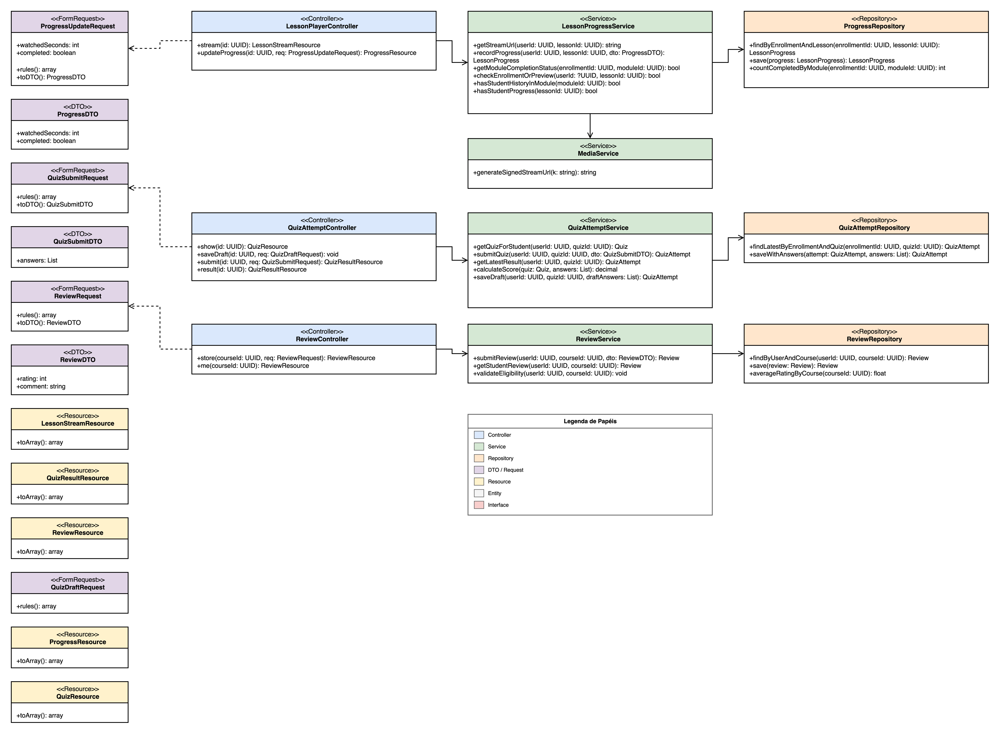

## 3. Área C – Aprendizagem do aluno

Classes dos casos de uso UC002, UC003, UC009, UC010, UC019 e UC020 (RF005, RF006, RF008, RF011, RF014 e RF015), estruturadas sob duas perspectivas complementares do mesmo modelo: negocial e de implementação técnica (MVC / arquitetura em camadas). A convenção de código adota rigorosamente `camelCase` para propriedades e métodos (ADR-0015). Erros de validação e regras de negócio utilizam a exceção centralizada parametrizada `ApiException(code: ErrorCode, httpStatus: int, fields: array = [])` e o enum `ErrorCode` (definidos no item 13 da Área A e no TDD seção 3.1), sem classes avulsas de exceção (decisão C5).

Na perspectiva negocial, o ator `Student` herda da classe abstrata `User` (Área A). As classes do domínio central modelam diretamente o vínculo do aluno com os cursos: `Enrollment` representa a matrícula em `Course` (Área B) com status tipado em `EnrollmentStatus` (`pending`, `active`, `cancelled`, `completed`); `Payment` representa a transação simulada (decisão #51, ADR-0007) com status `PaymentStatus` (`approved`, `declined`) e finalidade tipada em `PaymentPurpose` (`enrollment` ou `tutor_credits`, decisão D-cota-extra). Uma `Enrollment` tem 0..* `Payment` (tentativas recusadas e aprovadas ficam registradas); no caso de aquisição de pacotes avulsos de mensagens do tutor de IA, a referência a `enrollment` em `Payment` é opcional/anulável. Todas as entidades de domínio possuem o atributo `deletedAt: ?DateTime` para controle de exclusão lógica (ADR-0014). `LessonProgress` é composto por `Enrollment` e referencia a aula (`Lesson`, Área B), registrando segundos assistidos e estado de conclusão de modo desacoplado do quiz (UC009 R-4); `QuizAttempt` e suas respostas `QuizAnswer` registram o histórico de resolução de quizzes (`Quiz`, Área B), com status `QuizAttemptStatus` (`draft`, `submitted`) e pontuação (`score`) calculada na correção, nula enquanto a tentativa está em rascunho (sem expor o gabarito antes do envio, UC002 R-4); cada `QuizAnswer` referencia uma `Question` e uma `QuestionOption` (Área B) por associação tipada; e `Review` formaliza a avaliação com nota (1 a 5) e comentário do aluno sobre o curso, com restrição de unicidade para que reenvios substituam a avaliação anterior (UC010 R-2). Nenhuma classe mantém atributos de chave estrangeira (`*Id`): as referências são associações tipadas e composições, conforme as regras do TE5_1, e apenas o identificador `id` aparece como atributo.

Na perspectiva de implementação técnica, dividida em dois diagramas com layout padronizado da esquerda para a direita (Controller > Service > Repository > Entity, com cabeçalhos coloridos por papel arquitetural e legenda):
1. **Catálogo, matrícula e pagamento simulado:** `CatalogController`, `EnrollmentController` e `PaymentController` recebem as requisições HTTP validadas pelos respectivos Form Requests (`CatalogFilterRequest`, `PaymentSimulatedRequest`), que as transformam em DTOs tipados (`CatalogFilterDTO`, `PaymentDTO`). O parâmetro de paginação `perPage` é validado estritamente no intervalo de 1 a 100 (padrão 20), retornando HTTP `422 Unprocessable Content` com `ErrorCode.VALIDATION_FAILED` e indicação do campo em `fields.perPage` caso o valor seja inválido (decisão D-TC245). Os controladores delegam o processamento a `CatalogService`, `EnrollmentService` e `PaymentService`. No fluxo de matrícula paga (UC003, UC019 e US018), `EnrollmentController.checkStatus()` informa ao aluno o status atual da matrícula antes de nova tentativa (UC003 E1); `EnrollmentService.enroll()` cria a entidade `Enrollment` com status `pending` (curso pago) ou `active` (curso gratuito); ao confirmar a transação simulada, `PaymentService.processSimulatedPayment()` valida o preço e a disponibilidade do curso, registra a entidade `Payment` e invoca `EnrollmentService.activateEnrollment()`, promovendo a transição de estado da matrícula de `pending` para `active`. `PaymentRepository.findByEnrollmentId()` retorna a coleção de pagamentos da matrícula. As respostas são formatadas via API Resources (`EnrollmentResource`, `PaymentResource`, `CourseCatalogResource` na listagem e `CourseDetailResource` no detalhe do curso, UC020).
2. **Aulas, quizzes e avaliações:** `LessonPlayerController`, `QuizAttemptController` e `ReviewController` processam requisições validadas por `ProgressUpdateRequest`, `QuizDraftRequest`, `QuizSubmitRequest` e `ReviewRequest`, repassando DTOs em camelCase (`watchedSeconds`, `completed`, etc.) a `LessonProgressService`, `QuizAttemptService` e `ReviewService`. O retorno de `updateProgress` é `ProgressResource`. `LessonProgressService` interage com `MediaService` para emitir URLs assinadas temporárias de 15 minutos no Cloudflare R2 (RNF002) para reprodução protegida das videoaulas. `QuizAttemptService` efetua a correção automática imediata das questões contra o gabarito cadastrado na autoria e persiste a tentativa via `QuizAttemptRepository`. `LessonProgressService.checkEnrollmentOrPreview()` decide o acesso à aula (matrícula ativa ou aula de prévia, retornando HTTP `403 Forbidden` quando o acesso não for autorizado, UC009 E1 e decisão C3). `ReviewRepository.averageRatingByCourse()` recalcula a média de notas após cada avaliação (UC010). `ReviewService` valida a pré-condição de ao menos uma aula concluída antes de registrar ou substituir a avaliação em `ReviewRepository`.

**Interface pública da Área C para a Área B.** Três métodos de serviço são o ponto de acesso das outras áreas aos dados de matrícula e progresso, em vez de consulta direta às tabelas da Área C (ADR-0018): `EnrollmentService.hasActiveEnrollments(courseId: UUID): bool` (UC006, bloqueio de exclusão de curso com matrículas ativas), `LessonProgressService.hasStudentHistoryInModule(moduleId: UUID): bool` (UC014, histórico de progresso e tentativas de quiz no módulo) e `LessonProgressService.hasStudentProgress(lessonId: UUID): bool` (UC015, progresso registrado na aula). Esses métodos são declarados nos diagramas de implementação e não expõem entidades da Área C.

*Figura 0 – Diagrama de classes da Área C: perspectiva negocial*

*Figura 0 – Diagrama de classes da Área C: implementação de catálogo, matrícula e pagamento simulado*

*Figura 0 – Diagrama de classes da Área C: implementação de aulas, quizzes e avaliações*
