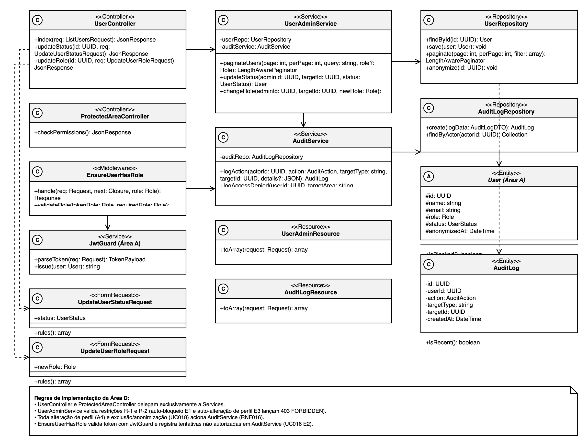

## 4. Área D – Tutor de IA, analytics e administração

Classes dos casos de uso UC001, UC007, UC008, UC016 e UC018, estruturadas sob as perspectivas negocial e técnica de implementação. Na perspectiva negocial, `Administrator` e `Instructor` são subclasses especializadas de `User` (ator do item 5 e entidade base da Área A). `Administrator` possui as operações de governança: `blockUser`, `unblockUser`, `changeUserRole`, `deleteAndAnonymize` e `viewDashboard`, refletindo expressamente as regras de negócio em que o Administrador não pode alterar o próprio perfil nem bloquear a própria conta (UC008 R-1, R-2, E1 e E3). `Instructor` possui a operação `viewDashboard`, permitindo a visualização analítica restrita aos seus próprios cursos (UC007 R-2). A interação com o assistente pedagógico é modelada por `Conversation`, que se associa aos tipos fortes `Student`, `Course` e `Lesson`, contendo uma composição de instâncias de `Message` (`1..*`), cada qual associada ao enumerador `MessageRole` (`user` ou `assistant`). As ações administrativas e eventos de segurança geram instâncias de `AuditLog`, associadas ao `User` ator (`1` para `0..*`) e tipadas pelo enumerador `AuditAction` (`USER_BLOCK`, `USER_UNBLOCK`, `ROLE_CHANGE`, `USER_DELETE`, `ACCESS_DENIED`), cumprindo o RNF016 com retenção de 12 meses e preservação da privacidade na anonimização conforme a LGPD (UC018 R-4). Em conformidade com o padrão do item 13 (TE5_1), as classes não utilizam identificadores de chaves estrangeiras como atributos primitivos, adotando associações e composições tipadas.

Na perspectiva de implementação, os componentes são organizados segundo o padrão arquitetural em camadas do monólito modular Laravel (ADR-0007), divididos em dois diagramas dedicados para assegurar legibilidade em página A4:

1. **Administração de usuários, áreas protegidas e auditoria (UC008, UC016 e UC018):** `UserController` e `ProtectedAreaController` recebem requisições HTTP REST validadas por Form Requests (`ListUsersRequest`, `UpdateUserStatusRequest`, `UpdateUserRoleRequest`) e delegam a orquestração negocial aos serviços de domínio. O middleware `EnsureUserHasRole` intercepta o acesso a rotas protegidas (UC016), consumindo `JwtGuard (Área A)` para validar o token JWT e extrair o payload (`parseToken`) e aplicando a checagem de autorização por perfil (`validateRole`), acionando o `AuditService` para registrar tentativas não autorizadas (UC016 E2, gerando `AuditLog` com ação `ACCESS_DENIED` e `targetId: UUID`). `UserAdminService` executa as validações de autorização e integridade — bloqueando tentativas de auto-bloqueio (E1) e auto-alteração de perfil (E3) com HTTP 403 `FORBIDDEN` —, persiste as alterações cadastrais via `UserRepository` sobre a entidade `User (Área A)` e aciona obrigatoriamente o `AuditService` para registrar toda alteração de perfil (UC008 A4), bloqueio ou exclusão/anonimização (UC018) na tabela `AuditLog` (RNF016). As respostas saem padronizadas por `UserAdminResource` e `AuditLogResource`.
2. **Tutor de IA e Analytics (UC001 e UC007):** `TutorController` gerencia as interações de chat e streaming. Ele delega ao `TutorService`, que recupera o histórico paginado por cursor no `MessageRepository`, valida pré-requisitos de matrícula (UC001 E4) e indexação da aula (UC001 E1), e verifica a cota de mensagens do Aluno no Redis via `TutorRateLimiter` (UC001 E2, respondendo HTTP 429 `TOO_MANY_REQUESTS` com `Retry-After`). O streaming em tempo real da resposta RAG (Server-Sent Events em menos de 3s, RNF003) é intermediado pelo `CourseTutorClient`, que consome o microsserviço `ai-service` (PostgreSQL 16 + pgvector) considerando o `User.locale` do usuário (RNF013). Para métricas e relatórios, `DashboardController` recebe parâmetros validados por `DashboardFilterRequest` (`inicio <= fim`) e aciona `DashboardAnalyticsService`, que aplica a regra de isolamento do Instrutor (UC007 R-2, impedindo visualização de cursos de terceiros via HTTP 403 `FORBIDDEN`) e executa consultas analíticas agregadas via `AnalyticsQueryRepository` (`aggregateProgressAndEnrollments(courseIds, start, end)`) sobre as tabelas transacionais `Enrollment` e `LessonProgress`, formatando o resultado em `DashboardResource`.

*Figura 0 – Diagrama de classes da Área D: perspectiva negocial*

*Figura 0 – Diagrama de classes da Área D: implementação de administração de usuários e auditoria*

*Figura 0 – Diagrama de classes da Área D: implementação de tutor de IA e analytics*
