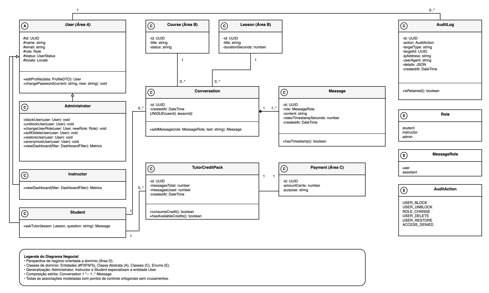
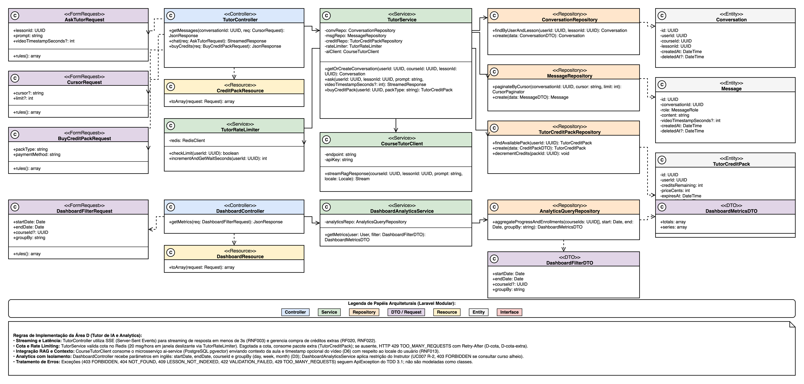

## 4. Área D – Tutor de IA, analytics e administração

Classes dos casos de uso UC001, UC007, UC008, UC016 e UC018, estruturadas sob as perspectivas negocial e técnica de implementação. Na perspectiva negocial, `Administrator` e `Instructor` são subclasses especializadas de `User` (ator do item 5 e entidade base da Área A). `Administrator` possui as operações de governança: `blockUser`, `unblockUser`, `changeUserRole`, `softDeleteUser`, `restoreUser`, `anonymizeUser` e `viewDashboard`, refletindo expressamente as regras de negócio em que o Administrador não pode alterar o próprio perfil nem bloquear a própria conta (UC008 R-1, R-2, E1 e E3). `Instructor` possui a operação `viewDashboard`, permitindo a visualização analítica restrita aos seus próprios cursos (UC007 R-2). A interação com o assistente pedagógico é modelada por `Conversation`, que se associa aos tipos fortes `Student`, `Course` e `Lesson`, contendo uma composição de instâncias de `Message` (`1..*`), cada qual associada ao enumerador `MessageRole` (`user` ou `assistant`), podendo conter o atributo opcional `videoTimestampSeconds` (D6). O consumo extra de interações pedagógicas além da cota é governado pela entidade `TutorCreditPack`, associada a `Student` (`1` para `0..*`) e sujeita a exclusão lógica via `deletedAt` (ADR-0014). As ações administrativas e eventos de segurança geram instâncias de `AuditLog`, associadas ao `User` ator (`1` para `0..*`) e tipadas pelo enumerador `AuditAction` (`USER_BLOCK`, `USER_UNBLOCK`, `ROLE_CHANGE`, `USER_DELETE`, `USER_RESTORE`, `ACCESS_DENIED`), cumprindo o RNF016 com retenção contínua em tabela particionada mensalmente (ADR-0016) e preservação da privacidade na anonimização conforme a LGPD (UC018 R-4). Em conformidade com o padrão do item 13 (TE5_1), as classes não utilizam identificadores de chaves estrangeiras como atributos primitivos, adotando associações e composições tipadas.

Na perspectiva de implementação, os componentes são organizados segundo o padrão arquitetural em camadas do monólito modular Laravel (ADR-0007), divididos em dois diagramas dedicados para assegurar legibilidade em página A4:

1. **Administração de usuários, áreas protegidas e auditoria (UC008, UC016 e UC018):** `UserController` e `ProtectedAreaController` recebem requisições HTTP REST validadas por Form Requests (`ListUsersRequest`, `UpdateUserStatusRequest`, `UpdateUserRoleRequest`) e delegam a orquestração negocial aos serviços de domínio. O parâmetro de paginação segue camelCase (`perPage: int`, entre 1 e 100, C10/ADR-0015). O middleware `EnsureUserHasRole` intercepta o acesso a rotas protegidas (UC016), consumindo `JwtGuard (Área A)` para validar o token JWT (`JwtGuard.parseToken(token)`), checar o perfil exigido pela rota (`JwtGuard.authorize(user, role)`) e verificar se o identificador do token consta na lista de revogação no Redis (`JwtGuard.revoke(jti, ttl)`, D7); a negação de acesso é registrada pelo `AuditService` (`logAccessDenied`), que grava `AuditLog` com ação `ACCESS_DENIED` (UC016 E2). Exceções como 401 `UNAUTHENTICATED`, 403 `FORBIDDEN`, 404 `NOT_FOUND` e 422 `VALIDATION_FAILED` não são classes: são encapsuladas por `ApiException(code: ErrorCode, httpStatus, fields)` conforme a seção 3.1 do TDD. `UserAdminService` executa as validações de autorização e integridade — bloqueando tentativas de auto-bloqueio (E1) e auto-alteração de perfil (E3) com HTTP 403 `FORBIDDEN` —, orquestra a paginação (`paginateUsers(filters: UserFiltersDTO): LengthAwarePaginator`) e persiste as alterações cadastrais via `UserRepository (Área A)` sobre a entidade `User (Área A)` (incluindo operações de `paginate(filters: UserFiltersDTO): LengthAwarePaginator`, `softDelete`, `restore` e `anonymize`, ADR-0014) e aciona obrigatoriamente o `AuditService` para registrar toda alteração de perfil (UC008 A4), bloqueio, exclusão ou restauração (UC018) na tabela `audit_logs` (RNF016). Usuários excluídos têm tokens invalidados no Redis e sessões de refresh revogadas; tentativas de login retornam HTTP 401 unauthenticated genérico (D8, TC262). As respostas saem padronizadas por `UserAdminResource`, `PermissionsResource` e `AuditLogResource`.
2. **Tutor de IA e Analytics (UC001 e UC007):** `TutorController` gerencia interações de chat, streaming e compra de créditos extras. Ele delega ao `TutorService`, que recupera o histórico paginado por cursor no `MessageRepository`, valida pré-requisitos de matrícula (UC001 E4) e indexação da aula (UC001 E1), e verifica a cota de mensagens do Aluno no Redis via `TutorRateLimiter` (UC001 E2, 20 msg/hora em janela deslizante). Caso a cota esteja esgotada, o serviço verifica e consome créditos disponíveis via `TutorCreditPackRepository`; se o saldo for nulo, responde HTTP 429 `TOO_MANY_REQUESTS` acompanhado do cabeçalho `Retry-After` (D-cota). O aluno pode adquirir pacotes de crédito extras por preço fixo de R$ 19,90 (RF020, RNF022) via rota tratada por `BuyCreditPackRequest` e formatada por `CreditPackResource`. O streaming em tempo real da resposta RAG (Server-Sent Events em menos de 3s, RNF003) é intermediado pelo `CourseTutorClient`, que consome o microsserviço `ai-service` (PostgreSQL 16 + pgvector) enviando a pergunta acompanhada opcionalmente de `videoTimestampSeconds` (D6) e respeitando o `User.locale` do usuário (RNF013). Para métricas e relatórios, `DashboardController` recebe parâmetros em inglês validados por `DashboardFilterRequest` (`startDate`, `endDate`, `courseId` opcional e `groupBy` com valores `day`, `week` ou `month`, D3) e aciona `DashboardAnalyticsService`, que aplica a regra de isolamento do Instrutor (UC007 R-2, impedindo visualização de cursos de terceiros via HTTP 403 `FORBIDDEN`) e executa consultas analíticas agregadas via `AnalyticsQueryRepository` (`aggregateProgressAndEnrollments(courseIds, start, end, groupBy)`) sobre as tabelas transacionais `Enrollment` e `LessonProgress`, devolvendo um `DashboardMetricsDTO` que `DashboardResource` formata para a resposta.

*Figura 0 – Diagrama de classes da Área D: perspectiva negocial*

*Figura 0 – Diagrama de classes da Área D: implementação de administração de usuários e auditoria*

*Figura 0 – Diagrama de classes da Área D: implementação de tutor de IA e analytics*
