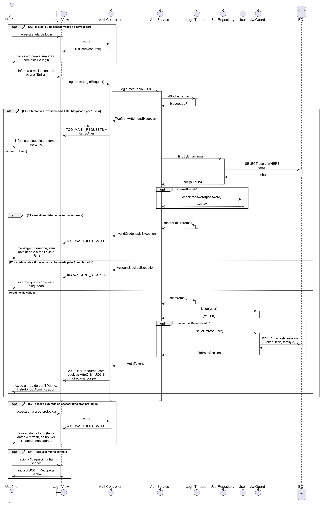
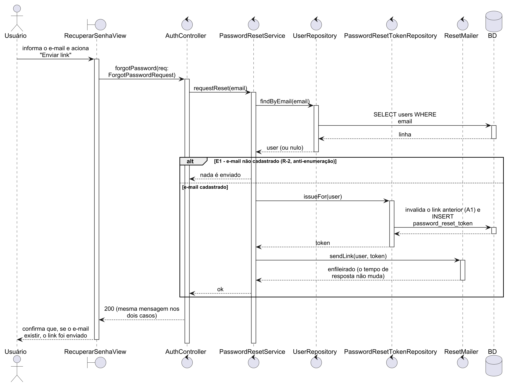
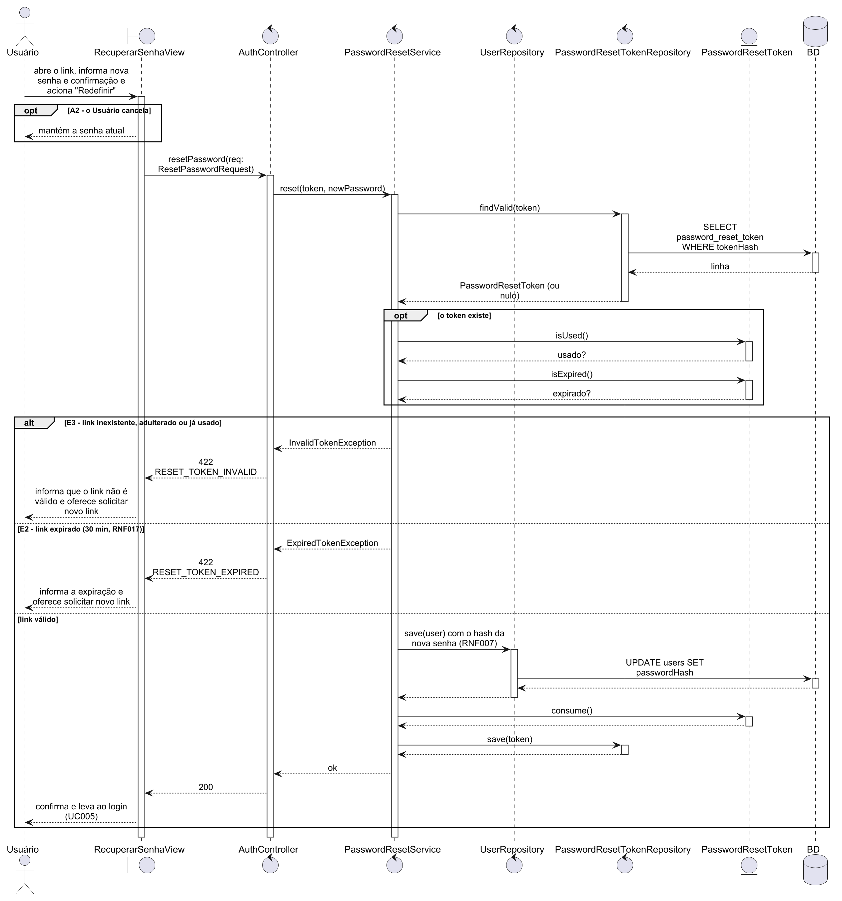
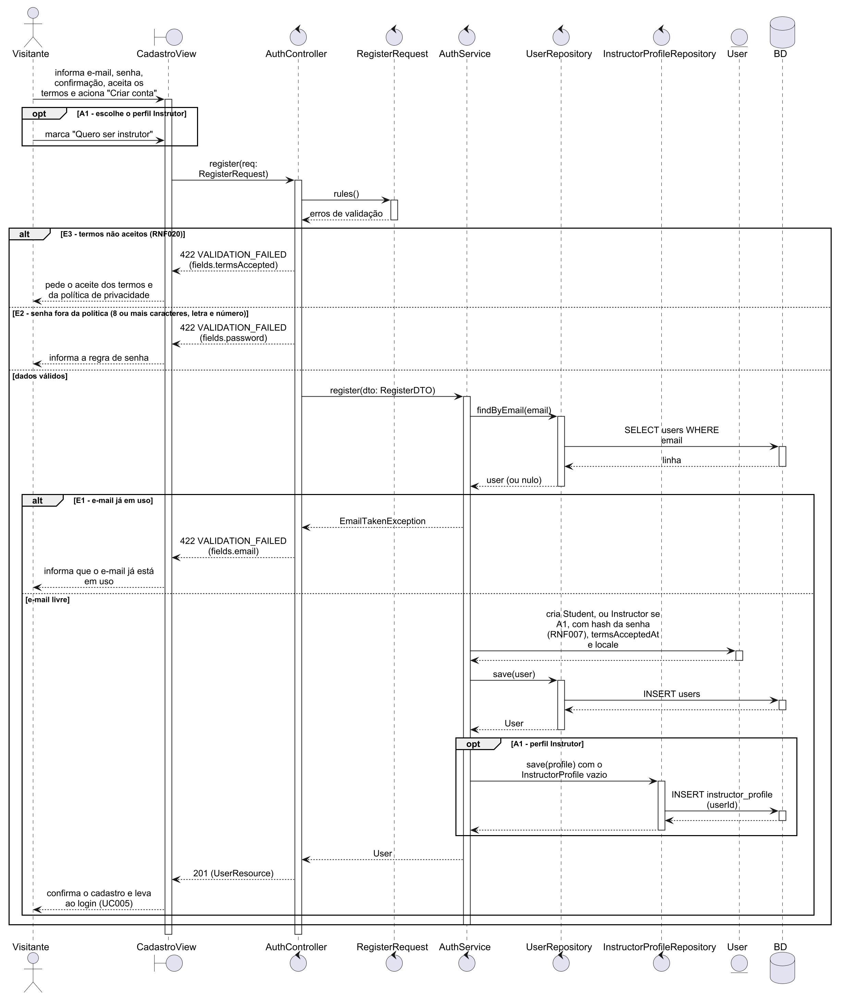
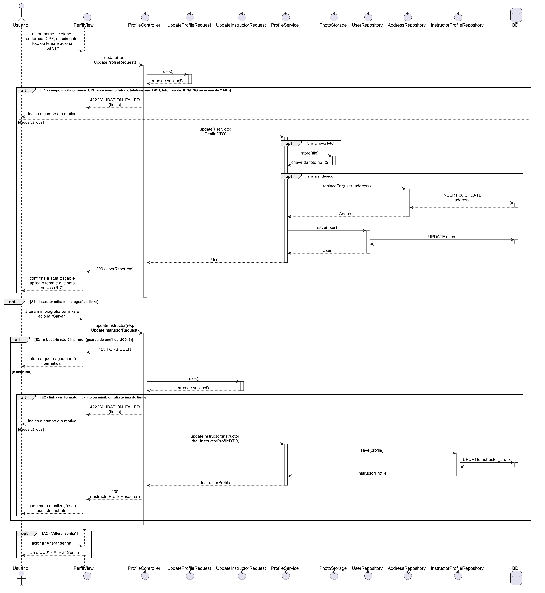
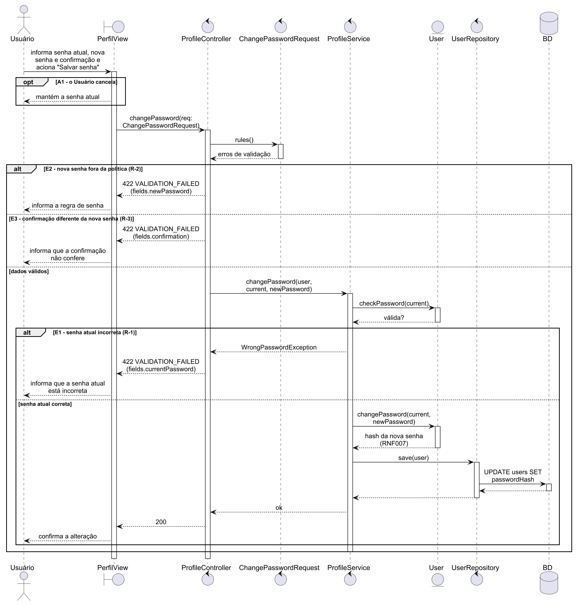

## 1. UC005 – Realizar Login

Fluxo básico e alternativos A1 (esqueci minha senha) e A2 (sessão já ativa). Exceções: bloqueio por tentativas, 429 com `Retry-After` (E4); credencial inválida, 401 genérico (E1); conta bloqueada, 403 `ACCOUNT_BLOCKED` (E3); sessão expirada, 401 (E2). Emite o refresh quando há «manter conectado».

*Figura 0 – UC005, diagrama de sequência: realizar login*

## 2. UC011 – Recuperar Senha

Duas fases. Solicitação do link: a resposta é a mesma com o e-mail cadastrado ou não (E1, anti-enumeração) e um novo link invalida o anterior (A1). Redefinição: link expirado, 422 `RESET_TOKEN_EXPIRED` (E2); link usado ou inválido, 422 `RESET_TOKEN_INVALID` (E3); cancelar (A2).

*Figura 0 – UC011, diagrama de sequência: solicitação do link*

*Figura 0 – UC011, diagrama de sequência: redefinição da senha*

## 3. UC012 – Cadastrar-se na Plataforma

Validação pelo Form Request (E2 senha fora da política, E3 termos não aceitos), e-mail em uso (E1) e o alternativo A1, que cria a conta como Instrutor com o `InstructorProfile` vazio. Os erros de campo são 422 `VALIDATION_FAILED` com `fields`.

*Figura 0 – UC012, diagrama de sequência: cadastrar-se na plataforma*

## 4. UC013 – Editar Dados do Perfil

Validação do perfil (E1), com foto no R2 e endereço; o alternativo A1 do Instrutor (`PUT /profile/instructor`), com validação de link e minibiografia (E2) e 403 `FORBIDDEN` para quem não é Instrutor (E3); e A2 (alterar senha).

*Figura 0 – UC013, diagrama de sequência: editar dados do perfil*

## 5. UC017 – Alterar Senha

Validação da política e da confirmação (E2, E3), senha atual incorreta (E1, 422 `VALIDATION_FAILED` em `fields.currentPassword`, não 401) e cancelamento (A1).

*Figura 0 – UC017, diagrama de sequência: alterar senha*
