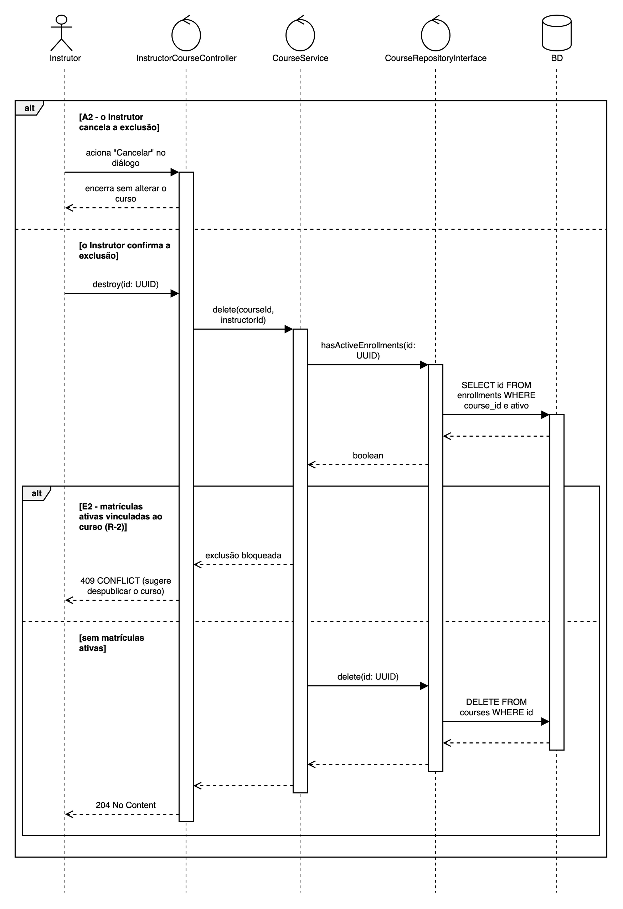
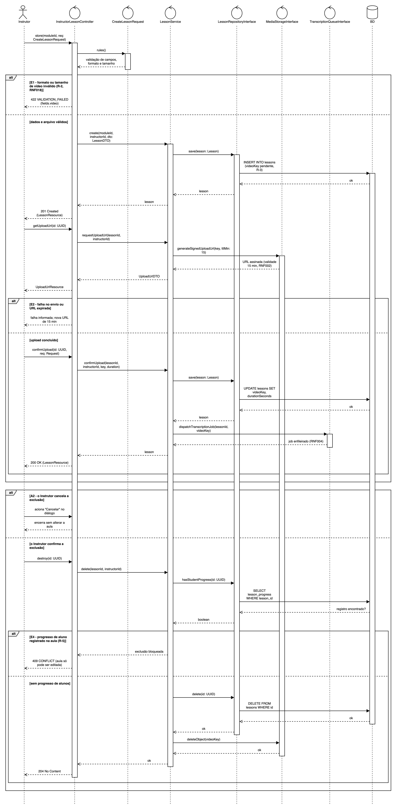
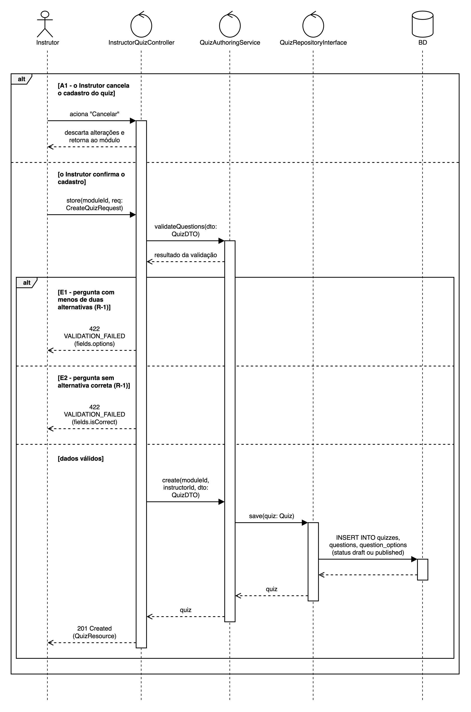

## 1. UC006 – Cadastrar Curso

Cobre o cadastro do curso com salvamento inicial em status `draft` (R-1), a publicação no catálogo e a exclusão. Na validação, campos obrigatórios ausentes devolvem 422 `VALIDATION_FAILED` (E1). Ao acionar a publicação, `Course.canBePublished()` barra o curso sem módulos ou aulas com 422 `VALIDATION_FAILED` (E4), mantendo o curso como rascunho; com conteúdo completo, `Course.publish()` altera o status para `published`. A exclusão é bloqueada com 409 `CONFLICT` quando há matrículas ativas (R-2), modelada no diagrama de exclusão.

*Figura 0 – UC006, diagrama de sequência: cadastrar e publicar curso*

*Figura 0 – UC006, diagrama de sequência: excluir curso (R-2)*

## 2. UC014 – Gerenciar Módulos do Curso

Cobre o fluxo básico de cadastro de módulo e o fluxo de exclusão (A2). Na criação, título ausente devolve 422 `VALIDATION_FAILED` (E1) e posição já utilizada no curso devolve 422 `VALIDATION_FAILED` (E2, R-2). Na exclusão, a confirmação consulta `ModuleRepositoryInterface.hasStudentHistory`: havendo progresso de alunos em aulas ou respostas de quiz do módulo, a exclusão é bloqueada com 409 `CONFLICT` (E4, R-4), e o Instrutor só pode editar o módulo; sem histórico, o módulo é removido em cascata com suas aulas e seu quiz (R-3), com 204 No Content.

*Figura 0 – UC014, diagrama de sequência: gerenciar módulos do curso*

## 3. UC015 – Gerenciar Aulas do Curso

Modela a criação de aula com upload desacoplado de vídeo e o fluxo de exclusão (A2). Formato ou tamanho inválidos devolvem 422 `VALIDATION_FAILED` (E1, R-2, RNF018). A aula é criada com `videoKey` pendente (`Lesson`, item 12); a URL pré-assinada de 15 minutos é gerada por `MediaStorageInterface.generateSignedUploadUrl` (R-3, RNF002), e o envio do arquivo segue direto ao storage, sem passar pela API. Falha no envio ou URL expirada gera nova URL (E2). Após a confirmação, `LessonService.confirmUpload` salva a chave do vídeo e `TranscriptionQueueInterface.dispatchTranscriptionJob` enfileira a transcrição e a indexação, uma única vez por vídeo (R-4, RNF004). Na exclusão, `LessonRepositoryInterface.hasStudentProgress` bloqueia a remoção com 409 `CONFLICT` quando há progresso de aluno (E4, R-5); sem progresso, a aula é removida e o vídeo é apagado com `MediaStorageInterface.deleteObject`.

*Figura 0 – UC015, diagrama de sequência: gerenciar aulas do curso*

## 4. UC004 – Cadastrar Quiz com Gabarito

Fluxo básico de cadastro de quiz, com validação em `QuizAuthoringService.validateQuestions`: pergunta com menos de duas alternativas devolve 422 `VALIDATION_FAILED` (E1, R-1) e pergunta sem alternativa correta devolve 422 `VALIDATION_FAILED` (E2, R-1). Dados válidos persistem o quiz com suas perguntas e alternativas, no status informado pelo Instrutor (`draft` ou `published`, item 12).

*Figura 0 – UC004, diagrama de sequência: cadastrar quiz com gabarito*

## Nota sobre o cancelamento

Os diagramas de sequência dos UC004, UC006, UC014 e UC015 modelam o cancelamento do Instrutor em bloco `alt` exclusivo, conforme a regra deste item. O item 10 não descreve esse fluxo para esses casos de uso; a dúvida está registrada em `pendencias-area-b.md`, na raiz do repositório.
