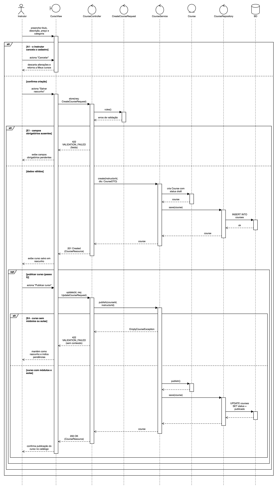

## 1. UC006 – Cadastrar Curso

Fluxo básico de criação de curso com salvamento inicial em status de rascunho e publicação posterior no catálogo (passos 1 a 6). O cancelamento pelo Instrutor é modelado obrigatoriamente em bloco `alt` exclusivo (A1), encerrando a execução sem persistência. No salvamento, campos obrigatórios ausentes retornam 422 `VALIDATION_FAILED` (E1). Ao acionar a publicação, a tentativa de publicar curso sem módulos ou aulas cadastrados é interceptada em `alt` como 422 `VALIDATION_FAILED` (E4), mantendo o curso como rascunho; com conteúdo completo, o curso é atualizado para publicado e liberado no catálogo.

*Figura 0 – UC006, diagrama de sequência: cadastrar curso*

## 2. UC014 – Gerenciar Módulos do Curso

Cobre o fluxo básico de cadastro e ordenação de módulos e o fluxo de exclusão (A2). Na exclusão, o cancelamento é isolado em bloco `alt`, encerrando o fluxo. Na confirmação, o `ModuleService` consulta o histórico acadêmico (`hasStudentHistory`): a detecção de progresso de alunos em aulas ou respostas em quizzes do módulo dispara o fluxo de exceção em `alt` como 422 `VALIDATION_FAILED` (E4), bloqueando a destruição e instruindo o Instrutor a apenas editar o módulo; sem histórico, o módulo, suas aulas e quizzes são excluídos em cascata, retornando 204 No Content. No fluxo de criação, validações barram título ausente (E1, 422) e posição conflitante dentro do curso (E2, 422).

*Figura 0 – UC014, diagrama de sequência: gerenciar módulos do curso*

## 3. UC015 – Gerenciar Aulas do Curso

Modela a criação de aula com upload desacoplado de vídeo e o fluxo de exclusão de aula (A2). Na exclusão, o cancelamento encerra o diagrama em bloco `alt`; na confirmação, `LessonService.hasStudentProgress` verifica se algum aluno já possui registros em `LessonProgress`: havendo histórico, a exclusão é bloqueada em `alt` com 422 `VALIDATION_FAILED` (E4), preservando os dados dos alunos; caso não haja progresso registrado, a aula é removida do banco (204 No Content) e o vídeo correspondente é excluído do storage Cloudflare R2. Na criação de aula, após validação de formato e limite de 500 MB (E1, 422, RNF018), é gerada URL pré-assinada temporária de 15 minutos (RNF002) para envio direto ao storage; após confirmação do upload, a aula é salva e o job de transcrição e indexação é enfileirado no RabbitMQ (RNF004).

*Figura 0 – UC015, diagrama de sequência: gerenciar aulas do curso*

## 4. UC004 – Cadastrar Quiz com Gabarito

Fluxo básico de cadastro de quiz e publicação aos alunos do módulo, com cancelamento tratado em bloco `alt` que encerra a operação. O `QuizService.validateQuestions` valida o atendimento às regras de negócio: perguntas com menos de 2 alternativas disparam 422 `VALIDATION_FAILED` (E1, R-1) e perguntas sem gabarito definido disparam 422 `VALIDATION_FAILED` (E2, R-1). Dados válidos persistem o quiz e suas alternativas com gabarito no banco de dados, oferecendo a opção de salvamento como rascunho sem visibilidade para os alunos (A2) ou publicação imediata para consumo dos alunos matriculados.

*Figura 0 – UC004, diagrama de sequência: cadastrar quiz com gabarito*
