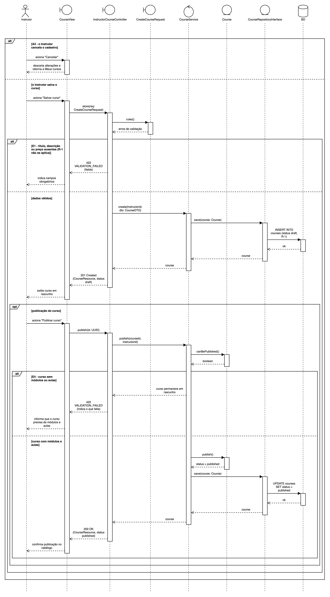
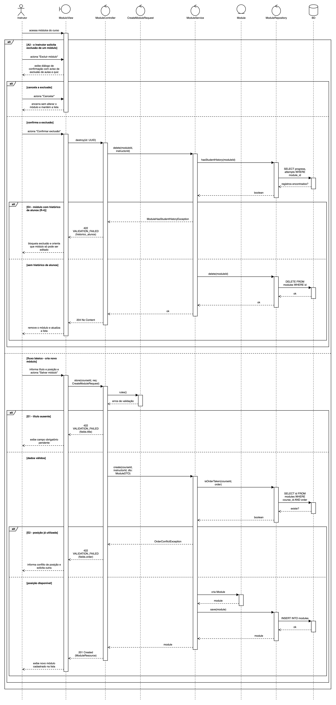

## 1. UC006 – Cadastrar Curso

Cobre o cadastro do curso com salvamento inicial em status `draft` (R-1), cancelamento da criação (A3), a publicação no catálogo e a exclusão (A2). Na validação, campos obrigatórios ausentes devolvem 422 `VALIDATION_FAILED` (E1). Ao acionar a publicação, `Course.canBePublished()` barra o curso sem módulos ou aulas com 422 `VALIDATION_FAILED` (E4), mantendo o curso como rascunho; com conteúdo completo, `Course.publish()` altera o status para `published`. A exclusão é bloqueada com 409 `CONFLICT` quando há matrículas ativas, consultadas em `EnrollmentService.hasActiveEnrollments` (Área C; E2, R-2); sem matrículas ativas, aplica-se exclusão lógica com registro de `deleted_at` (ADR-0014). O arquivamento de curso publicado (A4) é modelado no mesmo diagrama: `CourseService.archive()` muda o status para `archived`, retirando o curso do catálogo sem bloquear os alunos já matriculados, que mantêm acesso.

*Figura 0 – UC006, diagrama de sequência: cadastrar e publicar curso*

*Figura 0 – UC006, diagrama de sequência: excluir ou arquivar curso (R-2, A4)*

## 2. UC014 – Gerenciar Módulos do Curso

Cobre o fluxo básico de cadastro de módulo e o fluxo de exclusão (A2), com cancelamento em bloco `alt` (A3). Na criação, título ausente devolve 422 `VALIDATION_FAILED` (E1) e posição já utilizada no curso devolve 422 `VALIDATION_FAILED` (E2, R-2). Na exclusão, a confirmação consulta `LessonProgressService.hasStudentHistoryInModule` (Área C): havendo progresso de alunos em aulas ou respostas de quiz do módulo, a exclusão é bloqueada com 409 `CONFLICT` (E4, R-4), e o Instrutor só pode editar o módulo; sem histórico, o módulo é removido logicamente via `deleted_at` em cascata com suas aulas e seu quiz (R-3, ADR-0014), com 204 No Content.

*Figura 0 – UC014, diagrama de sequência: gerenciar módulos do curso*

## 3. UC015 – Gerenciar Aulas do Curso

Modela o envio direto de vídeo à API multipart (`media-service`), criação de aula com chave de vídeo obrigatória (`videoKey`, RNF018) e exclusão lógica de aula (A2) com cancelamento em bloco `alt` (A3). Formato ou tamanho inválidos (> 500 MB, mp4/webm) devolvem 422 `VALIDATION_FAILED` (E1, R-2, RNF018). Falha de transmissão ou armazenamento responde 503 `SERVICE_UNAVAILABLE` com `Retry-After`, informa o erro e permite nova tentativa de envio (E2). Com o envio do arquivo concluído, `MediaStorageInterface.uploadFile` retorna os metadados (`StoredFileDTO`), e a aula é persistida com `videoKey` obrigatório; logo após, `TranscriptionQueueInterface.dispatchTranscriptionJob` enfileira a transcrição e a indexação de forma assíncrona (RNF004). Na exclusão, `LessonProgressService.hasStudentProgress` (Área C) bloqueia a remoção com 409 `CONFLICT` quando há progresso de aluno (E4, R-5); sem progresso, a exclusão lógica marca `deleted_at` na aula e em seus materiais vinculados (ADR-0014), e os arquivos de vídeo e de materiais permanecem no Cloudflare R2, sem remoção física.

*Figura 0 – UC015, diagrama de sequência: gerenciar aulas do curso*

## 4. UC004 – Cadastrar Quiz com Gabarito

Fluxo básico de cadastro de quiz com cancelamento em bloco `alt` (A3) e validação em `QuizAuthoringService.validateQuestions`: pergunta com menos de duas alternativas devolve 422 `VALIDATION_FAILED` (E1, R-1) e pergunta sem alternativa correta devolve 422 `VALIDATION_FAILED` (E2, R-1). Dados válidos persistem o quiz com suas perguntas e alternativas, no status informado pelo Instrutor (`draft` ou `published`, item 12).

*Figura 0 – UC004, diagrama de sequência: cadastrar quiz com gabarito*

## Modelagem de fluxos de cancelamento

Os diagramas de sequência dos casos de uso UC004, UC006, UC014 e UC015 modelam os caminhos de cancelamento do Instrutor (fluxo alternativo A3 no item 10) em blocos `alt` exclusivos, assegurando que o cancelamento encerre a interação sem alterar o estado do sistema nem disparar persistência indevida.
