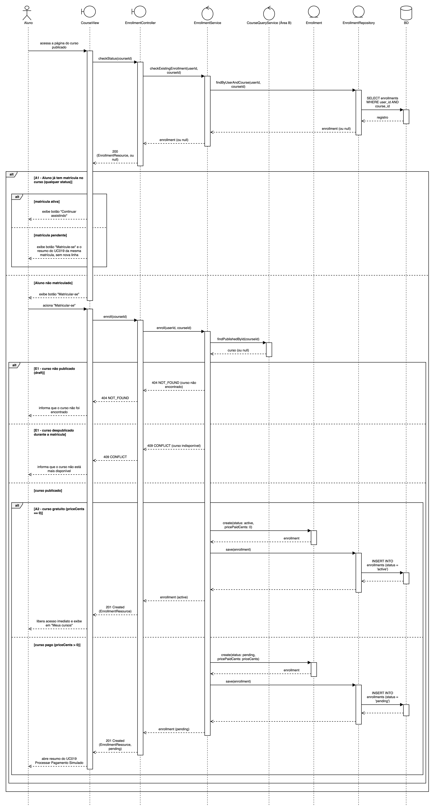
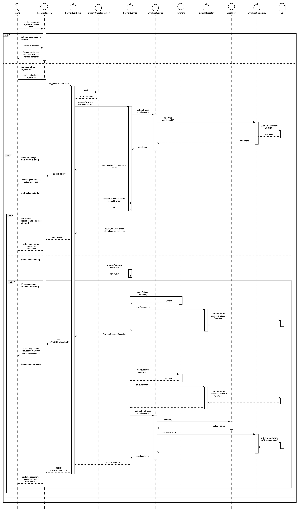
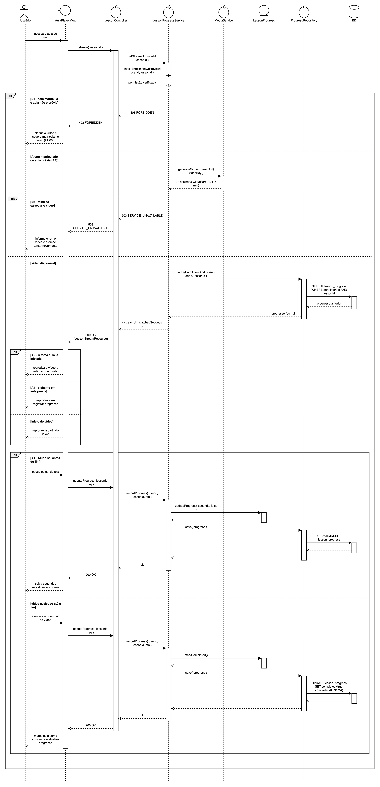
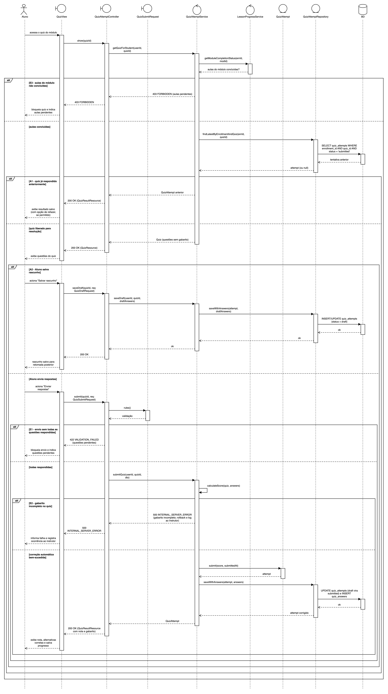
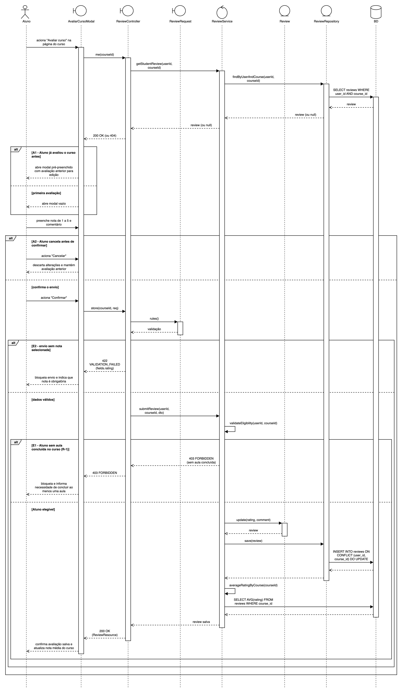
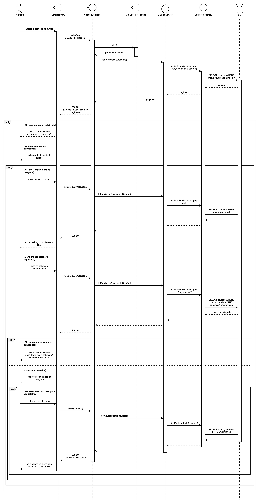

## 3. Área C – Aprendizagem do aluno

Diagramas de sequência para os casos de uso prioritários da Área C (UC003, UC019, UC009, UC002, UC010 e UC020), modelados em notação UML com ferramentas draw.io via `seqgen.py` conforme a [ADR-0013](../../docs/adr/0013-diagramas-do-ra2-em-drawio.md). As mensagens refletem com exatidão as operações das classes do item 13 e os endpoints REST e códigos de erro do TDD (seção 3). Cancelamentos e confirmações são modelados exclusivamente em fragmentos `alt`, com o ramo de cancelamento encerrando a sequência.

## 1. UC003 – Matricular-se em Curso

Fluxo básico e alternativos A1 (Aluno já tem matrícula no curso: se ativa, exibe o botão "Continuar assistindo"; se pendente, exibe "Matricule-se", que retoma o pagamento da mesma matrícula sem criar nova linha) e A2 (curso gratuito gerando matrícula com status `active` imediata, sem acionar gateway simulado; resposta `201 Created`). Em curso pago, gera matrícula inicial `pending` (resposta `201 Created`) e aciona o UC019. Exceção E1 trata a despublicação do curso durante a tentativa de matrícula, retornando `409 CONFLICT`.

*Figura 0 – UC003, diagrama de sequência: matricular-se em curso*

## 2. UC019 – Processar Pagamento Simulado

Resumo do pagamento simulado com fragmento `alt` para cancelamento pelo Aluno (A1, encerrando o fluxo sem cobrança e mantendo a matrícula `pending`). No fluxo de confirmação, valida disponibilidade e preço do curso (E2, `409 CONFLICT`) e verifica se a matrícula já se encontra ativa (E3, `409 CONFLICT` por duplo acionamento). Na simulação do pagamento (ADR-0007), a recusa (E1) registra `Payment` com status `declined`, responde `422 PAYMENT_DECLINED` e mantém a matrícula `pending`; a aprovação registra `Payment` com status `approved`, invoca `EnrollmentService.activateEnrollment()`, transiciona a matrícula para `active` e libera o acesso às aulas.

*Figura 0 – UC019, diagrama de sequência: processar pagamento simulado*

## 3. UC009 – Assistir Aula

Geração de URL assinada temporária de 15 minutos via `MediaService` no Cloudflare R2 (RNF002) para reprodução protegida do vídeo. Trata a aula indisponível para o usuário, sem matrícula e sem prévia (E1, `403 FORBIDDEN`, acesso não autorizado sem matrícula ativa e sem prévia), falha no carregamento de vídeo (E2, `503 SERVICE_UNAVAILABLE`) e os fluxos alternativos: retomada do ponto salvo em segundos assistidos (A2, R-2, R-3), reprodução pública para Visitante em aula prévia sem persistência de progresso (A4, R-1) e saída antes do término com persistência parcial do progresso (A1). O fluxo básico conclui com a marcação de aula finalizada e atualização do progresso global.

*Figura 0 – UC009, diagrama de sequência: assistir aula*

## 4. UC002 – Responder Quiz

Carregamento do quiz condicionado à conclusão de todas as aulas do módulo correspondente (E3, `403 FORBIDDEN`). Apresenta as questões sem expor o gabarito. Trata a consulta de resultado anterior com opção de refazer quando autorizado pelo instrutor (A1, R-3), salvamento de rascunho de respostas (A2) e bloqueio de envio com questões pendentes (E1, `422 VALIDATION_FAILED`). A submissão calcula a nota por correção automática imediata; na hipótese de quiz cadastrado com gabarito incompleto, responde `500 INTERNAL_SERVER_ERROR` (E2), desfaz o envio e registra o erro em log para o Instrutor responsável; no sucesso, persiste `QuizAttempt` com a nota (`score`), grava as respostas em `QuizAnswer` e exibe o gabarito ao lado das alternativas assinaladas.

*Figura 0 – UC002, diagrama de sequência: responder quiz*

## 5. UC010 – Avaliar Curso

Abertura do modal de avaliação com pré-carregamento de nota e comentário anteriores caso o aluno já tenha avaliado o curso (A1, R-2). Fragmento `alt` trata o cancelamento (A2, descartando alterações e encerrando o fluxo). No envio, valida se a nota obrigatória de 1 a 5 foi selecionada (E2, `422 VALIDATION_FAILED`) e verifica a regra R-1 exigindo a conclusão prévia de ao menos uma aula no curso (E1, `403 FORBIDDEN`). Com dados válidos, salva ou substitui a avaliação em `Review` (método `update(rating, comment)`) e recalcula a média de notas do curso por `ReviewRepository.averageRatingByCourse()`, exibida na página do curso.

*Figura 0 – UC010, diagrama de sequência: avaliar curso*

## 6. UC020 – Consultar Catálogo de Cursos

Consulta pública e paginada de cursos publicados (`page=1`, `perPage=20`, ordenação com desempate por `id`, ADR-0009, ADR-0015; com `perPage` estritamente de 1 a 100, retornando HTTP `422 VALIDATION_FAILED` fora desse intervalo, ADR-0009). Apresenta os estados de catálogo vazio (E1, "Nenhum curso disponível no momento.") e categoria sem cursos publicados (E2, com opção "Ver todos"). Trata a aplicação e limpeza de filtros por categoria (A1) e a seleção de um curso para visualização detalhada de sua ementa, módulos e aulas marcadas como prévia.

*Figura 0 – UC020, diagrama de sequência: consultar catálogo de cursos*
