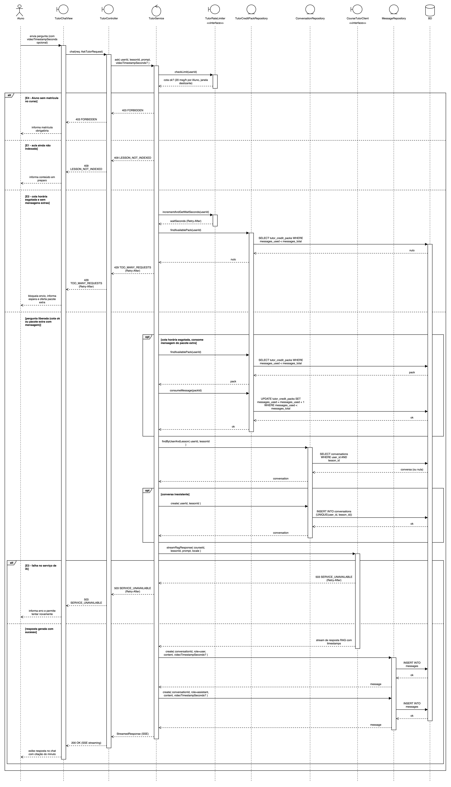
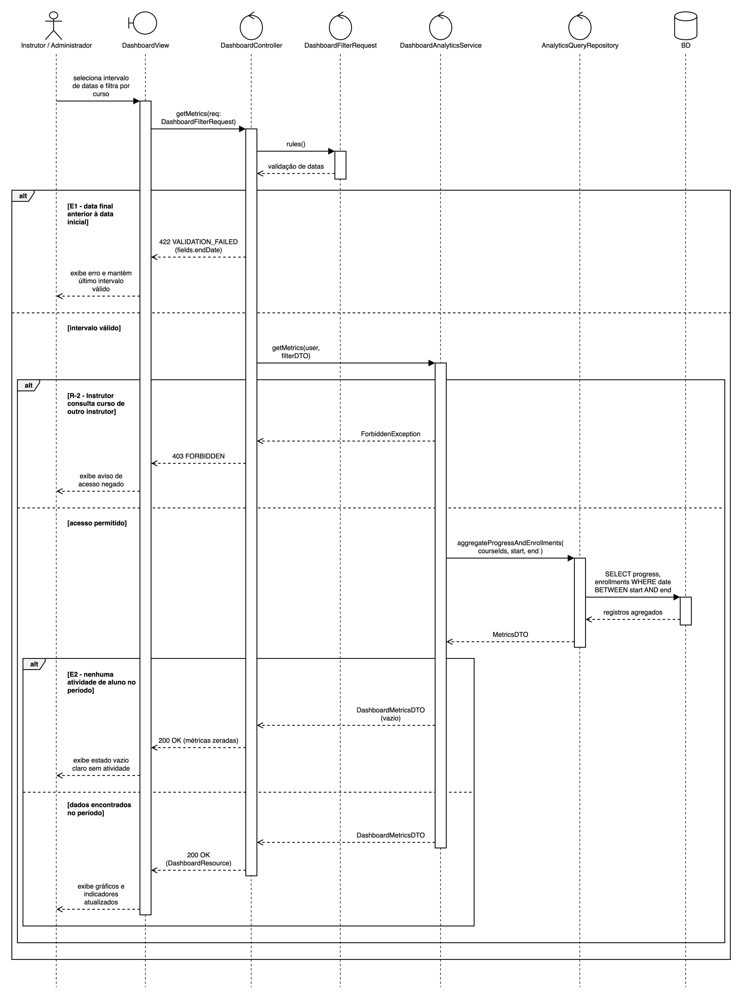
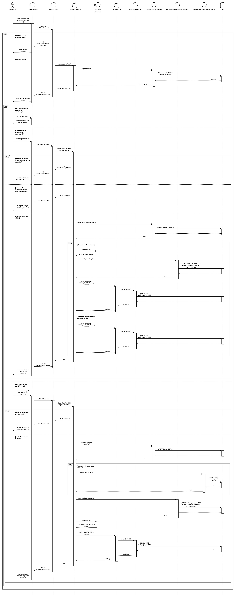
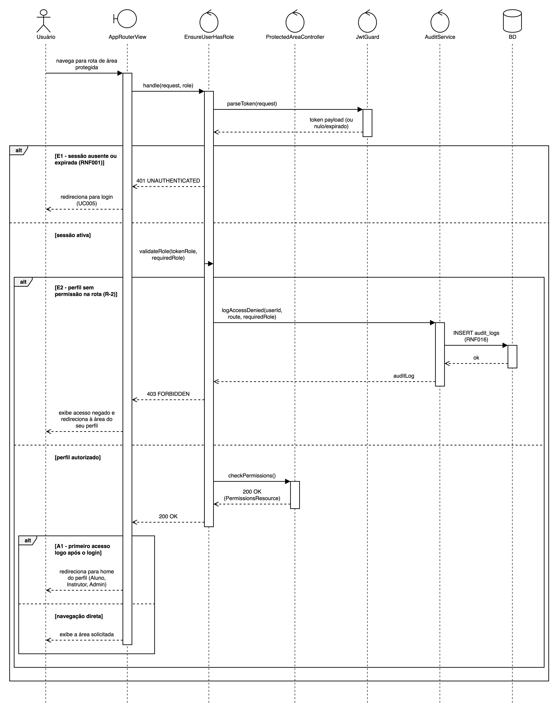
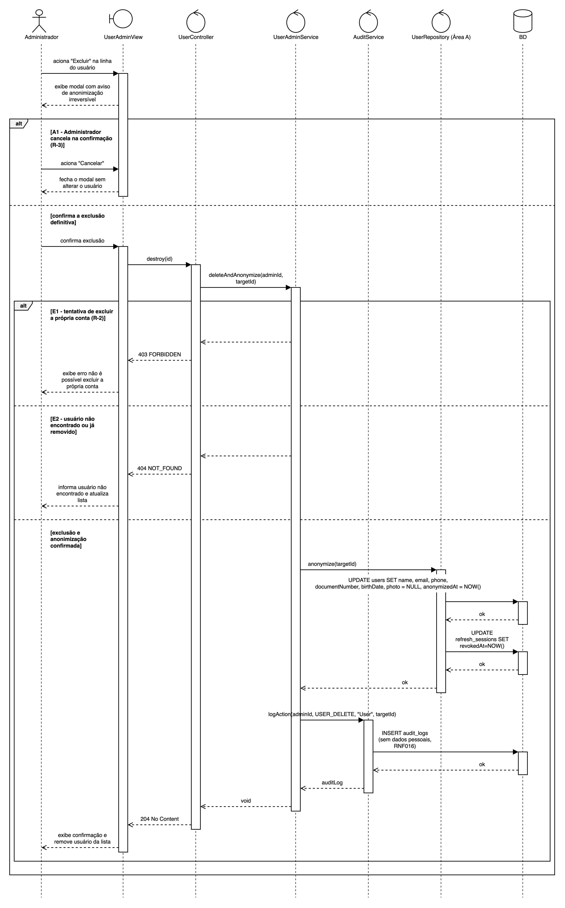

## 1. UC001 – Conversar com Tutor de IA

Fluxo básico e tratamento contextual de dúvidas pedagógicas na página da aula. O Aluno matriculado envia a pergunta via `POST /api/v1/ai/tutor/chat`, o `TutorService` valida a cota de mensagens no Redis com o `TutorRateLimiter` e delega a geração ao `CourseTutorClient`, que consome o pipeline RAG do `ai-service` via streaming SSE em menos de 3 segundos (RNF003) considerando o `User.locale` (RNF013). Exceções modeladas em blocos `alt`: aluno não matriculado (E4, 403 `FORBIDDEN`); limite de mensagens atingido (E2, 429 `TOO_MANY_REQUESTS` com cabeçalho `Retry-After`); aula ainda não indexada (E1, 409 `LESSON_NOT_INDEXED`); e indisponibilidade do microsserviço de inteligência artificial (E3, 503 `SERVICE_UNAVAILABLE` com `Retry-After`). Respostas com trechos e timestamps são gravadas no histórico (`MessageRepository`) e enviadas ao front-end por SSE.

*Figura 0 – UC001, diagrama de sequência: conversar com Tutor de IA*

## 2. UC007 – Ver Dashboard com Filtro

Consulta de métricas e gráficos de progresso e engajamento via `GET /api/v1/analytics/dashboard` pelo Instrutor ou Administrador. A validação das datas pelo Form Request garante que a data inicial seja menor ou igual à final, retornando 422 `VALIDATION_FAILED` em caso de inconsistência (E1). O `DashboardAnalyticsService` valida a propriedade dos cursos (UC007 R-2, retornando 403 `FORBIDDEN` caso um Instrutor tente visualizar dados de outro) e executa consultas agregadas dinâmicas sobre matrículas e progresso de aulas via `AnalyticsQueryRepository`. Se não houver atividade no período filtrado, a API responde 200 OK com métricas zeradas (E2), exibindo um estado vazio amigável na interface.

*Figura 0 – UC007, diagrama de sequência: ver dashboard com filtro*

## 3. UC008 – Gerenciar Usuários

Busca e governança de usuários pelo Administrador via `GET /api/v1/admin/users`, bloqueio/desbloqueio via `PUT /api/v1/admin/users/{id}/status` e alteração de perfil de acesso via `PUT /api/v1/admin/users/{id}/role` (A4, US016). O diagrama adota exclusivamente fragmentos `alt`: a confirmação ou cancelamento da ação é decidida em um bloco `alt` onde o cancelamento (A2) encerra a sequência sem mutações. Na alteração de perfil (A4), o `UserAdminService` verifica se o usuário-alvo é a própria conta do Administrador logado, rejeitando a tentativa com 403 `FORBIDDEN` (E3); se o usuário foi removido por outro administrador, responde 404 `NOT_FOUND` (E2); em caso de sucesso, atualiza o perfil em `UserRepository` e aciona obrigatoriamente o `AuditService` para gravar o registro em `AuditLog` (RNF016). No bloqueio de conta, a tentativa de auto-bloqueio é igualmente barrada com 403 `FORBIDDEN` (E1), enquanto a atualização bem-sucedida aciona o registro de auditoria e revoga imediatamente o acesso do usuário.

*Figura 0 – UC008, diagrama de sequência: gerenciar usuários*

## 4. UC016 – Acessar Área Protegida por Perfil

Verificação de autorização e controle de acesso a rotas privadas pelo middleware `EnsureUserHasRole` e `ProtectedAreaController`. A validação criptográfica do token JWT pelo `JwtGuard` direciona para 401 `UNAUTHENTICATED` se a sessão estiver ausente ou expirada (E1), conduzindo ao login (UC005). Se o usuário autenticado não possui o perfil exigido para a rota (E2), o middleware aciona o `AuditService` para registrar a tentativa de violação na trilha de auditoria (RNF016) e responde 403 `FORBIDDEN`, redirecionando o usuário à área inicial do seu próprio perfil. Quando autorizado, direciona para a página inicial do perfil após o login (A1) ou libera o acesso à área protegida solicitada.

*Figura 0 – UC016, diagrama de sequência: acessar área protegida por perfil*

## 5. UC018 – Excluir e Anonimizar Usuário

Exclusão definitiva de conta pelo Administrador com anonimização de dados pessoais conforme a LGPD via `DELETE /api/v1/admin/users/{id}`, estendendo o UC008. O fluxo inicia com a apresentação do modal de confirmação com aviso de anonimização irreversível: o cancelamento (A1) encerra a operação em bloco `alt`. Na confirmação da exclusão, o `UserAdminService` impede a autoexclusão da conta do Administrador com 403 `FORBIDDEN` (E1, R-2) e trata usuário inexistente com 404 `NOT_FOUND` (E2). Para usuário válido, o serviço limpa os dados pessoais na tabela `User`, preenche `anonymizedAt = NOW()`, revoga sessões de refresh ativas e grava o evento em `AuditLog` via `AuditService` preservando a privacidade (sem armazenar dados pessoais no log, R-4 e RNF016), respondendo 204 `No Content`.

*Figura 0 – UC018, diagrama de sequência: excluir e anonimizar usuário*

### Resolução das pendências cruzadas da Área A (Issue #123)

Em conformidade com a regra 8 do `AGENTS.md`, seguem resolvidas as pendências cruzadas deixadas pela Área A para a Área D no item 14:

1. **Códigos de erro `CONFLICT` e `SERVICE_UNAVAILABLE` do catálogo (`docs/tdd.md` seção 3.1):** Alinhados e confirmados para a Área D com base nos requisitos **RF009**, **RF012** e **RNF003**:
   - Conforme decisão técnica do grupo, o código de catálogo `CONFLICT` (HTTP 409) é reservado para operações onde há conflito de estado de negócio (como tentativa de exclusão bloqueada por dependências ativas), enquanto a interação com o Tutor de IA em aula cujo processamento de transcrição e geração de embeddings vetoriais ainda não foi finalizado utiliza o código específico e estável `LESSON_NOT_INDEXED` (HTTP 409, fluxo de exceção E1 do UC001).
   - O código `SERVICE_UNAVAILABLE` (HTTP 503) é confirmado para a Área D no fluxo de exceção E3 do UC001, acompanhado obrigatoriamente do cabeçalho HTTP `Retry-After` e do atributo `error.retryAfterSeconds`, retornado quando ocorre falha de comunicação, indisponibilidade temporária ou timeout do microsserviço físico `ai-service` ou da API do provedor de inteligência artificial.
2. **RNF016 nas ações administrativas do UC008:** Atendido por **RNF016**, **RF012** e regras de negócio do **UC008** (R-4) e **UC018** (R-4). O diagrama de sequência do UC008 (`14-sequencia-uc008.drawio`) e sua especificação modelam expressamente o acionamento síncrono do serviço `AuditService.logAction(...)` e a execução da operação de persistência em banco de dados (`INSERT audit_logs`) tanto no fluxo alternativo A4 (alteração de perfil de acesso pelo Administrador) quanto no fluxo básico de bloqueio e desbloqueio de usuários, bem como na negação de acesso do UC016 e na exclusão/anonimização do UC018. Todos os eventos auditados registram autor, ação, identificador do alvo e carimbo de data/hora, com garantia de retenção pelo período estrito de 12 meses.
